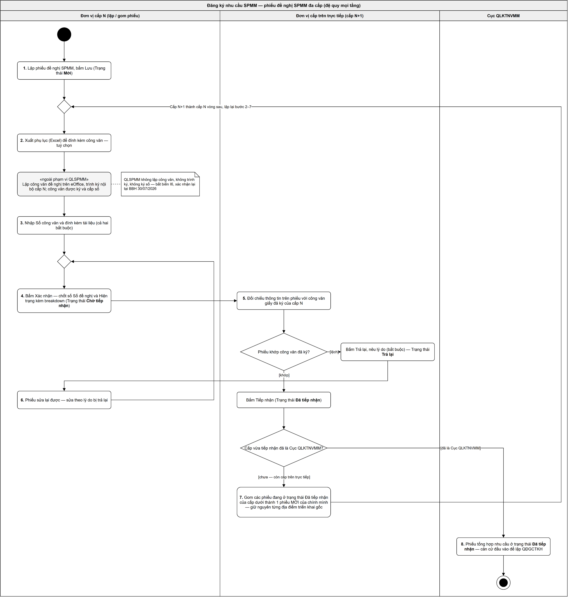
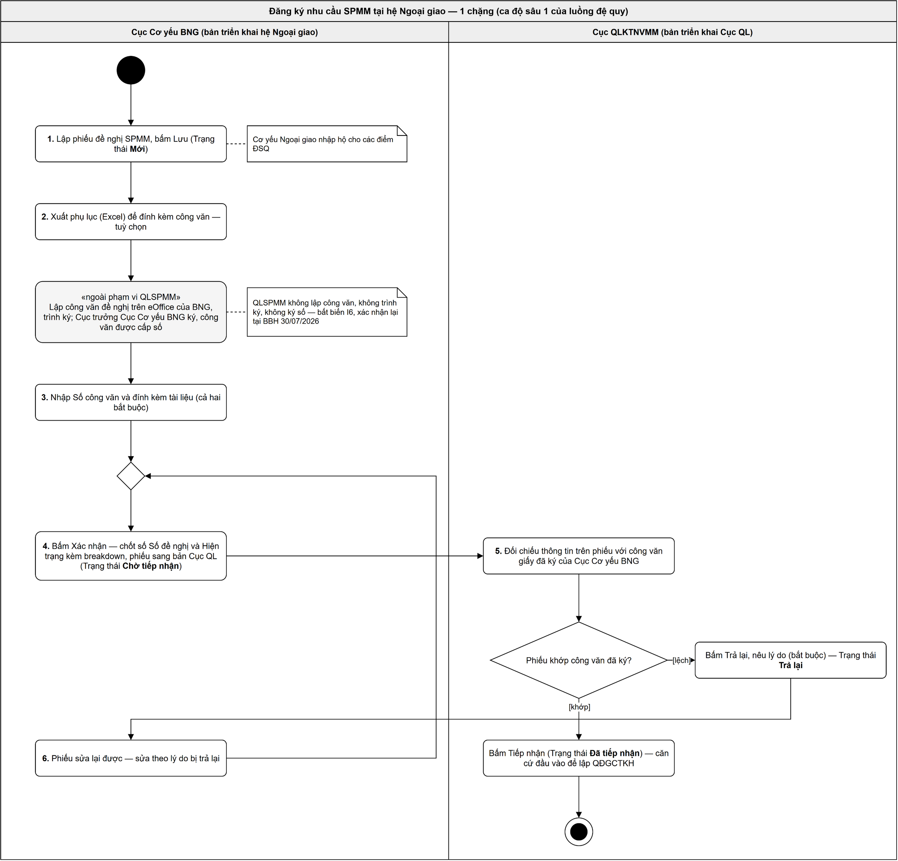
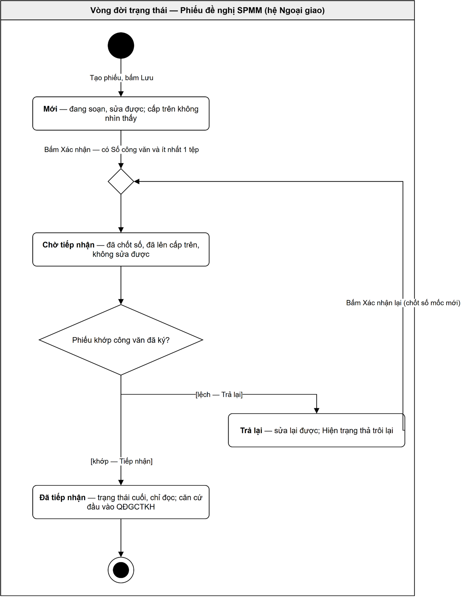

# SRS: Phiếu đề nghị SPMM — hệ Ngoại giao

## 1. Phạm vi

Cục Cơ yếu BNG lập một **Phiếu đề nghị SPMM** chi tiết đến từng điểm triển khai và gửi lên Cục QLKTNVMM làm căn cứ lập QĐGCTKH. Bản thân Cục QLKTNVMM cũng có nhu cầu SPMM của chính mình và lập phiếu bằng đúng màn đó, trên bản Cục QL.

**Trong phạm vi:**

- Lập, sửa, xoá, nhân bản phiếu; nhập lưới chi tiết `(SPMM × Địa điểm triển khai)`.
- Chốt số khi Xác nhận; trạng thái phiếu quyết định còn sửa được hay không.
- Cấp trên Tiếp nhận hoặc Trả lại; lưu lịch sử trả lại.
- **Phiếu tự đề nghị của đơn vị không có cấp trên trực tiếp** — đơn vị nhận đề nghị là chính nó.
- Xuất phụ lục Excel 2 sheet theo mẫu phát sẵn; nhập số lượng từ Excel theo biểu mẫu phát sẵn.

**Ngoài phạm vi:**

| Việc | Ở đâu |
|---|---|
| Lập công văn, trình ký, ký số, phê duyệt pháp lý | **eOffice riêng của từng đơn vị** — bất biến I6, xác nhận lại tại BBH 30/07/2026 |

**Đơn vị tính:** phiếu ghi số lượng **theo đúng đơn vị tính của từng loại SPMM** (*Cái*, *Bộ*, *Hệ thống*…) và **không mở ra bên trong** một *Hệ thống* có những thiết bị gì.

Quy trình ở Mục 2 viết đệ quy `cấp N → cấp trên trực tiếp N+1`, chạy trên cây các **đơn vị có tài khoản**. Ngoại giao là ca **độ sâu 1** (chỉ Cục CY BNG có tài khoản, các cơ quan đại diện là *địa điểm triển khai*, không có tài khoản); 

## 2. Quy trình nghiệp vụ

### 2.1 Luồng chuẩn chung mọi hệ (đệ quy mọi tầng)

### 2.2 Luồng ở hệ Ngoại giao (độ sâu 1)

### 2.3 Các bước

| # | Ai làm | Việc | Trạng thái sau bước |
|---|---|---|---|
| 1 | Cán bộ đơn vị cấp N | Lập phiếu, chọn *Loại kế hoạch* và *Năm áp dụng*, nhập lưới chi tiết, bấm **Lưu** | **Mới** |
| 2 | Cán bộ đơn vị cấp N | Xuất phụ lục Excel (tuỳ chọn) để đính kèm công văn. Không xuất thì tự điền tay vào công văn | Mới |
| 3 | *Ngoài phần mềm* | Lập công văn đề nghị trên **eOffice**, trình ký nội bộ; công văn được ký và cấp số | — |
| 4 | Cán bộ đơn vị cấp N | Nhập **Số công văn** và **Ngày chứng từ**, đính kèm tài liệu, bấm **Xác nhận**. Hệ thống **chốt số** và đẩy phiếu lên cấp trên trực tiếp | **Chờ tiếp nhận** |
| 5 | Cán bộ đơn vị cấp trên | Đối chiếu thông tin trên phiếu với công văn giấy đã ký. Khớp → **Tiếp nhận**; không khớp → **Trả lại**, bắt buộc nêu lý do | **Đã tiếp nhận** / **Trả lại** |
| 6 | Cán bộ đơn vị cấp N | Phiếu bị Trả lại thì sửa lại được; sửa xong bấm **Xác nhận** lại — chốt số lại tại mốc mới | **Chờ tiếp nhận** |
| 7 | Cán bộ đơn vị cấp trên | Gom các phiếu đang ở *Đã tiếp nhận* của cấp dưới thành **một phiếu MỚI của chính mình**, giữ nguyên từng địa điểm triển khai gốc, rồi lặp lại bước 2–6 | Mới (phiếu mới) |
| 8 | — | Lặp đến khi phiếu tới Cục QLKTNVMM. Trạng thái *Đã tiếp nhận* tại đó là **căn cứ đầu vào cho QĐGCTKH** | Đã tiếp nhận |

**Ở hệ Ngoại giao bước 7 không xảy ra** — chỉ Cục CY BNG có tài khoản, nên phiếu đi thẳng từ Cục CY BNG lên Cục QLKTNVMM.

Việc gom ở mỗi tầng **luôn kèm một vòng công văn eOffice riêng của chính tầng đó**, không phải thao tác tiếp nhận thụ động.

### 2.4 Phiếu tự đề nghị của đơn vị không có cấp trên

Cục QLKTNVMM cũng có nhu cầu SPMM của chính mình. Đơn vị này **không có cấp trên trực tiếp**, nên *Đơn vị nhận đề nghị* là chính nó và phiếu **không đi đâu cả** — nó ở lại bản Cục QL để làm đầu vào cho QĐGCTKH.

Phần mềm **không đẻ thêm bước nào**: vẫn đúng bước 1–4 ở trên. Khác duy nhất ở lúc bấm *Xác nhận*:

| Người bấm | Phiếu đi tới |
|---|---|
| Có **cả** quyền *Xác nhận* và quyền *Tiếp nhận* | **Đã tiếp nhận** — hai bước chạy liền trong một nhát bấm |
| Chỉ có quyền *Xác nhận* | **Chờ tiếp nhận** — chờ người có quyền *Tiếp nhận* của chính Cục QLKTNVMM xử lý, bằng đúng màn `5.8` |

Hai bước xảy ra **như một hành động duy nhất**: người dùng không bao giờ thấy phiếu dừng lại ở *Chờ tiếp nhận*, và bước sau hỏng thì phiếu **về lại *Mới* nguyên vẹn**, không để lại nửa vời.

Cách nhận ra phiếu tự đề nghị: **đơn vị đề nghị trùng đơn vị nhận đề nghị**. Đó là hệ quả của việc đơn vị lập không có cấp trên — xem `BR-de-nghi-spmm-045`.

## 3. Phân quyền

### 3.1 Phân quyền dữ liệu

| # | Luật |
|---|---|
| 1 | Một tài khoản thấy **phiếu của đơn vị mình** và **phiếu do cấp dưới trực tiếp gửi lên cho đơn vị mình**. Ngoài hai nhóm đó thì không thấy. |
| 2 | Phiếu của cấp dưới còn ở trạng thái *Mới* thì cấp trên **không thấy** — dữ liệu chỉ đi lên khi cấp dưới chủ động *Xác nhận*. |
| 3 | Đơn vị **không có cấp trên trực tiếp** thì đơn vị nhận đề nghị là chính nó, nên phiếu của nó **thuộc cả hai nhóm** ở luật 1. |

### 3.2 Phân quyền chức năng

*Tạo phiếu mới* thì tài khoản nào cũng làm được, cho đơn vị của mình. Khi đã mở một phiếu ra:

| Hành động | Phiếu của đơn vị mình | Phiếu cấp dưới gửi lên |
|---|:--:|:--:|
| Sửa phiếu | ✔ | **✘ cấm** |
| Xoá phiếu | ✔ | **✘ cấm** |
| Nhập số liệu trên lưới *(gõ trong ô · Thêm hàng loạt · Điền một số cho nhiều dòng · xoá dòng)* | ✔ | **✘ cấm** |
| Nhập Excel · Tải xuống tệp mẫu | ✔ | — |
| Tài liệu đính kèm — tải lên, xoá | ✔ | **✘ chỉ mở xem** |
| Nhân bản | ✔ | — |
| Xuất phụ lục | ✔ | ✔ |
| **Xác nhận** *(và Xác nhận lại)* | ✔ | — |
| **Tiếp nhận** | — | ✔ |
| **Trả lại** *(kèm lý do)* | — | ✔ |

`✔` được làm · `—` không áp dụng · `✘` cấm tường minh. Nút nào hiện ở trạng thái nào — xem Mục 4.

- Cấp trên **không sửa** số liệu chi tiết của phiếu cấp dưới. Thấy sai thì *Trả lại* để cấp dưới tự sửa — để trách nhiệm ở đúng chỗ. Đây là quy tắc nghiệp vụ, không phải hạn chế kỹ thuật.
- Cán bộ lập **tự soát và tự Xác nhận**, không có bước duyệt nội bộ, và **không dùng module cấu hình phê duyệt của core**.
- Hai quyền *Xác nhận* và *Tiếp nhận* cấp riêng cho từng tài khoản. Người có **cả hai**, khi bấm *Xác nhận* trên phiếu thuộc cả hai nhóm ở 3.1 luật 3, đi hết hai bước trong một nhát bấm.
- *Nhân bản* **không phải cách gom phiếu cấp dưới** — nó xoá sạch mọi *Số đề nghị* (Mục `5.1`), nên nhân bản phiếu của đơn vị khác chỉ ra một phiếu rỗng mang địa điểm của đơn vị đó. Cơ chế gom ở bước 7 **chưa đặc tả**, vì không phát sinh ở hệ Ngoại giao.

Ở hệ Ngoại giao: cán bộ Cục CY BNG chỉ dùng **cột trái** — cây độ sâu 1, không có cấp dưới nào gửi phiếu lên. Cán bộ Cục QLKTNVMM dùng **cột phải** với phiếu từ 4 hệ, và **cả hai cột** với phiếu do chính Cục lập.

## 4. Vòng đời trạng thái phiếu

| Trạng thái | Nghĩa nghiệp vụ | Ai đưa vào | Sửa được? | Xoá được? |
|---|---|---|:--:|:--:|
| **Mới** | Đang soạn. Cấp trên không nhìn thấy | Cán bộ đơn vị lập phiếu | ✔ | ✔ |
| **Chờ tiếp nhận** | Đã chốt số, đã lên cấp trên, không sửa được | Cán bộ đơn vị lập phiếu (bấm *Xác nhận*) | ✘ | ✘ |
| **Đã tiếp nhận** | Cấp trên đã đối chiếu và nhận. **Trạng thái cuối** | Cán bộ đơn vị cấp trên (bấm *Tiếp nhận*) — với phiếu tự đề nghị thì là chính đơn vị lập | ✘ | ✘ |
| **Trả lại** | Cấp trên thấy thông tin trên phiếu không khớp công văn đã ký, trả về để cấp dưới sửa | Cán bộ đơn vị cấp trên (bấm *Trả lại*, bắt buộc nêu lý do) | ✔ | ✘ |

| Từ | Sự kiện | Sang | Điều kiện & hệ quả |
|---|---|---|---|
| — | Bấm *Tạo phiếu mới* | **Mới** | Phiếu vào *Mới* **ngay lúc mở màn phiếu trắng**; hệ sinh *Số phiếu* tại đây và **chốt cứng khi Lưu lần đầu**. Bấm *Lưu* chỉ ghi phiếu lại, **không đổi trạng thái**; thoát mà không Lưu thì **không có phiếu và số được trả lại** |
| Mới | Bấm *Xác nhận* | **Chờ tiếp nhận** | Có *Số công văn* + *Ngày chứng từ* + ≥1 tệp đính kèm + ≥1 dòng đã nhập *Số đề nghị*. Chốt *Số đề nghị* và *Hiện trạng* kèm breakdown; bỏ dòng chưa nhập *Số đề nghị*; *Năm áp dụng* thôi sửa được |
| Mới *(hoặc Trả lại)* | Bấm *Xác nhận* trên **phiếu tự đề nghị**, người bấm có **cả hai quyền** | **Đã tiếp nhận** | Cùng điều kiện như dòng trên. Chạy liền *Xác nhận* rồi *Tiếp nhận* **như một hành động duy nhất** — không có lúc nào phiếu dừng ở *Chờ tiếp nhận*; bước sau hỏng thì phiếu **về lại trạng thái cũ nguyên vẹn**. **Mốc chốt số và mốc tiếp nhận ghi cùng một thời điểm** |
| Chờ tiếp nhận | Cấp trên bấm *Tiếp nhận* | **Đã tiếp nhận** | Ghi mốc tiếp nhận: thời điểm + người bấm (đơn vị chính là *đơn vị nhận đề nghị*, không lưu riêng) |
| Chờ tiếp nhận | Cấp trên bấm *Trả lại* | **Trả lại** | Bắt buộc nêu lý do. Sinh một dòng lịch sử trả lại. Phiếu sửa lại được; *Hiện trạng* thả trôi lại |
| Trả lại | Sửa phiếu, bấm *Lưu* | **Trả lại** *(không đổi)* | *Lưu* không đẩy phiếu đi đâu |
| Trả lại | Bấm *Xác nhận* lại | **Chờ tiếp nhận** | Cùng điều kiện lần đầu. **Chốt số lại tại mốc MỚI**, mốc cũ bỏ. Dải lý do thôi hiện; dòng lịch sử trả lại **vẫn giữ** |

## 5. Màn hình

**13 màn.** Chạy ở bản Cục QL: `5.8`, `5.9`, `5.12`, `5.13`.

**Hình** xem trên Figma qua link ở đầu mỗi mục con — Figma là nguồn sự thật về bố cục; **luật cấp trường** nằm ở bảng bên dưới.

**Phiếu là MỘT màn, không tách tab.** `phieu-nhom-theo-spmm` · `phieu-nhom-theo-dia-diem` · `phieu-trai-phang` là **ba cách xem của cùng một màn**, đổi bằng ô chọn *Xem theo*. `phieu-cho-tiep-nhan` · `phieu-bi-tra-lai` · `phieu-da-tiep-nhan` là **ba trạng thái của cùng màn phiếu đó**.

---

### 5.1 Danh sách phiếu đề nghị

**Figma:** [01 · Danh sách phiếu đề nghị](https://www.figma.com/design/uYUO7YWV28C8X5hhiqHo6j/BCY-2-?node-id=13-261) · **Bước trong quy trình:** 1, 5 · **Chạy ở bản:** Ngoại giao · **Slug:** `danh-sach-phieu`

Bảng liệt kê **phiếu của đơn vị mình** — theo Mục 3.1 luật 1. Bộ icon ở cột *Thao tác* bám theo Mục 3.2. Bản Cục QL dùng **cùng khuôn màn này nhưng khác hai cột**, tả riêng ở `5.12`.

| # | Tên | Loại control | Bắt buộc | Rule / validate | Hành vi khi bấm | Lỗi |
|---|---|---|:--:|---|---|---|
| 1 | Bộ chọn cột | MultiSelect | — | Nhãn luôn ở dạng đếm (*"9 cột được chọn"*), không liệt kê tên cột | Bật/tắt cột trên lưới. Lựa chọn, bề rộng và thứ tự cột lưu **ở máy người dùng**, mở lại giữ nguyên | — |
| 2 | Tạo phiếu mới | Button | — | Luôn bật, không phụ thuộc bộ lọc đang đặt | Mở phiếu trắng trạng thái *Mới*, sang màn phiếu ở cách xem *Nhóm theo SPMM*. **Hệ sinh *Số phiếu* ngay tại đây, trước khi Lưu** — ô có số từ lúc bắt đầu soạn. Chọn *Loại kế hoạch* thì *Năm áp dụng* được gợi ý theo — chỉ trong lúc phiếu chưa lưu lần nào (`BR-de-nghi-spmm-025`) | — |
| 3 | Tiêu đề màn | Label | — | Nguyên văn *"Phiếu đề nghị SPMM"* | — | — |
| 4 | Làm mới | Button (icon) | — | **Xoá hết bộ lọc** | Đặt mọi ô lọc ở hàng lọc `[5]` về trống rồi tải lại danh sách đầy đủ | — |
| 5 | Hàng lọc trong tiêu đề cột | Textbox / Dropdown | — | Đổi giá trị là lọc ngay, **không có nút *Tìm* / *Xoá lọc***. *Số phiếu* · *Số công văn*: tìm gần đúng. *Trạng thái*: chọn nhiều, hiện đúng nhãn có màu. *Loại kế hoạch*: 2 giá trị. *Năm áp dụng*: các năm đang có phiếu | Lọc tại chỗ, không chuyển màn | Không ra phiếu nào → hiện vùng bảng rỗng `[8]`, **không chặn** |
| — | Bảng danh sách phiếu | Table | — | Cột: STT · **Số phiếu** · Trạng thái · Số công văn · Loại kế hoạch · Năm áp dụng · Đơn vị đề nghị · **Tổng số SPMM** · Thao tác — **cùng một nhãn với trường tương ứng trên màn phiếu**. *Tổng số SPMM* = số dòng chi tiết, tức số cặp `(SPMM × Địa điểm)` **sau khi đã bỏ dòng trống** | Bấm *Số phiếu* mở phiếu, **luôn vào cách xem *Nhóm theo SPMM*, gập hết nhóm** | — |
| 6 | Cột Thao tác | Button (icon) | — | **Không có chữ *Xem*** — xem phiếu bằng cách bấm *Số phiếu*. **Sửa** (bút chì) chỉ ở *Mới* và *Trả lại*. **Xoá** (thùng rác đỏ) **chỉ ở *Mới***. **Nhân bản** có ở **mọi** trạng thái | *Nhân bản* ra **phiếu mới ở trạng thái *Mới***, mở thẳng màn phiếu, **không qua hộp thoại nào**. Phiếu mới **giữ**: tập cặp `(SPMM × Địa điểm)` — đúng số cặp như phiếu gốc — *Ghi chú mục đích*, *Loại kế hoạch*. **Bỏ trống**: *Số công văn*, *Ngày chứng từ*, tài liệu đính kèm, **toàn bộ *Số đề nghị***. *Số phiếu* **sinh mới ngay, không để trống**; *Năm áp dụng* **tính lại** theo *Loại kế hoạch*. Tooltip *"Nhân bản phiếu này"* | — |
| 7 | Phân trang | Dropdown + Link | — | Hiện khoảng đang xem trên tổng số, kèm ô chọn số dòng mỗi trang. Nút về đầu/lùi tắt ở trang đầu, tiến/về cuối tắt ở trang cuối | Tải theo trang — **không thiết kế với giả định người dùng thấy toàn bộ danh sách** | — |
| 8 | Vùng bảng rỗng | Label | — | Hiện **trong thân bảng**; hàng công cụ, tiêu đề, hàng lọc, phân trang **giữ nguyên vị trí**. **Không có nút gì trong vùng này** — muốn bỏ lọc thì bấm *Làm mới* `[4]` | — | Bộ lọc không trúng → trong thân bảng: *"Không có phiếu nào khớp bộ lọc đang đặt."* · Chưa có phiếu nào: *"Chưa có phiếu đề nghị nào. Bấm Tạo phiếu mới để bắt đầu."* Không chặn |

---

### 5.2 Phiếu — lưới, *Nhóm theo SPMM* (cách xem mặc định)

**Figma:** [02 · Phiếu Mới — Nhóm theo SPMM, thu gọn hết](https://www.figma.com/design/uYUO7YWV28C8X5hhiqHo6j/BCY-2-?node-id=28-2280) · biến thể mở nhóm: [03 · Nhóm theo SPMM, đã mở nhóm](https://www.figma.com/design/uYUO7YWV28C8X5hhiqHo6j/BCY-2-?node-id=33-6325) · hộp thoại xác nhận: [08 · Hộp thoại Xác nhận phiếu](https://www.figma.com/design/uYUO7YWV28C8X5hhiqHo6j/BCY-2-?node-id=336-33323) · **Bước:** 1, 4 · **Chạy ở bản:** Ngoại giao · **Slug:** `phieu-nhom-theo-spmm`

| # | Tên | Loại control | Bắt buộc | Rule / validate | Hành vi khi bấm | Lỗi |
|---|---|---|:--:|---|---|---|
| 1 | Hủy · Lưu | Button | — | *Lưu* **không** validate bắt buộc *Số công văn* và tài liệu đính kèm — hai thứ đó chỉ chặn ở *Xác nhận*. Cả hai nút **ẩn khi phiếu ở trạng thái *Chờ tiếp nhận* / *Đã tiếp nhận*** | *Hủy* bỏ thay đổi, về danh sách — còn thay đổi chưa lưu thì **hỏi lại trước khi rời**. *Lưu* ghi phiếu ở *Mới*, ở lại màn; **không có thay đổi chưa lưu thì nút *Lưu* tắt** (`BR-de-nghi-spmm-043`) | Ghi thất bại → xem `BR-de-nghi-spmm-042` |
| 2 | Xác nhận | Button | — | Bốn điều kiện: có *Số công văn* · có *Ngày chứng từ* · có ≥1 tệp đính kèm bất kể loại gì · **có ≥1 dòng đã nhập *Số đề nghị*** (thiếu điều kiện thứ tư thì chốt số xong ra phiếu rỗng). **Ẩn khi phiếu ở trạng thái *Chờ tiếp nhận* / *Đã tiếp nhận***; **ở trạng thái *Trả lại* hiện lại với nhãn *Xác nhận lại*** | Đủ điều kiện → **hộp thoại xác nhận** theo khuôn dùng chung ở `docs/design.md` Mục 9.4: tiêu đề *"Xác nhận phiếu"* · dòng nhận diện `Số phiếu {Số phiếu} — Số công văn {Số công văn}.` (**hai giá trị in đậm**) · câu hệ quả *"Sau khi xác nhận, số liệu sẽ không thể chỉnh sửa được. Vui lòng xác nhận."* · hai nút *Huỷ* · ***Xác nhận phiếu***. **Không cảnh báo gì thêm** — không nhắc phụ lục cũ, không nhắc *Số công văn* trùng, không đếm dòng trống, không có ô cam kết. Bấm *Xác nhận* → chốt số, **Mới → Chờ tiếp nhận**, sang `5.7`; vào từ `5.10` thì **Trả lại → Chờ tiếp nhận** và chốt số lại tại **mốc MỚI**. Phiếu tự đề nghị mà người bấm có cả hai quyền → đi thẳng **Đã tiếp nhận** (`BR-de-nghi-spmm-046`). *Huỷ* hoặc `(x)` → không chốt số, phiếu giữ nguyên trạng thái, không mất gì | **Thiếu điều kiện thì báo tại chỗ, KHÔNG có hộp thoại chặn:** thiếu *Số công văn* → cảnh báo đỏ ngay dưới ô, *"Chưa có Số công văn."* · thiếu *Ngày chứng từ* → cảnh báo đỏ ngay dưới ô, *"Chưa có Ngày chứng từ."* · badge tệp `(0)` → thông báo nổi *"Chưa có tài liệu đính kèm."* · không dòng nào có *Số đề nghị* → thông báo nổi *"Chưa có dòng nào nhập Số đề nghị."* Con trỏ vào **ô đầu tiên đang thiếu**, mục đang gập thì **tự mở ra**. **Chặn** |
| 3 | Thanh mục *Thông tin chung* | Accordion header | — | — | Gập/mở. Nhiều mục mở cùng lúc được | — |
| 4 | Nhãn trạng thái | Tag | — | Bốn giá trị *MỚI · CHỜ TIẾP NHẬN · ĐÃ TIẾP NHẬN · TRẢ LẠI* | — | — |
| — | Số phiếu | Label | — | **Chỉ đọc, không sửa được ở bất kỳ trạng thái nào, kể cả *Trả lại*.** Dạng **`PDN/<mã đơn vị>/<năm>/<số thứ tự 4 chữ số>`** — vd `PDN/BNG/2027/0001`. **Mã đơn vị lấy từ mã đã khai ở Master data**, không đặt bộ mã riêng cho phiếu; **số thứ tự chạy riêng theo từng đơn vị và từng năm**. **Sinh ngay khi bấm *Tạo phiếu mới* hoặc *Nhân bản*** — ô có số từ lúc bắt đầu soạn, **chốt cứng khi Lưu lần đầu**. Bấm *Hủy* hoặc thoát mà không Lưu → **không có phiếu nào được ghi lại** và **số đó trả lại, cấp cho phiếu tạo sau** — bấm nhầm rồi thoát **không làm thủng dãy số**. Hai người cùng đơn vị cùng soạn một lúc thì thấy cùng một số; **ai Lưu trước giữ số đó**, người kia nhận **số kế tiếp ngay khi Lưu**. Số của phiếu **đã Lưu rồi bị xoá thì KHÔNG cấp lại** — nó đã từng nằm trong danh sách và đã đồng bộ đi được. Duy nhất **kể cả sau khi đồng bộ lên Cục QL** | — | — |
| — | Đơn vị đề nghị · Đơn vị nhận đề nghị | Label | — | **Chỉ đọc, tự điền, không sửa được ở bất kỳ trạng thái nào.** *Đơn vị đề nghị* là đơn vị của người đang đăng nhập. *Đơn vị nhận đề nghị* là **cấp trên trực tiếp** của đơn vị đó, suy từ cây tổ chức — ở Ngoại giao luôn là *Cục QLKTNVMM*. **Đơn vị không có cấp trên trực tiếp thì lấy chính nó** (`BR-de-nghi-spmm-045`); hai ô hiện cùng một tên là **dấu hiệu nhìn thấy được của phiếu tự đề nghị**, không phải lỗi | — | — |
| 5 | Số công văn | Textbox | ✔ *(khi Xác nhận)* | Số của công văn giấy **đã ký trên eOffice**, nhập tay sau khi ký. Không bắt buộc lúc *Lưu*; **bắt buộc lúc *Xác nhận***. **Được phép trùng, và trùng thì KHÔNG cảnh báo gì** — nó không phải khoá nghiệp vụ. Không sửa được sau Xác nhận; sửa lại được khi phiếu bị Trả lại | — | Thiếu lúc Xác nhận → **cảnh báo đỏ ngay dưới ô**: *"Chưa có Số công văn."* **Chặn** |
| — | Ngày chứng từ | Datepicker | ✔ *(khi Xác nhận)* | Ngày ghi trên công văn giấy **đã ký trên eOffice**, đi cặp với *Số công văn*. Không bắt buộc lúc *Lưu*; **bắt buộc lúc *Xác nhận***. **Không mặc định ngày hôm nay** — để trống cho tới khi người dùng chọn, vì ngày ký công văn thường không trùng ngày nhập máy. **Được trùng** giữa các phiếu, không dùng làm khoá. Không sửa được sau Xác nhận; sửa lại được khi phiếu bị Trả lại | — | Thiếu lúc Xác nhận → **cảnh báo đỏ ngay dưới ô**: *"Chưa có Ngày chứng từ."* **Chặn** |
| 6 | Loại kế hoạch | Dropdown | ✔ | Hai giá trị: ***Kế hoạch năm*** (xin cho năm sau) · ***Kế hoạch bổ sung*** (xin cái mới cho năm nay). **Trường phân loại thuần**: không rẽ nhánh luồng, không mở thêm ô, không đổi người xử lý, không đổi trạng thái | Phiếu **chưa lưu lần nào** → đổi giá trị thì gợi ý lại *Năm áp dụng*. **Phiếu đã lưu thì đổi loại KHÔNG đụng tới *Năm áp dụng***. Giữ lại khi nhân bản phiếu | Luôn có giá trị mặc định |
| 7 | Năm áp dụng | Dropdown | ✔ | **Chỉ được gợi ý trong lúc lập phiếu mới, khi phiếu chưa lưu lần nào**: *Kế hoạch năm* → năm hiện tại + 1; *Kế hoạch bổ sung* → năm hiện tại. **Phiếu đã lưu — dù mở ra sửa hay bị Trả lại — thì KHÔNG BAO GIỜ tự nhảy nữa**; muốn đổi thì người dùng tự chọn tay. Sửa tay được trước Xác nhận. **Không sửa được sau Xác nhận; phiếu bị Trả lại thì sửa lại được**. **Một năm được có nhiều phiếu** | — | Luôn có giá trị mặc định nên không có ca thiếu |
| 8 | Mô tả | Textarea | — | Nhập nhiều dòng, tự do | — | — |
| 9 | Tài liệu đính kèm | Button + Badge | ✔ *(≥1 tệp khi Xác nhận)* | **Thành phần dùng chung** | Mở hộp thoại chứa danh sách tệp và luật định dạng | Badge `(0)` lúc Xác nhận → **thông báo nổi**: *"Chưa có tài liệu đính kèm."* **Chặn** |
| 10 | Thanh mục *Thông tin chi tiết* | Accordion header | — | Cùng khuôn với `[3]` | Gập/mở | — |
| 11 | Xem theo | Dropdown | ✔ | Ba lựa chọn: *Nhóm theo SPMM* · *Nhóm theo địa điểm triển khai* · *Trải phẳng*. **Mặc định *Nhóm theo SPMM*, gập hết mọi nhóm** | Đổi cách xem **không mất số đang gõ, không mất dòng đang chọn, không mất bộ lọc** | — |
| 12 | Hàng công cụ | Button + Link | — | **Đúng bốn thứ:** *+ Thêm hàng loạt* · *Nhập Excel* · *Tải xuống tệp mẫu* · *Xuất phụ lục*. Có ở **cả ba cách xem** | *Thêm hàng loạt* → `5.5`. Ba thứ còn lại: xem hai dòng dưới | — |
| — | Tải xuống tệp mẫu | Link | — | Biểu mẫu **trải phẳng**, mỗi dòng một cặp `(SPMM × Địa điểm triển khai)`. Tám cột: *Mã SPMM · Tên SPMM · ĐVT · Mã địa điểm triển khai · Tên địa điểm triển khai · Số lượng · Ghi chú mục đích · Kiểm tra*. Người dùng nhập **hai cột mã + *Số lượng***; ***Ghi chú mục đích* không bắt buộc**; bốn cột còn lại là công thức, **máy chủ bỏ qua**. Kèm **hai sheet danh mục** làm nguồn ô chọn xổ xuống — **chỉ gợi ý, không chặn gõ tay hay dán**. **Sinh ở máy chủ lúc bấm**, chỉ gồm SPMM và điểm triển khai **đang hoạt động**; **dải tham chiếu của công thức và ô chọn phủ đúng số dòng sheet danh mục tương ứng**, không đóng cứng. Hệ có cây sâu: phát **theo một nhánh cây**. Mẫu: [`BieuMau_Import_SPMM.xlsx`](BieuMau_Import_SPMM.xlsx) | **Bấm là tải luôn, không hỏi gì.** Số dòng sinh dư; thiếu thì chèn thêm dòng | — |
| — | Nhập Excel | Button | — | **Đối chiếu theo Mã**; **không tin công thức trong tệp**, máy chủ kiểm lại theo danh mục hiện hành. **Đọc hết mọi dòng có dữ liệu.** Sai biểu mẫu → không nhận, không ghi ô nào; đúng biểu mẫu → **nhập được bao nhiêu vào bấy nhiêu**. **Luật ghi — cái sau đè cái trước:** hai dòng cùng cặp trong một tệp → **dòng dưới thắng**; cặp đã có trên lưới → **đè số cũ, không sinh dòng thứ hai**; cặp chưa có → **sinh dòng mới**. **Ô trống thì giữ nguyên giá trị trên lưới** (cả *Số lượng* lẫn *Ghi chú mục đích*) — trống là *không điền*, không phải *xoá*. **Dòng bị loại** (không ghi gì, **không tham gia đè**) và **nguyên văn lý do**: mã SPMM lạ → *Sai mã SPMM* · mã địa điểm lạ → *Sai mã địa điểm* · trống một trong hai mã → *Thiếu mã* · điểm đã ngừng hoạt động → *Đơn vị đã ngừng hoạt động* · trống *Số lượng* → *Thiếu số lượng* · *Số lượng* không phải số nguyên dương → *Số lượng không hợp lệ*. Năm câu đầu **trùng nguyên văn cột *Kiểm tra*** của biểu mẫu | Số vào thẳng lưới đang mở, kèm hộp thoại kết quả | Hộp thoại kết quả **hiện bảng dòng bị loại ngay trên màn** (cuộn được) + nút tải tệp: *"Đã nhập N ô (M ô đè số cũ, K dòng trùng trong tệp lấy dòng dưới). P dòng chưa nhập được."* Tệp tải về **giữ đủ cấu trúc biểu mẫu, cả hai sheet danh mục**; sheet dữ liệu điền sẵn dòng bị loại, thêm cột cuối ***Lý do chưa nhập được***. Sửa tại chỗ rồi **nộp thẳng tệp đó lên lại**. **Không chặn.** Sai biểu mẫu → *"Tệp không đúng biểu mẫu. Tải lại tệp mẫu và điền vào đó."*, không ghi ô nào, **chặn** |
| — | Xuất phụ lục | Button | — | **Tuỳ chọn, xuất lúc nào cũng được, không cảnh báo gì.** Xuất đúng mẫu [`PhuLuc_DeNghi_SPMM_Mau.xlsx`](PhuLuc_DeNghi_SPMM_Mau.xlsx) — **2 sheet**: *Tổng hợp theo SPMM* và *Chi tiết trải phẳng*. **Mẫu xuất giống nhau ở cả ba cách xem**, và **dòng đang tích không làm đổi nội dung file** — luôn xuất cả phiếu. Chưa có *Số công văn* thì ô đó trong file **để trống**. Xuất **theo đơn vị tính**, **không mở ra bên trong một *Hệ thống*** có những thiết bị gì | Tải file Excel về máy | — |
| 13 | Thanh ngữ cảnh | Label + Button + Link | — | **Chỉ xuất hiện khi có ≥1 dòng được tích**; không dòng nào chọn thì cả thanh biến mất. *Đã chọn N dòng* — đếm cả dòng con lẫn dòng nhóm được tích | *Điền số hàng loạt* → `5.6`. *Xoá dòng đã chọn* — **hỏi lại trước khi xoá nhiều dòng** | — |
| 14 | Hàng tiêu đề cột | Table header | — | **Một bộ cột dùng chung cho cả ba cách xem, chỉ đổi thứ tự hai cột đầu**: `[chọn] · <cột nhóm> · <cột còn lại> · ĐVT · Hiện trạng · Số đề nghị · Ghi chú mục đích · Thao tác`. **Cột đang gom nhóm LUÔN đứng đầu** | - | — |
| 15 | Hàng lọc trong lưới | MultiSelect | — | **Nằm TRONG lưới, hàng ngay dưới tiêu đề cột** — không phải một dải riêng phía trên bảng. Hiện `Tất cả (n)` khi chưa lọc. Cả ba cách xem đều có đủ hai ô lọc. **Không có cây đơn vị bên trái ở bất kỳ cách xem nào** | Lọc tại chỗ | — |
| 16 | Dòng nhóm (đang mở) | Table row | — | Mang `Mã · Tên SPMM · ĐVT · Hiện trạng tổng · Tổng đề nghị` — **bộ số để soát tổng**. Cột *Ghi chú mục đích* ở dòng nhóm **để TRỐNG**. **Dòng nhóm KHÔNG có ô nhập** | Tích ở dòng nhóm = chọn cả cụm; **gập/mở là việc khác với chọn** | — |
| 17 | Dòng nhóm (đang gập) | Table row | — | Dòng con ẩn. **Mặc định khi mở phiếu là gập hết.** Cùng bộ số với `[16]` | Bấm mũi tên ra danh sách địa điểm của SPMM đó | — |
| — | Dòng con | Table row | — | **Tên địa điểm ở cột *Địa điểm*, cột *SPMM* để trống.** *Số đề nghị* và *Ghi chú mục đích* sửa **thẳng trong ô bảng** ở cả ba cách xem. *Số đề nghị* phải là **số nguyên dương** — gõ chữ, số âm hoặc số `0` thì **ô không nhận, trả về giá trị cũ** (`BR-de-nghi-spmm-008`). **Không validate, không chặn *Số đề nghị* theo *Hiện trạng*** — đó là chuyện khác. Số dự phòng 1-1 tại một điểm **gộp vào *Số đề nghị***, giải thích ở *Ghi chú mục đích* — **không tách cột riêng**. Hai điểm nội bộ của đầu mối (*Cục CY BNG — Triển khai*, *Cục CY BNG — Dự phòng*) là **hai điểm triển khai ngang hàng các cơ quan đại diện**, xếp **hai dòng đầu**. **Ẩn dòng không có số** khi xem lại phiếu đã Xác nhận | — | — |
| — | Cột Hiện trạng | Label + Tooltip | — | Nhãn đúng là ***Hiện trạng***, **không dùng chữ "Tồn kho"**. **Không có số thì ghi `0`, KHÔNG dùng dấu `–`.** Ô ở **dòng nhóm** để TRỐNG khi cộng ngang khác đơn vị tính, và **điểm `— Dự phòng` cũng để TRỐNG** vì nó là phần **chưa gán điểm triển khai nào**, không có gì để đếm — **ô trống và số `0` là hai chuyện khác nhau**. Toàn bộ hiện trạng của đơn vị nằm ở dòng `— Triển khai`. Chốt lại tại thời điểm Xác nhận kèm breakdown; bị Trả lại thì **thả trôi lại** | Rê chuột hiện chú giải, **mỗi tình trạng một dòng riêng xếp DỌC**: `Đang sử dụng: n` / `Dự phòng: n` / `Đang sửa chữa: n` / `số liệu cập nhật đến dd/mm/yyyy`. Nhãn *"số liệu cập nhật đến …"* là **BẮT BUỘC**, có ở **mọi dòng**. Phiếu **chưa Xác nhận**: nhãn ghi **mốc đồng bộ gần nhất** — số hiện trạng đến từ bản triển khai khác qua **đồng bộ định kỳ** nên **không phải số thời gian thực**, có thể cũ vài ngày (`FR-de-nghi-spmm-008`). Phiếu **đã Xác nhận**: nhãn **đóng băng ở mốc chốt số**. Rê chuột vào ô trống của điểm `— Dự phòng` hiện: *"Chưa gán điểm triển khai nên không có số hiện trạng. Số của đơn vị xem ở dòng — Triển khai."* | — |
| 18 | Dòng thêm nhanh | Textbox + Dropdown | — | **Một dòng trống đặt ở CUỐI danh sách dữ liệu.** Hai ô chọn theo đúng **hai cột đầu của cách xem đang dùng**. Ô *ĐVT* và *Hiện trạng* **để trống cho tới khi chọn xong SPMM** rồi tự điền | Gõ xong bấm Enter là dòng được ghi nhận; sai thì bấm thùng rác | Cặp `(SPMM × Địa điểm)` đã có trong phiếu → **thông báo nổi**: *"Cặp SPMM – Địa điểm này đã có trong phiếu."* và **không sinh dòng**. Chặn việc sinh dòng, không chặn màn |
| 19 | Hàng *＋ Thêm 1 dòng* | Button | — | **GHIM ĐÁY vùng cuộn của lưới** — luôn nhìn thấy được trong khi thân bảng cuộn phía trên. **Chưa có dòng dữ liệu nào thì nó là hàng duy nhất của bảng** | Thêm một dòng thêm nhanh `[18]` mới ở cuối danh sách | — |
| — | Cột Thao tác | Button (icon) | — | **Icon thùng rác đỏ**, có ở **CẢ dòng nhóm lẫn dòng con** | Xoá ở **dòng nhóm** = bỏ hẳn cả SPMM đó (hoặc cả địa điểm đó ở cách xem kia) khỏi phiếu — **hỏi lại trước khi thực hiện**. Xoá ở **dòng con** = bỏ một cặp, **không hỏi lại** | — |
| 20 | Chân lưới | Label | — | **Chỉ ghi con số tổng**: số SPMM · số địa điểm · số dòng. Danh sách dài thì **CUỘN DỌC** — **không nút *Tải thêm***, không tải dần theo nhóm | — | — |

---

### 5.3 Phiếu — lưới, *Nhóm theo địa điểm triển khai*

**Figma:** [04 · Phiếu Mới — Nhóm theo địa điểm triển khai](https://www.figma.com/design/uYUO7YWV28C8X5hhiqHo6j/BCY-2-?node-id=33-6729) · **Bước:** 1 · **Chạy ở bản:** Ngoại giao · **Slug:** `phieu-nhom-theo-dia-diem`

| # | Tên | Loại control | Bắt buộc | Rule / validate | Hành vi khi bấm | Lỗi |
|---|---|---|:--:|---|---|---|
| 1 | Xem theo — *Nhóm theo địa điểm* | Dropdown | ✔ | Cùng ô chọn với `5.2`, chỉ khác giá trị. **Cột *Địa điểm triển khai* đảo lên ĐỨNG ĐẦU**, cột *SPMM* xuống thứ hai; **bộ cột còn lại giữ nguyên hoàn toàn** nên bảng không nhảy bề rộng | Đổi sang đây **không mất số đang gõ, không mất dòng đang chọn, không mất bộ lọc** | — |
| 2 | Dòng nhóm — điểm nội bộ *Triển khai* | Table row | — | **Dòng nhóm ở cách xem này chỉ mang tên địa điểm — MỌI cột số để TRỐNG** (một địa điểm chứa nhiều SPMM khác đơn vị tính, cộng ngang ra số sai). **Không hiện số đếm dòng con trong ngoặc** — cách xem *Nhóm theo SPMM* không có, cách xem này cũng không | *Cục CY BNG — Triển khai* là **một điểm triển khai ngang hàng các cơ quan đại diện**, xếp **dòng đầu tiên** | — |
| 3 | Dòng nhóm — điểm nội bộ *Dự phòng* | Table row | — | Điểm thứ hai của đầu mối, **dòng thứ hai**, cũng ngang hàng các cơ quan đại diện — **phần chưa gán điểm triển khai nào, phải đếm riêng được**. Cột *Hiện trạng* **để TRỐNG**. **Không có nhánh cha *Nội bộ Cục CY BNG*** | như `[2]` | — |
| 4 | Dòng nhóm — cơ quan đại diện | Table row | — | Các điểm còn lại, xếp sau hai điểm nội bộ, **mặc định gập**. Đối xử **hoàn toàn như hai điểm nội bộ** | Xoá ở dòng nhóm = bỏ **toàn bộ SPMM của địa điểm đó** khỏi phiếu, hỏi lại trước | — |
| — | Dòng con | Table row | — | **Tên SPMM ở cột *SPMM*, cột *Địa điểm* để trống** — đối xứng với cách xem kia. Mang `Mã · Tên SPMM · ĐVT · Hiện trạng · Số đề nghị · Ghi chú mục đích`. Nhập liệu **giống hệt** `5.2` | — | — |
| — | Phần còn lại | — | — | Hàng lọc, dòng thêm nhanh, hàng *＋ Thêm 1 dòng* ghim đáy, thanh ngữ cảnh, chân lưới, cột *Thao tác*, cột *Hiện trạng*: **giống hệt `5.2`**. Hai ô chọn ở dòng thêm nhanh đảo thứ tự theo hai cột đầu | — | như `5.2` |

---

### 5.4 Phiếu — lưới, *Trải phẳng*

**Figma:** [05 · Phiếu Mới — Trải phẳng](https://www.figma.com/design/uYUO7YWV28C8X5hhiqHo6j/BCY-2-?node-id=33-7133) · **Bước:** 1 · **Chạy ở bản:** Ngoại giao · **Slug:** `phieu-trai-phang`

| # | Tên | Loại control | Bắt buộc | Rule / validate | Hành vi khi bấm | Lỗi |
|---|---|---|:--:|---|---|---|
| 1 | Xem theo — *Trải phẳng* | Dropdown | ✔ | **Không nhóm** — mỗi dòng đúng **một cặp `(SPMM × Địa điểm triển khai)`**, không có dòng nhóm, không có mũi tên gập. Thứ tự cột giữ như *Nhóm theo SPMM* | Đổi cách xem không mất gì | — |
| 2 | Dòng dữ liệu | Table row | — | **Mọi cột đều sắp xếp và lọc tự do**, kể cả *ĐVT*, *Hiện trạng*, *Số đề nghị*, *Ghi chú mục đích*. Là **sheet thứ hai** của file phụ lục | Nhập liệu, ô đánh dấu, thùng rác giống hai cách xem kia. **Không có dòng nhóm nên không có thao tác xoá cả cụm** — muốn xoá cả một SPMM thì sang cách xem *Nhóm theo SPMM* | — |
| 3 | Chân lưới | Label | — | Chỉ ghi số dòng | — | — |

---

### 5.5 Hộp thoại *Thêm hàng loạt*

**Figma:** [06 · Hộp thoại Thêm hàng loạt](https://www.figma.com/design/uYUO7YWV28C8X5hhiqHo6j/BCY-2-?node-id=28-4327) · **Bước:** 1 · **Chạy ở bản:** Ngoại giao · **Slug:** `them-hang-loat`

**Đây là đường nhập chính của phiếu, không phải công cụ phụ.**

| # | Tên | Loại control | Bắt buộc | Rule / validate | Hành vi khi bấm | Lỗi |
|---|---|---|:--:|---|---|---|
| 1 | Tiêu đề hộp thoại | Label + Button | — | Nguyên văn *"Thêm hàng loạt"* | `(x)` đóng, **không sinh dòng nào, không hỏi lại** | — |
| 2 | Đầu cột trái | Label | — | Công thức **`<đang chọn>/<tổng> địa điểm đang chọn`**. **Hai đầu cột viết CÙNG một công thức** | Cập nhật ngay mỗi lần tích/bỏ tích | — |
| 3 | Đầu cột phải | Label | — | **`<đang chọn>/<tổng> SPMM đang chọn`**. Cùng công thức với `[2]` | như `[2]` | — |
| 4 | Tìm địa điểm | Textbox | — | Lọc gần đúng trong danh sách bên dưới. **Lọc không xoá lựa chọn đã tích** | — | — |
| 5 | Tìm SPMM | Textbox | — | Tìm theo **cả Mã lẫn Tên**. Cùng hành vi với `[4]` | — | — |
| 6 | Danh sách địa điểm | Checkbox | ✔ *(≥1)* | **Dòng đầu là ô *Tất cả (n)*** — `n` là **tổng số điểm đang hoạt động trong danh mục**, không phải số đang chọn; chọn một phần thì ô ở dạng gạch ngang. **Danh sách PHẲNG, không cấp cha.** **Hai điểm nội bộ của đơn vị lập nằm HAI DÒNG ĐẦU TIÊN**, ngang hàng các cơ quan đại diện. Danh sách dài thì **cuộn dọc**, không có nút *Tải thêm* | Tích *Tất cả* chọn cả `n`, bỏ tích bỏ hết | Danh mục chưa có điểm nào → trong thân cột: *"Chưa có địa điểm triển khai nào trong danh mục."* Nút *Thêm* vẫn chặn theo `[10]`. Ngoài ra xem `[10]` |
| 7 | Danh sách SPMM | Checkbox | ✔ *(≥1)* | **KHÔNG có ô *Tất cả*** — khác cột địa điểm. Mỗi dòng: ô đánh dấu + **Mã** + Tên + **ĐVT**. **KHÔNG gom theo Nhóm SPMM** — danh sách phẳng như cột trái. **Không đánh dấu gì lên từng dòng để báo "đã có trong phiếu"**, không tích sẵn — ô đánh dấu ở đây là **trục để NHÂN**, không phải trạng thái *"đã có"*. **Mở hộp thoại là TRẮNG** | — | Danh mục chưa có SPMM nào → trong thân cột: *"Chưa có SPMM nào trong danh mục."* Nút *Thêm* vẫn chặn theo `[10]`. Ngoài ra xem `[10]` |
| 8 | Chân hộp thoại | Label | — | **Đúng hai điều**: (1) phép nhân ra bao nhiêu dòng — cập nhật ngay mỗi lần tích/bỏ tích; (2) **cặp đã có được giữ nguyên, không bị ghi đè số đã nhập**. Việc chống trùng **chạy ngầm lúc bấm *Thêm***, không hiện lên từng dòng. **Hộp thoại này KHÔNG có ô nhập số lượng**; **không có tuỳ chọn sắp xếp** | — | — |
| 9 | Hủy | Button | — | Đóng, không sinh dòng nào. **Lựa chọn không được nhớ cho lần mở sau** | — | — |
| 10 | Thêm | Button | — | Nhãn là ***Thêm*, KHÔNG gắn con số** — con số đã nằm ở `[8]` | Sinh tổ hợp `N × M`. **Cặp đã có trong phiếu: không sinh dòng thứ hai, không đổi *Số đề nghị*, không đổi *Ghi chú mục đích*, không xoá.** Thêm xong đóng hộp thoại, về lưới ở cách xem đang dùng; **các dòng vừa sinh được TÍCH SẴN** để bấm *Điền số hàng loạt* chạy tiếp được ngay | Chưa tích đủ hai cột → dải đỏ **ngay trên chân hộp thoại**: *"Chọn ít nhất một địa điểm và một SPMM."*, hộp thoại **không đóng**, **con trỏ về cột chưa tích**. **Chặn** |

---

### 5.6 Hộp thoại *Điền một số cho nhiều dòng*

**Figma:** [07 · Hộp thoại Điền một số cho nhiều dòng](https://www.figma.com/design/uYUO7YWV28C8X5hhiqHo6j/BCY-2-?node-id=28-4992) · **Bước:** 1 · **Chạy ở bản:** Ngoại giao · **Slug:** `dien-so-nhieu-dong`

Mở từ **thanh ngữ cảnh**, nên chỉ tồn tại khi đã có dòng được tích.

| # | Tên | Loại control | Bắt buộc | Rule / validate | Hành vi khi bấm | Lỗi |
|---|---|---|:--:|---|---|---|
| 1 | Tiêu đề hộp thoại | Label + Button | — | **Hộp thoại một-việc, đúng ba thứ:** dòng đếm, một ô nhập, cặp nút. **KHÔNG có** ô *Chỉ điền vào dòng đang trống*, **KHÔNG có** liên kết *Xem danh sách dòng đã chọn* | `(x)` đóng, không đổi gì | — |
| 2 | Đang chọn | Label | — | Số dòng sẽ bị áp số, lấy từ thanh ngữ cảnh. Chỉ đọc. Đếm cả dòng con lẫn dòng con thuộc dòng nhóm được tích | — | — |
| 3 | Số đề nghị | Textbox | ✔ | **Số nguyên dương.** **Không validate theo *Hiện trạng***. **Lẫn nhiều đơn vị tính trong tập dòng đang chọn VẪN cho phép** — con số áp cho từng dòng riêng, không cộng ngang | — | Trống hoặc không phải số → **ngay dưới ô nhập**: *"Nhập một số đề nghị hợp lệ."*, hộp thoại **không đóng**, **con trỏ ở lại ô *Số đề nghị***. **Chặn** |
| 4 | Hủy | Button | — | Đóng, không đổi số nào. **Các dòng vẫn giữ nguyên trạng thái đang tích** | — | — |
| 5 | Áp dụng | Button | — | Đặt cùng một *Số đề nghị* cho **mọi** dòng đang chọn | Ghi số, đóng hộp thoại, về lưới | như `[3]` |

---

### 5.7 Phiếu *Chờ tiếp nhận* — chỉ đọc

**Figma: không vẽ.** Đây là **màn phiếu ở trạng thái chỉ đọc**, không phải một màn khác; khuôn chỉ-đọc xem frame [Cục QL · Phiếu đề nghị 03 — Phiếu đến](https://www.figma.com/design/uYUO7YWV28C8X5hhiqHo6j/BCY-2-?node-id=50-14470) — cùng một khuôn, chỉ khác bộ nút và nhãn trạng thái. **Bước:** 4 · **Chạy ở bản:** Ngoại giao · **Slug:** `phieu-cho-tiep-nhan`

**Sáu chỗ khác so với phiếu *Mới*:**

| # | Tên | Loại control | Bắt buộc | Rule / validate | Hành vi khi bấm | Lỗi |
|---|---|---|:--:|---|---|---|
| 1 | Về danh sách | Button | — | **Nút DUY NHẤT còn lại trên hàng tiêu đề.** Ba nút *Hủy* / *Lưu* / *Xác nhận* đều **biến mất**. **Không có nút *Thu hồi* / *Hủy xác nhận*** — bảng chuyển trạng thái không có sự kiện nào đưa phiếu từ *Chờ tiếp nhận* ngược về *Mới*; muốn sửa phải chờ cấp trên **Trả lại** | Về danh sách phiếu, **không hỏi lại** vì không có thay đổi nào để mất | — |
| 2 | Nhãn trạng thái | Tag | — | *CHỜ TIẾP NHẬN* | — | — |
| 3 | Mốc chốt số | Label | — | **Chỉ có ở phiếu đã Xác nhận** — dòng cuối mục *Thông tin chung*. Ghi **thời điểm chốt số + người bấm *Xác nhận***. Bị Trả lại rồi Xác nhận lại → **hiện mốc MỚI**, mốc cũ bỏ | — | — |
| 4 | Hàng công cụ | Button | — | **Chỉ còn *Xuất phụ lục*** | Xuất phụ lục của phiếu đã chốt, cùng mẫu ở `5.2` | — |
| 5 | Lưới chỉ đọc | Table | — | **Năm thứ biến mất so với phiếu *Mới***: ô đánh dấu ở cột đầu · ô nhập trong ô bảng · cột *Thao tác* · dòng thêm nhanh · hàng *＋ Thêm 1 dòng* ghim đáy. **Thanh ngữ cảnh không bao giờ hiện.** **Vẫn giữ**: hàng lọc trong lưới, mũi tên gập, ô chọn *Xem theo* đủ ba cách xem, sắp xếp cột, cuộn dọc, chú giải *Hiện trạng*. Số trong lưới là **số đã chốt**, không phải số thả trôi | — | — |
| 6 | Chân lưới | Label | — | ⚠️ **Số dòng ở đây THẤP HƠN lúc soạn** vì dòng chưa nhập *Số đề nghị* đã bị bỏ lúc Xác nhận. **Phải khớp** con số ở cột *Tổng số SPMM* của màn danh sách | — | — |

---

### 5.8 Cục QL — xem phiếu đến, Tiếp nhận hoặc Trả lại

**Figma:** [Cục QL · Phiếu đề nghị 03 — Phiếu đến (Tiếp nhận / Trả lại)](https://www.figma.com/design/uYUO7YWV28C8X5hhiqHo6j/BCY-2-?node-id=50-14470) · hộp thoại tiếp nhận: [Cục QL · Phiếu đề nghị 04](https://www.figma.com/design/uYUO7YWV28C8X5hhiqHo6j/BCY-2-?node-id=336-32885) · **Bước:** 5 · **Chạy ở bản:** **Cục QL** · **Slug:** `cucql-phieu-den`

Cùng khuôn màn phiếu, nhưng lưới **chỉ đọc** và bộ nút khác hẳn.

| # | Tên | Loại control | Bắt buộc | Rule / validate | Hành vi khi bấm | Lỗi |
|---|---|---|:--:|---|---|---|
| 1 | Trả lại | Button | — | Dùng khi **thông tin trên phiếu không khớp công văn giấy đã ký** — số lượng, *Năm áp dụng*, *Loại kế hoạch*, hay bất cứ trường nào khác. **Không giới hạn lý do trả lại** | Mở hộp thoại `5.9` — **không trả lại ngay**, phải nêu lý do trước | — |
| 2 | Tiếp nhận | Button | — | Chỉ chạy khi phiếu **còn ở *Chờ tiếp nhận*** — người khác vừa xử lý xong thì bấm không có tác dụng (`BR-de-nghi-spmm-043`) | **Hộp thoại xác nhận** cùng khuôn `5.2`: tiêu đề *"Tiếp nhận phiếu"* · dòng nhận diện `Số phiếu {Số phiếu} — Số công văn {Số công văn}.` · câu hệ quả *"Sau khi tiếp nhận, phiếu không thể trả lại được nữa. Vui lòng xác nhận."* · hai nút *Huỷ* · ***Tiếp nhận phiếu***. **Không có ô ghi chú, không nêu lý do** — khác hẳn `5.9`. Bấm *Tiếp nhận* → **Chờ tiếp nhận → Đã tiếp nhận**, sang `5.11`, ghi mốc tiếp nhận: thời điểm + người bấm (đơn vị chính là *đơn vị nhận đề nghị*, không lưu riêng). *Huỷ* hoặc `(x)` → phiếu giữ *Chờ tiếp nhận*, không ghi gì | Ghi thất bại → xem `BR-de-nghi-spmm-042` |
| 3 | Nhãn trạng thái | Tag | — | *CHỜ TIẾP NHẬN*. **Phiếu ở trạng thái khác không xuất hiện trên màn này** — phiếu *Mới* của cấp dưới cấp trên không nhìn thấy | — | — |
| 4 | Đơn vị đề nghị | Label | — | **Cấp dưới trực tiếp** của đơn vị đang xem. Ở Ngoại giao **luôn là *Cục Cơ yếu BNG*** vì cây độ sâu 1 | — | — |
| 5 | Tài liệu đính kèm | Button + Badge | — | Mở xem được, **không tải lên thêm được, không xoá được**. Đây là chỗ cấp trên mở **công văn giấy đã ký** ra để đối chiếu với số trên lưới | Mở hộp thoại xem danh sách tệp | — |
| 6 | Mốc chốt số | Label | — | Cho biết số trên lưới được chốt lúc nào và do ai bấm | — | — |
| 7 | Xem theo | Dropdown | ✔ | Đủ **cả ba cách xem**, mặc định *Nhóm theo SPMM* gập hết | Đổi cách xem | — |
| 8 | Xuất phụ lục | Button | — | **Nút DUY NHẤT còn lại trên hàng công cụ** — ba công cụ nhập liệu kia đều biến mất | Xuất để lưu hồ sơ, hoặc để gom vào phiếu của chính mình ở bước tiếp theo | — |
| 9 | Lưới chỉ đọc | Table | — | **Cấp trên KHÔNG SỬA ĐƯỢC số liệu chi tiết của phiếu cấp dưới, chỉ Tiếp nhận hoặc Trả lại.** **Năm thứ không có**: ô đánh dấu · ô nhập trong ô bảng · cột *Thao tác* · dòng thêm nhanh · hàng *＋ Thêm 1 dòng*. **Vẫn giữ**: hàng lọc, mũi tên gập, *Xem theo*, sắp xếp cột, cuộn dọc, chú giải *Hiện trạng*. **Chi tiết địa điểm triển khai gốc GIỮ NGUYÊN xuyên suốt các tầng gom**, không rút gọn khi lên cao | — | — |
| 10 | Chân lưới | Label | — | **Số dòng SAU khi bỏ dòng trống** lúc cấp dưới Xác nhận — **khớp với chân lưới ở `5.7` và với cột *Tổng số SPMM* ở màn danh sách** | — | — |

---

### 5.9 Cục QL — nêu lý do trả lại

**Figma:** [Cục QL · Phiếu đề nghị 05 — Hộp thoại Trả lại, nêu lý do](https://www.figma.com/design/uYUO7YWV28C8X5hhiqHo6j/BCY-2-?node-id=50-14947) · **Bước:** 5 · **Chạy ở bản:** **Cục QL** · **Slug:** `cucql-tra-lai-ly-do`

| # | Tên | Loại control | Bắt buộc | Rule / validate | Hành vi khi bấm | Lỗi |
|---|---|---|:--:|---|---|---|
| 1 | Tiêu đề hộp thoại | Label + Button | — | Nguyên văn *"Trả lại phiếu"* | `(x)` tương đương *Hủy* — phiếu **giữ trạng thái *Chờ tiếp nhận***, không có gì được ghi lại. **Lý do đang gõ dở không được lưu** | — |
| 2 | Lý do trả lại | Textarea | ✔ | Bắt buộc. Nhập nhiều dòng, tự do. **Không có danh mục lý do soạn sẵn.** Lý do hiện **nguyên văn** cho cấp dưới ở `5.10` | — | Trống hoặc chỉ khoảng trắng → thông báo đỏ **ngay dưới ô nhập**: *"Nhập lý do trả lại."*, hộp thoại **không đóng**, **con trỏ ở lại ô *Lý do trả lại***. **Chặn** |
| 3 | Hủy | Button | — | Đóng hộp thoại, về `5.8`. Phiếu **giữ trạng thái *Chờ tiếp nhận***, chưa có gì thay đổi | — | — |
| 4 | Xác nhận trả lại | Button | — | — | Chuyển **Chờ tiếp nhận → Trả lại**. **Sinh một dòng lịch sử trả lại**: đơn vị trả lại, người bấm, thời điểm, nguyên văn lý do. Phiếu quay về bản Ngoại giao **ở kỳ đồng bộ kế tiếp**. Sau khi trả lại, phiếu **biến mất khỏi danh sách phiếu đến** của Cục QL cho tới khi cấp dưới Xác nhận lại | như `[2]` |

---

### 5.10 Phiếu *Trả lại* — hiện lý do, sửa lại được

**Figma:** [09 · Phiếu Trả lại — hiện lý do, sửa lại được](https://www.figma.com/design/uYUO7YWV28C8X5hhiqHo6j/BCY-2-?node-id=97-15819) · **Bước:** 6 · **Chạy ở bản:** Ngoại giao · **Slug:** `phieu-bi-tra-lai`

Cùng màn phiếu, sửa lại được.

| # | Tên | Loại control | Bắt buộc | Rule / validate | Hành vi khi bấm | Lỗi |
|---|---|---|:--:|---|---|---|
| 1 | Hủy · Lưu | Button | — | **Quay lại giống hệt phiếu *Mới*** — phiếu bị Trả lại thì sửa lại được | *Hủy* về danh sách, **hỏi lại nếu còn thay đổi chưa lưu**. *Lưu* ghi thay đổi, phiếu **vẫn ở trạng thái *Trả lại*** — *Lưu* không đẩy phiếu đi đâu cả | — |
| 2 | Xác nhận lại | Button | — | Nhãn là ***Xác nhận lại***, không phải *Xác nhận*. **Cùng bốn điều kiện và cùng cách báo thiếu như `5.2` `[2]`** | Hộp thoại xác nhận **giống `5.2`**. Chuyển **Trả lại → Chờ tiếp nhận**, **chốt số lại tại mốc MỚI**; mốc chốt cũ bỏ, **không lưu lịch sử nhiều mốc chốt số**. ⚠️ **Phần mềm KHÔNG kiểm việc công văn đã ký có còn khớp số vừa sửa hay không** — người dùng tự quyết định có lập công văn mới không, ngoài phần mềm | như `5.2` |
| 3 | Nhãn trạng thái | Tag | — | *TRẢ LẠI* | — | — |
| 4 | Dải lý do trả lại | Label (dải cảnh báo) | — | **Đặt ngay đầu mục *Thông tin chung*, trên mọi trường.** **Hai dòng**: dòng đầu ghi *ai trả lại · lúc nào*; dòng sau ghi *"Lý do: …"* rồi nguyên văn lý do. **Không cắt ngắn, không có nút *Xem thêm***. **Chỉ hiện khi phiếu đang ở trạng thái *Trả lại***; bấm *Xác nhận lại* thành công thì **dải mất khỏi màn**. Luôn hiện **lý do của lần trả lại gần nhất**, không xếp chồng. **Trên màn không bày lịch sử trả lại ra**: không có liên kết xem lại, không đếm số lần bị trả lại, không nhãn kiểu *"đã bị trả lại 2 lần"*. Dòng lý do vẫn được ghi vết trong dữ liệu và **không xoá được từ giao diện** (`NFR-de-nghi-spmm-003`) | — | — |
| 5 | Trường sửa lại được | Textbox / Datepicker / Dropdown / Table | — | **Sửa lại được:** *Số công văn*, *Ngày chứng từ*, *Năm áp dụng*, *Mô tả*, *Loại kế hoạch*, *Tài liệu đính kèm* (tải thêm và xoá được), và **toàn bộ lưới chi tiết** (*Số đề nghị*, *Ghi chú mục đích*, thêm/xoá dòng). Đổi *Loại kế hoạch* ở đây **KHÔNG kéo theo *Năm áp dụng*** — phiếu đã lưu rồi, hai trường sửa độc lập (`BR-de-nghi-spmm-025`). **Vẫn không sửa được:** *Số phiếu* — hệ sinh, chỉ đọc suốt đời | — | như `5.2` |
| — | Hiện trạng thả trôi lại | Label + Tooltip | — | **Bỏ số đã chốt, quay lại lấy số hiện thời.** Hệ quả người dùng thấy: **con số ở cột *Hiện trạng* có thể khác lúc gửi lần đầu**, và mốc *"số liệu cập nhật đến …"* cũng đổi theo. **Đây là hành vi đúng, không phải lỗi.** Chốt lại tại mốc mới khi bấm *Xác nhận lại* | — | — |
| 6 | Lưới sửa được | Table | — | **Trở lại đầy đủ như phiếu *Mới***: ô đánh dấu, ô nhập trong ô bảng, cột *Thao tác*, dòng thêm nhanh, hàng *＋ Thêm 1 dòng* ghim đáy, thanh ngữ cảnh khi tích dòng, đủ bốn nút hàng công cụ. Mô tả đầy đủ ở `5.2`, **không lặp lại ở đây** | — | như `5.2` |
| 7 | Chân lưới | Label | — | ⚠️ **Số dòng KHÔNG quay về con số lúc soạn lần đầu.** Dòng trống đã bị bỏ vĩnh viễn ở lần Xác nhận đầu; **mở ra sửa lại không hoàn nguyên chúng**. Muốn có lại thì thêm dòng mới bằng dòng thêm nhanh hoặc *Thêm hàng loạt* | — | — |

---

### 5.11 Phiếu *Đã tiếp nhận* — trạng thái cuối

**Figma: không vẽ.** Là **màn phiếu chỉ đọc, chỉ khác nhãn trạng thái và thêm một mốc** so với `5.7`; khuôn xem frame [Cục QL · Phiếu đề nghị 03](https://www.figma.com/design/uYUO7YWV28C8X5hhiqHo6j/BCY-2-?node-id=50-14470). **Bước:** 5, 8 · **Chạy ở bản:** Ngoại giao *(và Cục QL với phiếu do Cục QL tiếp nhận)* · **Slug:** `phieu-da-tiep-nhan`

| # | Tên | Loại control | Bắt buộc | Rule / validate | Hành vi khi bấm | Lỗi |
|---|---|---|:--:|---|---|---|
| 1 | Về danh sách | Button | — | **Nút duy nhất.** Không có *Hủy*, *Lưu*, *Xác nhận*, và **không có *Nhân bản* ở đây** — nhân bản là icon trên dòng của màn danh sách | Về danh sách, **không hỏi lại** | — |
| 2 | Nhãn trạng thái | Tag | — | *ĐÃ TIẾP NHẬN* — **trạng thái cuối, chỉ đọc**. **Không có sự kiện nào đưa phiếu ra khỏi trạng thái này**: không thu hồi, không mở lại, không huỷ. Sai sót phát hiện sau đó phải xử bằng **một phiếu mới** | — | — |
| 3 | Mốc chốt số | Label | — | Mốc **cuối cùng** — phiếu qua vòng Trả lại thì đây là mốc của lần Xác nhận sau. Số trên lưới là số của đúng mốc này | — | — |
| 4 | Mốc tiếp nhận | Label | — | **Chỉ có ở trạng thái *Đã tiếp nhận***: đơn vị nhận đề nghị, thời điểm, người bấm. Xếp dưới `[3]`. Với phiếu đi qua cấp trên, hai mốc `[3]` và `[4]` **luôn lệch nhau**; ⚠️ **không suy ra tần suất đồng bộ từ khoảng lệch này**. **Ngoại lệ:** phiếu tự đề nghị đi hết hai bước trong một nhát bấm thì **hai mốc trùng nhau** — đúng, không phải lỗi (Mục 2.4) | — | — |
| 5 | Xuất phụ lục | Button | — | Nút hành động duy nhất còn lại trên hàng công cụ | Xuất phụ lục của phiếu đã tiếp nhận để lưu hồ sơ | — |
| 6 | Lưới chỉ đọc | Table | — | **Giống hệt `5.7`**. Số liệu **và tên gọi đóng băng vĩnh viễn** ở mốc `[3]` (`NFR-de-nghi-spmm-004`) — mở lại sau nhiều năm vẫn ra đúng con số và đúng tên như lúc Xác nhận. Cột *Hiện trạng* cũng là **số đã chốt kèm breakdown**, không phải số hiện thời | — | — |

---

### 5.12 Cục QL — danh sách phiếu đề nghị

**Figma:** [Cục QL · Phiếu đề nghị 01 — Danh sách](https://www.figma.com/design/uYUO7YWV28C8X5hhiqHo6j/BCY-2-?node-id=335-31855) · **Bước:** 1, 5 · **Chạy ở bản:** **Cục QL** · **Slug:** `cucql-danh-sach-phieu`

Cùng khuôn `5.1`, và là **một danh sách duy nhất** chứa cả hai nhóm phiếu ở Mục 3.1 luật 1: phiếu do 4 hệ gửi lên, và phiếu do chính Cục lập. Chỉ mô tả **những chỗ khác** `5.1`.

| # | Tên | Loại control | Bắt buộc | Rule / validate | Hành vi khi bấm | Lỗi |
|---|---|---|:--:|---|---|---|
| 1 | Cột *Đơn vị đề nghị* | Table column | — | Thay chỗ cột *Tổng số SPMM* của `5.1` không có ở đây. Giá trị là **một trong 4 hệ** với phiếu đến, hoặc **Cục QLKTNVMM** với phiếu tự đề nghị | Sắp xếp, lọc như mọi cột | — |
| 2 | Cột *QĐGCTKH* | Table column + Link | — | **Chỉ có ở bản Cục QL.** Cho biết phiếu đã được đưa vào quyết định nào — trống nghĩa là **chưa vào quyết định nào và còn chọn được**. Trống ở phiếu chưa tới *Đã tiếp nhận* là đương nhiên, không phải thiếu dữ liệu. Bản Ngoại giao **không có cột này** vì bản đó không có QĐGCTKH | Bấm mã quyết định mở quyết định đó | — |
| 3 | Cột *Thao tác* | Button (icon) | — | Bám theo Mục 3.2, nên **phiếu đến từ hệ không có icon nào** — kể cả *Nhân bản*, vì nhân bản phiếu của đơn vị khác chỉ ra một phiếu rỗng mang địa điểm của họ. Phiếu **tự đề nghị** có đủ *Sửa* · *Xoá* · *Nhân bản* theo đúng luật trạng thái ở `5.1` | Mở phiếu bằng cách bấm *Số phiếu*: phiếu đến mở `5.8`, phiếu tự đề nghị mở `5.13` | — |
| 4 | Bộ lọc *Trạng thái* | MultiSelect | — | Bốn giá trị như `5.1`. Phiếu đến từ hệ **không bao giờ ở *Mới*** trên bản này (Mục 3.1 luật 2), nên lọc *Mới* chỉ ra phiếu tự đề nghị | Lọc tại chỗ | — |

---

### 5.13 Cục QL — phiếu tự đề nghị

**Figma:** [Cục QL · Phiếu đề nghị 02 — Phiếu tự lập (Mới)](https://www.figma.com/design/uYUO7YWV28C8X5hhiqHo6j/BCY-2-?node-id=335-32338) · **Bước:** 1, 4 · **Chạy ở bản:** **Cục QL** · **Slug:** `cucql-phieu-tu-de-nghi`

**Đúng màn phiếu ở `5.2`** — cùng chín trường *Thông tin chung*, cùng ba cách xem lưới, cùng bốn nút hàng công cụ, cùng bộ nút *Hủy · Lưu · Xác nhận*. Chỉ mô tả **những chỗ khác**.

| # | Tên | Loại control | Bắt buộc | Rule / validate | Hành vi khi bấm | Lỗi |
|---|---|---|:--:|---|---|---|
| 1 | Đơn vị đề nghị · Đơn vị nhận đề nghị | Label | — | **Hai ô cùng hiện *Cục QLKTNVMM***, vì đơn vị lập không có cấp trên trực tiếp (`BR-de-nghi-spmm-045`). Đây là dấu hiệu nhìn thấy được của phiếu tự đề nghị | — | — |
| 2 | Cột *Địa điểm triển khai* trong lưới | Table column | — | Hai điểm nội bộ của Cục là ***Cục QLKTNVMM — Triển khai*** và ***Cục QLKTNVMM — Dự phòng***, đối xử ngang hàng nhau và xếp hai dòng đầu, đúng khuôn `BR-de-nghi-spmm-011`. **Không dùng chữ *"dự phòng toàn ngành"*** ở đây — hai nghĩa của chữ *Dự phòng* phải khác nhãn (`BR-de-nghi-spmm-012`) | — | — |
| 3 | Xác nhận | Button | — | Cùng bốn điều kiện như `5.2`. Khác ở **đích đến**: người bấm có **cả** quyền *Xác nhận* và *Tiếp nhận* → phiếu sang thẳng ***Đã tiếp nhận***; chỉ có quyền *Xác nhận* → phiếu dừng ở *Chờ tiếp nhận* (`BR-de-nghi-spmm-046`) | Validate và hộp thoại xác nhận **giống hệt `5.2`** | như `5.2` |

---

## 6. Yêu cầu chức năng không thuộc màn hình nào

| ID | Yêu cầu | Cách kiểm | Căn cứ nguồn |
|---|---|---|---|
| `FR-de-nghi-spmm-008` | **Đồng bộ giữa bản Ngoại giao và bản Cục QL.** Phiếu ở *Chờ tiếp nhận* đi lên bản Cục QL; kết quả *Tiếp nhận* / *Trả lại* kèm lý do đi ngược về bản Ngoại giao. Đồng bộ **theo định kỳ**, đường ngược đi cùng đường đồng bộ của điều chuyển SPMM. **Tần suất và cơ chế: quy định sau.** Mọi câu chữ hướng tới người dùng viết *"ở kỳ đồng bộ kế tiếp"*, **không ghi con số** | Grep toàn bộ chuỗi hiển thị của tính năng → không có chuỗi nào chứa con số thời gian đồng bộ | bất biến I7 · brainstorming Mục 6.1, 6.3 |
| `FR-de-nghi-spmm-010` | **Danh mục đơn vị / địa điểm triển khai là dữ liệu chuẩn cấu hình động** ở Quản lý đơn vị. Đơn vị **đã có dữ liệu thì ngừng hoạt động, không xoá** — để phiếu cũ vẫn đọc được. Mục `— Dự phòng` của một đơn vị **sinh theo một ô tích ở Quản lý đơn vị**, **không tạo bản ghi đơn vị mới** — cùng cơ chế ở `FR-qdgctkh-003`. Đơn vị nào được tích thì danh sách địa điểm của đơn vị đó có thêm mục ấy; **không giới hạn ở Cơ yếu đầu hệ** | Cho một đơn vị ngừng hoạt động → phiếu cũ vẫn mở được và vẫn hiện tên đơn vị đó; đơn vị đó không còn xuất hiện trong hộp thoại *Thêm hàng loạt*. Bật ô tích cho một đơn vị → danh sách địa điểm của đơn vị đó có thêm mục `— Dự phòng`, và cây tổ chức ở các chức năng khác **không** xuất hiện đơn vị nào tên *Dự phòng* | brainstorming Mục 3 · `FR-qdgctkh-003` |

## 7. Quy tắc nghiệp vụ

Chỉ những quy tắc **xuyên nhiều màn** hoặc **không thuộc màn nào**. Luật của từng ô — bắt buộc hay không, validate gì, sai thì hiện câu gì ở đâu — nằm ngay trong bảng mô tả màn ở Mục 5, **không nhắc lại ở đây**.

| ID | Quy tắc | Áp ở | Căn cứ nguồn |
|---|---|---|---|
| `BR-de-nghi-spmm-002` | Lưới **luôn phẳng**: mỗi dòng đúng **một cặp `(SPMM × Địa điểm triển khai)`**. Ba cách xem chỉ là cách xếp lại cùng một tập dữ liệu | `5.2`–`5.4` | brainstorming Mục 2 #10 · Mục 3 |
| `BR-de-nghi-spmm-008` | *Số đề nghị* phải là **số nguyên dương** — áp cho **cả hai đường nhập**: gõ thẳng trong ô lưới và hộp thoại *Điền một số cho nhiều dòng* | `5.2`–`5.4`, `5.6` | brainstorming Mục 3 |
| `BR-de-nghi-spmm-009` | **Không validate, không chặn *Số đề nghị* theo *Hiện trạng*** — cột *Hiện trạng* chỉ để tham khảo | `5.2`–`5.4`, `5.6` | brainstorming Mục 2 #9 · Mục 3 |
| `BR-de-nghi-spmm-011` | Đơn vị lập có **2 điểm triển khai riêng, NGANG HÀNG các cơ quan đại diện** — *— Triển khai* và *— Dự phòng* — mỗi điểm một dòng, có số đề nghị riêng, xếp **hai dòng đầu**. **Không có nhánh cha gom hai điểm này.** Áp cho **mọi đơn vị được bật ô tích ở Quản lý đơn vị** (`FR-de-nghi-spmm-010`), không riêng Cơ yếu đầu hệ, và **không phụ thuộc *Loại kế hoạch*** | `5.3`, `5.5`, `5.13` | brainstorming Mục 2 #4 — sửa 18/08/2026 · @quynhdtn17 chốt 24/08/2026 |
| `BR-de-nghi-spmm-012` | Chữ **"Dự phòng"** mang **hai nghĩa**, phân biệt bằng **chỗ nó xuất hiện** chứ không bằng chữ: (a) *một dòng trong chú giải cột Hiện trạng* — số cái đang có tại điểm đó nhưng chưa đưa vào sử dụng; (b) *tên một điểm triển khai* `<Đơn vị> — Dự phòng` — phần chưa gán điểm triển khai nào, ô *Hiện trạng* **luôn TRỐNG** (`BR-de-nghi-spmm-011`). Ngoài ra còn *dự phòng 1-1 tại một điểm*, **không có nhãn riêng** — nằm lẫn trong *Số đề nghị*, giải thích ở *Ghi chú mục đích*. Mọi đơn vị dùng **chung một khuôn nhãn**, **không đặt tên riêng cho Cục QL** | Toàn tính năng | brainstorming Mục 4 · @quynhdtn17 chốt 24/08/2026 |
| `BR-de-nghi-spmm-021` | Máy **chỉ đếm đã có tệp đính kèm hay chưa**: không khai danh mục *loại tài liệu*, không bắt chọn loại khi tải lên, **không kiểm tệp đó có phải công văn đã ký hay không**. Người lập tự chịu trách nhiệm | `5.2`, `5.10` | brainstorming Mục 3 — chốt 18/08/2026 |
| `BR-de-nghi-spmm-023` | Bấm *Xác nhận* **bỏ vĩnh viễn các dòng chưa nhập *Số đề nghị***, **không đếm và không báo trước số dòng sẽ bỏ**. **Mở ra sửa lại sau khi bị Trả lại KHÔNG hoàn nguyên các dòng đã bỏ** | `5.7`, `5.10` | brainstorming Mục 3 · @quynhdtn17 bỏ phần đếm dòng 21/08/2026 |
| `BR-de-nghi-spmm-024` | **Chốt số tại thời điểm Xác nhận** — cả *Số đề nghị* lẫn *Hiện trạng* kèm breakdown. Lý do: Cục CY BNG và Cục QLKTNVMM xử lý lệch nhau về thời gian, không chốt thì **hai bên không bao giờ nhìn cùng một con số** | Bước 4 | brainstorming Mục 2 #9 |
| `BR-de-nghi-spmm-025` | ***Năm áp dụng* chỉ được gợi ý khi phiếu chưa lưu lần nào.** Phiếu đã lưu — kể cả khi bị Trả lại — thì đổi *Loại kế hoạch* **không kéo theo *Năm áp dụng***, người dùng tự chọn tay. **Không sửa được sau Xác nhận**; bị Trả lại thì sửa lại được. **Một năm được có nhiều phiếu** | `5.1`, `5.2`, `5.10` | brainstorming Mục 2 #12 · Mục 3 · @quynhdtn17 chốt 19/08/2026 |
| `BR-de-nghi-spmm-026` | *Loại kế hoạch* có **đúng hai giá trị**: *Kế hoạch năm* (xin cho năm sau) và *Kế hoạch bổ sung* (xin cái mới cho năm nay). Hai loại khác nhau **chỉ ở chỗ làm đầu vào cho hai QĐGCTKH khác nhau**; trong phiếu đề nghị nó **thuần là trường phân loại** — không rẽ nhánh luồng, không thêm ô, không đổi người xử lý, không đổi trạng thái | `5.1`, `5.2` | brainstorming Mục 3, Mục 6.2 — chốt 18/08/2026 |
| `BR-de-nghi-spmm-027` | **Cán bộ lập tự soát và tự Xác nhận** — một nút *Xác nhận*, không có bước duyệt nội bộ, **không dùng module cấu hình phê duyệt của core**, và **không có ô *Tôi đã kiểm và chịu trách nhiệm*** | `5.2` | brainstorming Mục 2 #8 · Mục 3 |
| `BR-de-nghi-spmm-035` | **Phần mềm không kiểm và không thiết kế gì cho việc công văn đã ký có còn khớp số vừa sửa hay không.** Người dùng tự quyết định có lập công văn mới không, ngoài phần mềm | Bước 6 | brainstorming Mục 3 — luồng ngoại lệ |
| `BR-de-nghi-spmm-036` | **Chi tiết địa điểm triển khai giữ nguyên xuyên suốt các tầng gom**, không rút gọn khi lên cao — vì *địa điểm triển khai* **chính là một cấp đơn vị** trong cây tổ chức, không phải một thuộc tính mô tả. **Không có ngưỡng cấp nào được rút gọn** | Bước 7, `5.8` | brainstorming Mục 3 — chốt 18/08/2026 |
| `BR-de-nghi-spmm-042` | **Ghi dữ liệu thất bại thì không mất gì.** Áp cho mọi hành động ghi — *Lưu*, *Xác nhận*, *Tiếp nhận*, *Trả lại*: máy chủ lỗi hoặc mất kết nối thì **dữ liệu đang nhập giữ nguyên trên màn** và **phiếu giữ nguyên trạng thái cũ**, bấm lại được. Thông báo nổi *"Không lưu được, vui lòng thử lại."* | `5.2`, `5.8`, `5.9`, `5.10` | @quynhdtn17 chốt 19/08/2026 |
| `BR-de-nghi-spmm-043` | **Trạng thái nguồn là điều kiện của mọi thao tác đổi trạng thái.** *Xác nhận* chỉ chạy khi phiếu còn ở *Mới* hoặc *Trả lại*; *Tiếp nhận* và *Trả lại* chỉ khi còn ở *Chờ tiếp nhận*. Phiếu đã rời trạng thái đó — do chính người dùng bấm lần trước, hay do người khác vừa xử lý xong — thì lần bấm sau **không có tác dụng**, màn hiện lại phiếu ở **trạng thái mới nhất**. Đây là thứ bảo đảm **không chốt số hai lần và không tiếp nhận hai lần**, không cần cơ chế nào khác | `5.2`, `5.8`, `5.9`, `5.10` | @quynhdtn17 chốt 19/08/2026 |
| `BR-de-nghi-spmm-045` | ***Đơn vị nhận đề nghị* suy từ cây tổ chức: cấp trên trực tiếp của đơn vị lập. Đơn vị lập không có cấp trên trực tiếp thì lấy chính nó.** Trường chỉ đọc, không có ô nhập nào. Hệ quả: **đơn vị đề nghị trùng đơn vị nhận đề nghị** chính là cách nhận ra **phiếu tự đề nghị**, và phiếu đó thuộc cả hai nhóm ở Mục 3.1 luật 1 | `5.2`, `5.13`, Mục 2.4 | @quynhdtn17 chốt 21/08/2026 |
| `BR-de-nghi-spmm-046` | **Phiếu tự đề nghị không có bước riêng.** Bấm *Xác nhận* chạy lại đúng hai bước đã có — *Xác nhận* rồi *Tiếp nhận* — **như một hành động duy nhất**: người dùng không thấy phiếu dừng ở *Chờ tiếp nhận*, và bước sau hỏng thì phiếu **về lại trạng thái cũ nguyên vẹn**. Bước thứ hai **chỉ chạy khi người bấm có quyền *Tiếp nhận***. **Không đẻ thêm chuyển trạng thái nào vào bảng Mục 4** | Mục 2.4, `5.2`, `5.13` | @quynhdtn17 chốt 21/08/2026 |

## 8. Yêu cầu phi chức năng

Chỉ ghi những yêu cầu **có thật** ở tính năng này. Không stub cho đủ form.

| ID | Yêu cầu | Cách kiểm |
|---|---|---|
| `NFR-de-nghi-spmm-001` | **Quy mô một phiếu ở hệ Ngoại giao:** khoảng vài chục điểm triển khai × hơn chục loại SPMM, ra **cỡ vài trăm dòng chi tiết**. Với lượng dữ liệu lớn như vậy, **cuộn lưới không được lag**, và hàng *＋ Thêm 1 dòng* ghim đáy không bị cuốn đi | Mở một phiếu ở quy mô lớn nhất của hệ, cuộn từ đầu đến cuối: không lag, hàng chân bảng luôn nhìn thấy được |
| `NFR-de-nghi-spmm-002` | Màn danh sách phiếu **tải theo trang**, không thiết kế với giả định người dùng thấy toàn bộ danh sách — hệ có ngành dọc sâu sẽ có hàng nghìn phiếu | Tạo dữ liệu vượt một trang → phân trang hoạt động, nút đầu/cuối tắt đúng lúc |
| `NFR-de-nghi-spmm-003` | **Ghi vết** hai hành động đổi trạng thái: bấm *Xác nhận* (mốc chốt số + người bấm) và bấm *Xác nhận trả lại* (một dòng lịch sử trả lại). Vết **không xoá được từ giao diện** | Xác nhận rồi Trả lại rồi Xác nhận lại → có đủ mốc chốt số mới và 1 dòng lịch sử trả lại; không có đường nào trên giao diện xoá được chúng |
| `NFR-de-nghi-spmm-004` | **Xác nhận là mốc đóng băng — đóng băng HẾT, không riêng con số.** Phiếu đã Xác nhận giữ vĩnh viễn cả *Số đề nghị*, *Hiện trạng* kèm breakdown, lẫn **tên SPMM, ĐVT, tên địa điểm triển khai và đơn vị đề nghị** — đọc từ **bản chụp lúc Xác nhận**, KHÔNG đọc lại danh mục hiện hành. Đổi tên hay chuyển đơn vị sang cha khác về sau **không làm đổi phiếu cũ**, để phiếu luôn khớp bản giấy đã ký. Đây là điều kiện để phiếu dùng được làm căn cứ cho QĐGCTKH | Đổi tồn kho ở module Điều chuyển / Cấp phát, mở lại phiếu cũ → số không đổi. Đổi tên một SPMM và một địa điểm triển khai, mở lại phiếu cũ → **vẫn hiện tên cũ** |
| `NFR-de-nghi-spmm-005` | Giao diện theo **`docs/design.md`**. Nhãn trạng thái dùng **màu có sẵn trong code** (`design.md` Mục 3.5), không tự chọn màu mới | Đối chiếu màu 4 nhãn trạng thái với `design.md` Mục 3.5 |
| `NFR-de-nghi-spmm-006` | Tuỳ chọn hiển thị lưới lưu **ở máy người dùng**, không lưu trên server — nó là sở thích cá nhân, không phải dữ liệu nghiệp vụ | Đổi tuỳ chọn ở một máy → máy khác cùng tài khoản không bị đổi theo |
| `NFR-de-nghi-spmm-007` | **Khuôn tệp mẫu nhập Excel và khuôn phụ lục xuất ra sửa được** — thêm/bớt cột, đổi nhãn — **mà không phải chờ một bản phát hành phần mềm mới** | Đổi khuôn → tệp mẫu tải về và file phụ lục xuất ra đổi theo ngay, không build lại |

## 9. Tiêu chí thành công

| # | Tiêu chí | Đo bằng |
|---|---|---|
| 1 | Cán bộ Cục CY BNG lập được **một phiếu phủ hết các điểm triển khai** mà không phải gõ từng dòng | Thời gian từ *Tạo phiếu mới* đến khi lưới đủ dòng, dùng *Thêm hàng loạt* + *Điền số hàng loạt*: **dưới 15 phút** |
| 2 | Cục QLKTNVMM đối chiếu được phiếu với công văn giấy **ngay trên màn phiếu**, không phải mở phụ lục ra mới soát được | Bộ số ở dòng nhóm cách xem *Nhóm theo SPMM* (gập hết) khớp với bảng tổng trong công văn: **đúng loại SPMM và đúng số lượng**. Vẫn mở được từng dòng chi tiết khi cần |
| 3 | Sau khi Xác nhận, **hai bên nhìn cùng một con số** dù xử lý lệch nhau về thời gian | Số trên phiếu ở bản Cục QL = số tại mốc chốt ở bản Ngoại giao, kể cả khi tồn kho đã đổi ở giữa |
| 4 | Vòng Trả lại chạy được **trọn một vòng** và không mất dấu | Trả lại → sửa → Xác nhận lại → Tiếp nhận: phiếu về đúng *Đã tiếp nhận*, mốc chốt số là mốc mới, **lịch sử trả lại vẫn còn đủ dòng** |
| 5 | Mở sang hệ có cây tổ chức sâu **chỉ cần khai lại cây tổ chức**, không sửa đặc tả | Đọc lại **Mục 2** với một cây độ sâu 4: không câu nào phải viết lại vì đóng đinh số tầng |

## 📝 Changelog

| Ngày cập nhật | Loại thay đổi | Nguồn liên quan | Người yêu cầu | Nội dung thay đổi |
|---|---|---|---|---|
| 2026-08-19 | thêm mới | `docs/ngoai-giao/brainstorming/brainstorm-de-nghi-spmm.md` · 2 sơ đồ luồng · `states-de-nghi-spmm` · `erd-de-nghi-spmm` · `userflow-de-nghi-spmm.md` · 3 file wireframe ASCII · `docs/design.md` · `docs/meetings/2026-07-30-2026-08-04-thong-nhat-quy-trinh-qlspmm.md` | @quynhdtn17 | **v0 — khởi tạo.** Đặc tả Phiếu đề nghị SPMM cho hệ Ngoại giao, 11 mục. **Bàn giao Dev 19/08/2026** |
| 2026-08-19 | cập nhật | Yêu cầu trực tiếp | @quynhdtn17 | Bỏ mục *Mô hình dữ liệu* (ảnh ERD + 2 bảng thực thể) và cột *Trường DB* ở 13 bảng màn hình. Còn 10 mục, mã màn dồn `6.x` → `5.x` |
| 2026-08-19 | cập nhật | `docs/ngoai-giao/brainstorming/brainstorm-de-nghi-spmm.md` Mục 2 #11 · Mục 3 | @quynhdtn17 | **Gộp luật cấp trường về đúng ô mô tả, Mục 6 từ 10 dòng còn 2.** Bỏ 8 yêu cầu trùng lặp: luật sinh *Số phiếu*, nhân bản, xuất phụ lục, nhập Excel viết thẳng vào ô tương ứng ở `5.1` `5.2`; luật chốt số, lịch sử trả lại, lưu tuỳ chọn cột đã có đủ ở bảng trạng thái, `BR-023`/`BR-024`/`BR-032`, `NFR-003`/`NFR-004`/`NFR-006`. Tách hàng công cụ `5.2` `[12]` thành ba dòng riêng cho *Nhập Excel* và *Xuất phụ lục*. Chốt vòng đời cấp *Số phiếu*: sinh khi Tạo mới, **chốt cứng khi Lưu**, không Lưu thì trả số lại. Thêm `NFR-007` (khuôn Excel sửa được không cần phát hành). **Xoá Mục 10 Câu hỏi mở**; còn 9 mục |
| 2026-08-21 | cập nhật | Yêu cầu trực tiếp · đối chiếu Figma bản chốt 21/08/2026 | @quynhdtn17 | **Thêm nhánh phiếu tự đề nghị của Cục QLKTNVMM** (Mục 1, Mục 2.4 mới, `BR-045`, `BR-046`) — đơn vị không có cấp trên thì đơn vị nhận là chính nó, bấm *Xác nhận* chạy liền hai bước như một hành động, đích đến phụ thuộc người bấm có đủ hai quyền hay không. **Viết lại Mục 3** thành `3.1 Phân quyền dữ liệu` + `3.2 Phân quyền chức năng`: bảng chức năng đổi trục từ tên đơn vị sang **quan hệ với phiếu** (2 cột), bỏ luật *Tiếp nhận/Trả lại* khỏi phân quyền dữ liệu vì trùng với bảng, gỡ khối ⚠️ "chưa đặc tả", thêm dòng nhập số liệu trên lưới và tài liệu đính kèm, sửa *Nhân bản* trên phiếu cấp dưới thành `—`. Thêm ba màn `5.14`–`5.16` (danh sách Cục QL có cột *QĐGCTKH*, phiếu tự đề nghị, hộp thoại Tiếp nhận). Sửa `BR-031`: **Tiếp nhận nay có hộp thoại xác nhận**. Cập nhật `5.8` (link Figma + biến thể hệ quả), `5.13` (hai mốc trùng nhau là đúng), nhãn cột *Đơn vị lập → Đơn vị đề nghị*, và tên frame Figma trong mọi link. **Dồn lại số mục màn hình cho liền mạch** — mục `5.5` bỏ trống từ đợt gỡ ERD 19/08, nay `5.6`–`5.17` dồn xuống thành `5.5`–`5.16`; mọi tham chiếu chéo trong Mục 5 và Mục 7 cập nhật theo |
| 2026-08-20 | cập nhật | Yêu cầu trực tiếp | @quynhdtn17 | Đổi giá trị *Loại kế hoạch* **Đột xuất → Kế hoạch bổ sung** (`5.2`, `BR-026`). Thêm trường **Ngày chứng từ** vào *Thông tin chung*, đi cặp với *Số công văn* — điều kiện Xác nhận từ 3 lên 4, thêm `BR-044`, cập nhật `5.1` nhân bản, `5.7`, `5.12`, `BR-033`, bảng chuyển trạng thái. Màn danh sách đổi tiêu đề cột *Loại KH → Loại kế hoạch* và *Năm → Năm áp dụng* |
| 2026-08-21 | cập nhật | Yêu cầu trực tiếp | @quynhdtn17 | **Bỏ hai hộp thoại trung gian và mọi cảnh báo mềm.** Xoá màn *Xác nhận bị chặn* (`5.7` cũ) — validate về thẳng nút *Xác nhận* ở `5.2`: thiếu *Số công văn* / *Ngày chứng từ* báo **đỏ tại ô**, thiếu tệp hoặc chưa có dòng nào nhập *Số đề nghị* báo bằng **thông báo nổi**. Xoá màn *Xác nhận phiếu — cảnh báo mềm và chốt số* (`5.8` cũ) và *Hộp thoại Tiếp nhận* (`5.16` cũ), thay bằng **một hộp thoại xác nhận ba dòng** (tiêu đề · nhận diện phiếu · một câu hệ quả), tả gọn trong ô nút ở `5.2` và `5.8` mới. Bỏ cảnh báo phụ lục đã cũ (`BR-022`), bỏ cảnh báo *Số công văn* trùng (`BR-020`), bỏ việc đếm và báo trước số dòng trống bị bỏ (`BR-023`), bỏ dòng nhắc trong hộp thoại Trả lại. Mục 5 từ **16 màn còn 13 màn**; các mục `5.9`–`5.15` dồn xuống `5.7`–`5.13`, mọi tham chiếu chéo cập nhật theo. **Figma sửa cùng đợt:** dựng hộp thoại *Xác nhận phiếu* vào frame `08` (frame này trước đó chỉ có lớp mờ, chưa hề có hộp thoại), gọn hộp thoại *Tiếp nhận* của Cục QL, **xoá frame `Cục QL · Phiếu đề nghị 06`** vì biến thể phiếu tự đề nghị nay dùng chung hộp thoại xác nhận |
| 2026-08-21 | cập nhật | Yêu cầu trực tiếp · lấy popup *Xác nhận ban hành* của QĐGCTKH làm chuẩn | @quynhdtn17 | **Chuẩn hoá khuôn hộp thoại xác nhận dùng chung cho toàn phần mềm.** Bốn popup đang có (xác nhận phiếu, tiếp nhận phiếu, xác nhận ban hành, xoá quyết định) trước đó lệch nhau về bề rộng, tiêu đề có/không nhồi mã, dấu phân cách, có/không dòng nhận diện, có/không câu *"Vui lòng xác nhận."*, và nhãn nút chính khớp/không khớp tiêu đề. Khuôn chốt: **tiêu đề = cụm động từ hành động, không kèm mã** · **dòng nhận diện** `Số phiếu <mã> — <Tên trường số chứng từ> <giá trị>.` với **hai giá trị in đậm** · **câu hệ quả** *"Sau khi <hành động>, <hệ quả không quay lại được>. Vui lòng xác nhận."* · **nút chính mang đúng chữ của tiêu đề**, nút phụ *Huỷ* · bề rộng 600. Khuôn này áp cho mọi loại phiếu nên **sống ở `docs/design.md` Mục 9.4**, SRS chỉ trích nguyên văn của riêng mình. Sửa `5.2` `[2]` và `5.8` `[2]` theo khuôn; Figma sửa cùng đợt cả 4 popup |
| 2026-08-22 | cập nhật | `docs/reference/BieuMau_Import_SPMM.xlsx` · @quynhdtn17 chốt 22/08/2026 | @quynhdtn17 | **Chốt khuôn tệp mẫu nhập Excel và luật ghi**, gỡ hai dấu ⚠️ *"khuôn cột chưa chốt"*. Biểu mẫu **ma trận → trải phẳng**; *Ghi chú mục đích* có nhập qua Excel, không bắt buộc. Ô `5.2` tách thành hai dòng *Tải xuống tệp mẫu* / *Nhập Excel*, kèm link tải tệp mẫu. Luật ghi thống nhất **cái sau đè cái trước** — thay luật cũ *"cặp trùng thì bỏ cả hai"*; thêm vế **ô trống thì giữ nguyên giá trị trên lưới**. Tệp mẫu **sinh ở máy chủ lúc bấm**, máy chủ **đọc hết mọi dòng có dữ liệu**. Tệp lỗi trả về đổi từ báo cáo sang **cùng khuôn biểu mẫu + cột *Lý do chưa nhập được***, nộp lại được; chốt **nguyên văn 6 câu lý do** |
| 2026-08-21 | cập nhật | Yêu cầu trực tiếp | @quynhdtn17 | **Mục 7 từ 46 quy tắc còn 17.** Bỏ 29 quy tắc chỉ chép lại nguyên văn nội dung đã có ở Mục 2/3/4/5 (`BR-001`, `003`–`007`, `010`, `013`–`020`, `022`, `028`–`034`, `037`–`041`, `044`) — Dev và QC phải đọc hai lần cùng một luật. Mục 7 nay **chỉ giữ quy tắc xuyên nhiều màn hoặc không thuộc màn nào**; bảng còn 4 cột, bốn cột thông báo lỗi bỏ đi vì lỗi nguyên văn + vị trí + chặn/không đã nằm trong bảng mô tả màn ở Mục 5. Đổi tiêu đề mục thành *Quy tắc nghiệp vụ*. **Mã đã bỏ KHÔNG cấp lại cho quy tắc mới.** |
| 2026-08-24 | cập nhật | Yêu cầu trực tiếp · `docs/cuc-ql/srs/srs-qdgctkh.md` `FR-qdgctkh-003` | @quynhdtn17 | **Điểm `— Dự phòng` để TRỐNG ở cột *Hiện trạng*.** Nó là **phần chưa gán điểm triển khai nào** nên không có gì để đếm; toàn bộ hiện trạng của đơn vị dồn về dòng `— Triển khai`, ô trống có chú giải trỏ đường sang đó. Sửa `5.2` cột *Hiện trạng* và `5.3` `[3]`. Nhãn *"số liệu cập nhật đến …"* **giữ ở mọi dòng** — nó là **mốc chốt số** lúc Xác nhận, không phải dấu hiệu số liệu lấy từ báo cáo giấy. `FR-010` ghi rõ mục `— Dự phòng` **sinh theo một ô tích ở Quản lý đơn vị**, không tạo bản ghi đơn vị mới, **không giới hạn ở Cơ yếu đầu hệ** — cùng cơ chế `FR-qdgctkh-003`. `BR-011` áp cho mọi đơn vị được tích và **cả hai *Loại kế hoạch***. `BR-012` **bỏ chữ *"đệm toàn ngành"***, ba tầng nghĩa rút còn **hai** vì phần chưa gán điểm của một hệ và của Cục QL là **cùng một cơ chế, chỉ khác ai lập phiếu**; sửa theo ở `5.13` `[2]` |
| 2026-08-24 | cập nhật | `docs/design.md` Mục 8 · @quynhdtn17 chốt 24/08/2026 | @quynhdtn17 | **Chú giải cột *Hiện trạng*: đổi nhãn *Dự phòng tại chỗ* → *Dự phòng*** ở `5.2`. Kéo theo `BR-012` phải viết lại: chữ *Dự phòng* nay dùng cho **cả dòng chú giải lẫn tên điểm triển khai**, nên luật đổi từ *"hai nghĩa phải khác nhãn"* thành **phân biệt bằng chỗ xuất hiện** — dòng trong chú giải là số đang rảnh tại điểm, tên điểm `<Đơn vị> — Dự phòng` là phần chưa gán điểm và ô *Hiện trạng* luôn trống. Nghĩa thứ ba *dự phòng 1-1 tại một điểm* vẫn **không có nhãn riêng**, nằm trong *Số đề nghị* |
| 2026-08-24 | cập nhật | Dev hỏi lại 24/08/2026 | @quynhdtn17 | Xác nhận **đóng băng cả tên gọi** (tên SPMM, ĐVT, tên địa điểm), không riêng con số — `NFR-004`, `5.13`. Nhãn *"số liệu cập nhật đến …"*: phiếu chưa Xác nhận là **mốc đồng bộ gần nhất**, đã Xác nhận là **mốc chốt số**. Bỏ số đếm `(n dòng)` ở dòng nhóm cách xem *Nhóm theo địa điểm* (`5.3` `[2]`) cho khớp hai cách xem kia |
| 2026-08-24 | cập nhật | `docs/reference/PhuLuc_DeNghi_SPMM_Mau.xlsx` · @quynhdtn17 chốt 24/08/2026 | @quynhdtn17 | Chốt mẫu phụ lục **2 sheet**, bỏ sheet pivot theo địa điểm — sửa Mục 1, `5.4`, `5.7`. Ô nút *Xuất phụ lục* ở `5.2` trỏ thẳng tệp mẫu: mẫu giống nhau ở cả ba cách xem, dòng đang tích không đổi nội dung xuất, chưa có *Số công văn* thì ô đó để trống |
| 2026-08-27 | cập nhật | Dev và QC hỏi lại 27/08/2026 | @quynhdtn17 | Nút *Làm mới* ở danh sách phiếu (`5.1` `[4]`) nay **xoá hết bộ lọc** rồi tải lại, thay vì giữ bộ lọc đang đặt. Bỏ link `< Xoá bộ lọc >` trong vùng bảng rỗng (`5.1` `[8]`) vì trùng chức năng |
