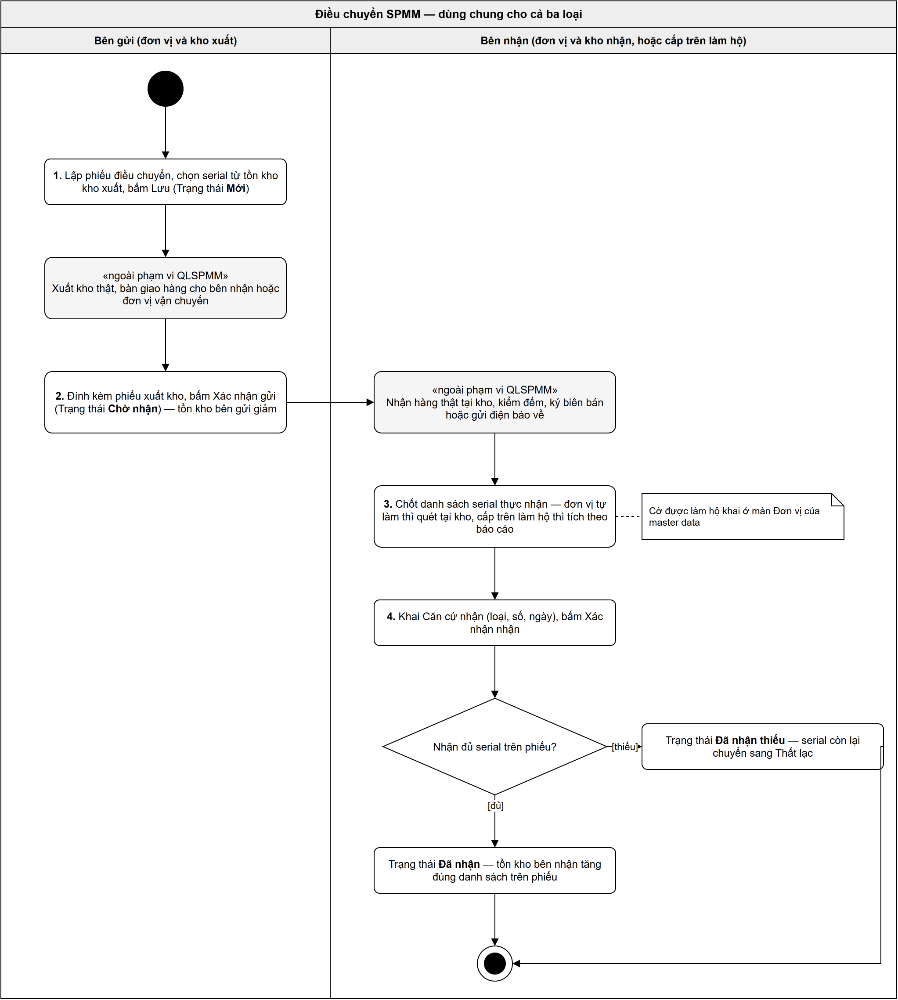
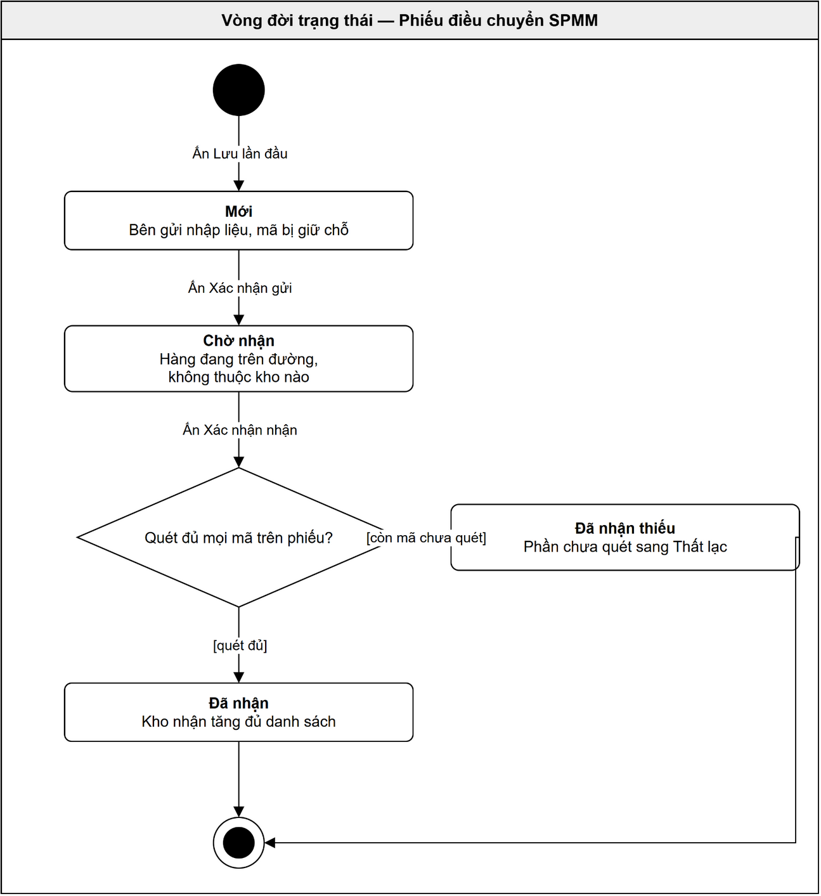

# Đặc tả: Phiếu điều chuyển SPMM

**Figma:** file **BCY(2)** · Page 1 · khu vực 8 — **31 khung**, khung 1440. Năm khung dùng chung đánh `ĐC 01`–`ĐC 05`; 26 khung còn lại đánh `ĐC <loại>.<bước>` theo ba hàng, mỗi hàng một loại điều chuyển.

## 1. Phạm vi

Điều chuyển là **bước 5** của chuỗi nghiệp vụ QLSPMM: sau *Nhập kho*, trước *Cấp phát*.

**Một phiếu, hai bên cùng dùng.** Bên gửi lập phiếu, chọn mã định danh từ tồn kho của mình, xuất kho thật rồi bấm *Xác nhận gửi* — tồn kho bên gửi giảm. Hàng tới nơi, bên nhận quét đối chiếu từng cái rồi bấm *Xác nhận nhận* — tồn kho bên nhận tăng. Không bên nào phải gõ lại danh sách của bên kia.

**Giữa hai mốc đó hàng không thuộc kho nào** — đang trên đường. Tra một mã định danh bất kỳ lúc nào cũng ra được nó đang ở kho nào, hay đang trên đường theo phiếu nào.

**Ba loại điều chuyển** khác nhau ở căn cứ và ở trần số lượng, giống nhau ở mọi thứ còn lại:

| Loại | Dùng khi | Căn cứ | Trần số lượng | Đơn vị nhận |
|---|---|---|---|---|
| **1 — Từ đơn vị sản xuất về đơn vị đặt hàng** | Nhà máy giao hàng theo hợp đồng | *Hợp đồng* | *SL còn lại theo HĐ* — **chặn** | chọn |
| **2 — Điều chuyển giữa các đơn vị** | Cục QL xuống hệ đầu hệ, và giữa các đơn vị trong cùng một hệ | *QĐGCTKH năm*, đọc theo **số hiện hành** | *SL còn lại theo QĐ* — **không chặn** | chọn |
| **3 — Chuyển kho nội bộ đơn vị** | Đổi kho trong cùng một đơn vị | không có | không có | bằng *Đơn vị xuất*, khoá |

Cả ba loại đều **chặn khi vượt tồn kho** của kho xuất.

**Điều chuyển không tạo mã định danh mới.** Mã sinh ra ở phiếu nhập kho và cố định suốt vòng đời; điều chuyển chỉ chọn lại mã đang có trong tồn kho của mình. Xem `docs/cuc-ql/srs/srs-nhap-kho.md` Mục 1.3.

**Hai con số trên một SPMM.** ***Mã định danh SPMM*** 15 chữ số do đơn vị sản xuất đánh — **cố định suốt vòng đời**, là con số phiếu này quét và theo dõi. ***Serial vật lý của linh kiện*** đổi được khi thay bo mạch chính hay CPU — **phiếu điều chuyển không ghi, không đối chiếu**. Hai con số này không được gộp làm một. Cột trên màn tên là *Số serial* theo cách gọi quen của người dùng, nhưng thứ ghi vào là mã định danh 15 số.

**Không có tiền trên phiếu này.** Không cột đơn giá, không thành tiền, không tổng tiền — điều chuyển là chuyển chỗ, không phải mua bán.

### 1.1 Bản triển khai

| Loại | Chạy ở bản |
|---|---|
| **Loại 1** — nhà máy về Cục QL | **Cục QL** |
| **Loại 2** — Cục QL xuống hệ đầu hệ | **Cục QL** lập, **bản của hệ nhận** xác nhận nhận |
| **Loại 2** — giữa các đơn vị trong cùng một hệ | **bản của hệ đó** |
| **Loại 3** — nội bộ đơn vị | **bản mà đơn vị đó đang dùng** |

> ⚠️ **Chưa chốt: tần suất và cơ chế đồng bộ giữa bản Cục QL và bản của bốn hệ.** Phiếu loại 2 đi giữa hai bản triển khai nên phụ thuộc trực tiếp vào cơ chế này. Đợt này đặc tả **hành vi nghiệp vụ hai đầu**; việc phiếu đi qua đường đồng bộ nào, trễ bao lâu, xung đột thì xử lý ra sao là việc Cục QLKTNVMM chốt. Màn hình và quy tắc không đổi theo hướng nào.

### 1.2 Ngoài phạm vi

- **Công văn, trình ký, ký số, phê duyệt pháp lý** — nằm ở eOffice riêng của từng đơn vị. Phần mềm chỉ ghi lại số hiệu và ngày của văn bản, kèm tệp đính kèm.
- **Biên bản giao nhận và mọi thủ tục giấy** giữa bên giao và bên nhận — quy trình riêng của đơn vị.
- **Cấp mã định danh SPMM** — làm ở phiếu nhập kho.
- **Serial vật lý của linh kiện** — xem Mục 1.
- **Danh mục kho và vị trí cất giữ**, **cây đơn vị**, **cờ *Cho phép cấp trên thao tác hộ*** — quản lý ở master data, phiếu chỉ đọc.
- **Xử lý tiếp của mã đã sang *Thất lạc*** — thuộc module quản lý tài sản, chưa đặc tả.
- **Chọn hàng theo thứ tự nhập trước xuất trước (FIFO)** — chưa làm đợt này. Bảng serial đã có sẵn cột *Ngày nhập kho* để làm được về sau mà không phải dựng lại màn.
- **Cấp phát cho người dùng cuối** — chức năng riêng, có đặc tả riêng.

## 2. Quy trình nghiệp vụ

| # | Ai làm | Làm gì | Ở đâu |
|:--:|---|---|---|
| 1 | Bên gửi · Bên nhận | **Trao đổi công văn, chốt số lượng, chuẩn bị chứng từ** theo quy trình riêng | **Ngoài phạm vi QLSPMM** |
| 2 | Cán bộ kho bên gửi | Tạo phiếu, chọn *Loại điều chuyển*, *Kho xuất*, *Đơn vị nhận*, *Kho nhận*. Loại 1 và 2 chọn thêm *Phiếu căn cứ* — phần mềm đổ danh sách SPMM của căn cứ đó | `5.3` · `5.4` |
| 3 | Cán bộ kho bên gửi | Gõ *Số lượng chuyển* cho từng dòng, rồi quét mã định danh của từng cái — ở ô quét chung trên lưới, hoặc trong hộp thoại của từng dòng. Bấm *Lưu* — sinh *Mã phiếu*, phiếu ở *Mới*, mã bị giữ chỗ | `5.4` · `5.7` |
| 4 | Bên gửi | **Xuất hàng thật ra khỏi kho**, giao cho bên vận chuyển | **Ngoài phạm vi QLSPMM** |
| 5 | Cán bộ kho bên gửi | Nhập *Số phiếu xuất kho*, đính tài liệu, bấm *Xác nhận gửi* — tồn kho bên gửi giảm, phiếu sang *Chờ nhận*, hàng đang trên đường | `5.5` · `5.8` |
| 6 | Bên nhận | **Nhận hàng thật, kiểm đếm** | **Ngoài phạm vi QLSPMM** |
| 7 | Cán bộ kho bên nhận, hoặc cấp trên làm hộ | Quét từng mã thực nhận — **lần đối chiếu vật lý duy nhất trong toàn luồng**. Khai *Số phiếu nhập kho*, *Ngày nhập kho*, đính tài liệu, bấm *Xác nhận nhận* | `5.11` |
| 8 | Cán bộ kho bên nhận | Quét đủ thì phiếu sang *Đã nhận*. Còn mã chưa quét thì xác nhận lại ở hộp thoại — phiếu sang *Đã nhận thiếu*, phần chưa quét sang *Thất lạc* | `5.12` |

**Điều kiện vào:** kho xuất đang có tồn SPMM cần chuyển; loại 1 và 2 có một căn cứ hợp lệ.
**Điều kiện ra:** mã định danh đã nằm trong tồn kho của kho nhận, sẵn sàng cho điều chuyển tiếp hoặc cấp phát.

## 3. Phân quyền

### 3.1 Quyền theo vai trò

| Quyền | Cho phép |
|---|---|
| **Xem phiếu điều chuyển** | Mở danh sách `5.1`, mở chi tiết `5.5` / `5.13`, xem danh sách serial của một dòng |
| **Lập phiếu điều chuyển** | Tạo mới, sửa *Thông tin chung*, chọn và đổi căn cứ, gõ *Số lượng chuyển*, quét mã, đính tài liệu |
| **Xác nhận gửi** | Bấm *Xác nhận gửi* |
| **Xác nhận nhận** | Bấm *Xác nhận nhận*, khai khối *Thông tin nhập kho*, quét mã thực nhận |
| **Xoá phiếu điều chuyển** | Xoá phiếu còn *Mới* |

### 3.2 Thao tác theo trạng thái

Một thao tác chạy được khi **tài khoản có quyền ở Mục 3.1** *và* **trạng thái phiếu cho phép** *và* **người dùng đứng đúng bên**. Thiếu một trong ba thì nút không hiện.

| Thao tác trên một phiếu | *Mới* | *Chờ nhận* | *Đã nhận* · *Đã nhận thiếu* |
|---|:--:|:--:|:--:|
| Xem chi tiết | ✔ | ✔ | ✔ |
| Sửa *Thông tin chung* | ✔ (bên gửi) | ✘ | ✘ |
| Đổi *Phiếu căn cứ* · *Kho xuất* · *Loại điều chuyển* | ✔ (bên gửi) | ✘ | ✘ |
| Thêm và bớt dòng SPMM | ✔ (bên gửi) | ✘ | ✘ |
| Sửa *Số lượng chuyển* | ✔ (bên gửi) | ✘ | ✘ |
| Thêm và bớt mã định danh | ✔ (bên gửi) | ✘ | ✘ |
| Xem danh sách mã của một dòng | ✔ | ✔ | ✔ |
| Xác nhận gửi | ✔ (bên gửi) | ✘ | ✘ |
| Quét mã thực nhận | ✘ | ✔ (bên nhận) | ✘ |
| Khai khối *Thông tin nhập kho* | ✘ | ✔ (bên nhận) | ✘ |
| Xác nhận nhận | ✘ | ✔ (bên nhận) | ✘ |
| Xoá | ✔ (bên gửi) | ✘ | ✘ |

`✔` được làm · `✘` phần mềm chặn

### 3.3 Phạm vi dữ liệu và cơ chế làm hộ

**Một đơn vị thấy phiếu mà mình là bên gửi hoặc bên nhận.** Cấp trên thấy thêm phiếu của các đơn vị cấp dưới trong nhánh của mình.

**Đơn vị nhận mang cờ *Cho phép cấp trên thao tác hộ*** thì **cấp trên trực tiếp** của đơn vị đó bấm *Xác nhận nhận* thay được, căn cứ báo cáo bên dưới gửi về. Cờ đặt ở màn *Đơn vị* trong master data, bật tắt theo ý chí — **không suy ra từ việc đơn vị có tài khoản hay không**. **Cờ đọc tại lúc thao tác, không chép vào phiếu** — bật cờ khi phiếu đã ở *Chờ nhận* thì cấp trên vào làm hộ được ngay, không phải lập lại phiếu.

Cấp trên làm hộ thì **không quét tại kho** vì không đứng ở kho — tích theo báo cáo. Màn hiện một dòng ghi vết ở đầu, xem `5.11` `[2]`.

Luật này viết theo dạng **cấp N → cấp trên trực tiếp N+1**, không đóng đinh số tầng — cây tổ chức Ngoại giao nông, Công an và Quân đội có ngành dọc sâu hơn.

## 4. Vòng đời trạng thái

Bốn trạng thái, hai trạng thái cuối. **Không có nấc phê duyệt**, không có nhánh *Trả lại*, **không có đường lùi**.

| Trạng thái | Nghĩa | Tồn kho |
|---|---|---|
| ***Mới*** | Bên gửi đang nhập liệu. Sửa và xoá được. Mã đã chọn **bị giữ chỗ** nhưng vẫn nằm trong kho xuất | chưa đổi |
| ***Chờ nhận*** | Bên gửi đã xuất hàng. Hàng **đang trên đường**, không thuộc kho nào | kho xuất đã giảm |
| ***Đã nhận*** | Bên nhận quét đủ mọi mã. Khoá hẳn | kho nhận tăng đủ |
| ***Đã nhận thiếu*** | Bên nhận quét được một phần. Khoá hẳn. Phần thiếu sang *Thất lạc* | kho nhận tăng phần đã quét |

| Từ | Đến | Kích hoạt bằng | Điều kiện | Hệ quả |
|---|---|---|---|---|
| *(chưa có)* | ***Mới*** | *Lưu* lần đầu ở `5.4` | Đủ trường bắt buộc khi lưu, xem `5.4` `[23]` | **Sinh *Mã phiếu***, không đổi về sau. Mã đã quét bị giữ chỗ — phiếu khác quét trùng thì bị chặn. **Chưa trừ vào trần, chưa trừ tồn kho** |
| ***Mới*** | ***Chờ nhận*** | *Xác nhận gửi* ở `5.5`, xác nhận lại ở `5.8` | Năm điều kiện ở `5.5` `[3]` | **Khoá sửa toàn bộ.** Tồn kho *Kho xuất* giảm đúng danh sách mã. Từ lúc này mã **trừ vào trần** của căn cứ. Ghi lại người bấm và thời điểm |
| ***Chờ nhận*** | ***Đã nhận*** | *Xác nhận nhận* ở `5.11` | Đã khai đủ khối *Thông tin nhập kho* **và quét đủ mọi mã trên phiếu** | Tồn kho *Kho nhận* tăng đủ danh sách, vào đúng *Vị trí kho nhận* của từng dòng. **Trạng thái cuối** |
| ***Chờ nhận*** | ***Đã nhận thiếu*** | *Xác nhận nhận* ở `5.11`, xác nhận lại ở `5.12` | Đã khai đủ khối *Thông tin nhập kho*, đã quét ít nhất một mã, **còn mã chưa quét** | Tồn kho *Kho nhận* tăng **đúng phần đã quét**. Mã chưa quét sang ***Thất lạc*** — không thuộc kho nào, **không quay về kho bên gửi**, **không cộng lại vào trần**. **Trạng thái cuối** |
| ***Mới*** | *(xoá hẳn)* | Icon xoá ở `5.1` hoặc `5.5`, xác nhận ở `5.10` | — | Xoá bản ghi. **Toàn bộ mã phiếu đó đang giữ chỗ được nhả ra ngay**, phiếu khác quét lại được |

**Chuyển trạng thái bị CẤM:** phiếu *Chờ nhận* trở đi **không quay lại *Mới***, **không huỷ gửi, không sửa, không xoá**. Gửi nhầm thì xử lý bằng một phiếu điều chuyển ngược.

## 5. Màn hình

**14 mục**, toàn bộ đã vẽ trên Figma. Mục nào khác nhau giữa ba loại thì ghi rõ theo loại; không ghi gì tức là ba loại giống hệt.

Năm hộp thoại `5.8` `5.10` `5.12` `5.14` và hộp thoại xác nhận khi đổi căn cứ theo khuôn dùng chung ở `docs/design.md` Mục 9.4: tiêu đề là cụm động từ hành động · dòng nhận diện · câu hệ quả · nút chính mang đúng chữ của tiêu đề.

**Thiếu điều kiện khi bấm nút chốt thì tô đỏ tại trường** — không hộp thoại liệt kê. Chỉ hai chỗ dùng thông báo nổi: **lỗi của ô quét**, và thứ **không gắn với ô nào** — bảng chi tiết chưa có dòng nào.

**SPMM luôn là MỘT cột `Mã - Tên`**, cùng cách với phiếu nhập kho.

**Bảng chi tiết là lưới phẳng — một dòng một SPMM, không có dòng con.** Vị trí lấy hàng trong kho xuất không phải là thứ người lập chọn; nó đi theo từng mã và hiện trong hộp thoại serial.

**Lưới chi tiết rộng hơn khung nên cuộn ngang, cột *Thao tác* ghim ở mép phải** — `docs/design.md` Mục 9.3.

### 5.1 Danh sách phiếu điều chuyển

**Figma:** `1313:69278` *"ĐC 01"*

| # | Items | Control type | Data type | Description |
|---|-------|--------------|-----------|-------------|
| 1 | Điều chuyển SPMM | Nút | — | Mở màn lập phiếu `5.4`. Luôn bấm được |
| 2 | Bộ chọn cột | Danh sách chọn nhiều | Danh mục cột | Chọn cột nào hiện trong lưới. Mặc định hiện đủ 10 cột |
| 3 | Làm mới | Nút biểu tượng | — | Tải lại lưới theo bộ lọc đang đặt. Không xoá bộ lọc |
| 4 | STT | Ô hiển thị | Số | Số thứ tự trong trang đang xem |
| 5 | Số phiếu chuyển SPMM | Liên kết | Chuỗi | Bấm để mở phiếu. Phiếu *Mới* mở `5.5`; phiếu *Chờ nhận* mở `5.11` nếu người dùng thuộc bên nhận hoặc là cấp trên của đơn vị nhận có cờ *Cho phép cấp trên thao tác hộ*, ngược lại mở `5.13`; phiếu *Đã nhận* và *Đã nhận thiếu* mở `5.13` |
| 6 | Trạng thái | Thẻ trạng thái | Danh mục | Bốn giá trị ở Mục 4 |
| 7 | Loại điều chuyển | Ô hiển thị | Danh mục | Ba giá trị ở Mục 1 |
| 8 | Ngày xuất kho | Ô hiển thị | Ngày | Ngày bên gửi ghi trên phiếu |
| 9 | Ngày nhập kho | Ô hiển thị | Ngày | Ngày bên nhận khai. **Để trống khi phiếu chưa được nhận** |
| 10 | Đơn vị xuất · Kho xuất | Ô hiển thị | Chuỗi | Bên gửi hàng |
| 11 | Đơn vị nhận · Kho nhận | Ô hiển thị | Chuỗi | Bên nhận hàng. Loại 3 thì đơn vị nhận trùng đơn vị xuất |
| 12 | Thao tác | Cụm biểu tượng | — | Sửa và xoá **chỉ hiện ở dòng *Mới* mà người dùng thuộc bên gửi**. Xoá mở `5.10` |
| 13 | Hàng lọc | Ô nhập / ô chọn / ô ngày | Theo cột | Nằm **trong lưới, ngay dưới tiêu đề cột**. Gõ tới đâu lọc tới đó, không có nút Tìm |
| 14 | Chân lưới | Phân trang | — | Số dòng đang xem trên tổng, chọn số dòng mỗi trang, chuyển trang |

### 5.2 Danh sách rỗng

**Figma:** `1314:69766` *"ĐC 02"*

Lưới không có dòng nào, hiện *"Chưa có phiếu điều chuyển nào"* và *"Bấm Điều chuyển SPMM để lập phiếu đầu tiên."*; chân lưới ghi `Hiển thị 0 – 0 / 0 phiếu`. Hàng lọc vẫn hiện — người dùng phải phân biệt được *"chưa có phiếu nào"* với *"bộ lọc không ra kết quả"*.

### 5.3 Chọn Phiếu căn cứ

**Figma:** loại 1 `1324:94862` · loại 2 `1324:95458`. **Loại 3 không có màn này.**

| # | Items | Control type | Data type | Description |
|---|-------|--------------|-----------|-------------|
| 1 | Phiếu căn cứ | Ô chọn | Danh mục | **Bắt buộc.** Loại 1 liệt kê hợp đồng theo hai cột *Mã hợp đồng* · *Số hợp đồng*, chỉ hợp đồng **Đã xác nhận**, chưa **Kết thúc**, còn ít nhất một SPMM chưa chuyển hết. Loại 2 liệt kê QĐGCTKH năm theo hai cột *Số quyết định* · *Ngày quyết định*, đọc theo **số hiện hành**. Chọn một. Chọn xong thì ô chỉ hiện **mã của căn cứ**, không kèm ngày |
| 2 | Bảng chi tiết khi chưa chọn | Lưới | — | Rỗng, hiện *"Chọn Phiếu căn cứ để nạp danh sách SPMM"* |
| 3 | Danh sách căn cứ rỗng | Nhãn | — | Không có căn cứ nào thoả điều kiện thì ô chọn hiện *"Đơn vị chưa có hợp đồng nào còn SPMM chưa chuyển hết."* (loại 2: *"Chưa có QĐGCTKH năm hiện hành cho đơn vị."*). Không chọn được gì thì **không lập được phiếu loại 1 và loại 2** |
| 4 | Chọn xong | — | — | Bảng chi tiết nạp đủ các dòng SPMM của căn cứ đó, kèm cột trần |
| 5 | Đổi hoặc chọn lại căn cứ | Hộp thoại | — | **Chọn lại chính căn cứ đang chọn** thì phần mềm thêm lại những dòng SPMM của căn cứ đó đang thiếu trên phiếu, giữ nguyên các dòng và mã đã quét — không hỏi lại vì không xoá gì. Đổi **sang căn cứ khác**: Bảng đang có mã đã quét thì mở hộp thoại: tiêu đề *Đổi Phiếu căn cứ*, câu hệ quả *"Đổi Phiếu căn cứ sẽ xoá `<N>` mã đã chọn. Vui lòng xác nhận."*. Xác nhận thì xoá hết dòng và nhả mọi mã; huỷ bỏ thì giữ nguyên căn cứ cũ |

### 5.4 Lập phiếu điều chuyển

**Figma:** loại 1 `1322:82430` · loại 2 `1314:70883` · loại 3 `1322:82982`

| # | Items | Control type | Data type | Description |
|---|-------|--------------|-----------|-------------|
| 1 | Mã phiếu | Ô chỉ đọc | Chuỗi | Phần mềm sinh khi *Lưu* lần đầu. Trước đó hiện *"Sinh khi Lưu"* |
| 2 | Số phiếu xuất kho | Ô nhập | Chuỗi | Số chứng từ do đơn vị đặt. **Bắt buộc khi *Xác nhận gửi***, không bắt buộc khi *Lưu*. Trước khi nhập hiện *"Nhập khi xác nhận gửi"*. Kiểm trùng trong cùng đơn vị cùng năm khi *Xác nhận gửi* |
| 3 | Ngày xuất kho | Ô ngày | Ngày | **Bắt buộc.** Mặc định ngày hiện tại, lùi ngày được. **Lịch không cho chọn ngày sau hôm nay** — chặn ngay tại chỗ chọn, không đợi tới lúc xác nhận |
| 4 | Loại điều chuyển | Ô chọn | Danh mục | **Bắt buộc.** Ba giá trị ở Mục 1. Đổi loại thì ô căn cứ đổi theo và bảng chi tiết bị xoá trắng; bảng đang có mã đã quét thì hỏi lại như `5.3` `[5]`. Loại 3 thì *Đơn vị nhận* tự bằng *Đơn vị xuất* rồi khoá |
| 5 | Đơn vị xuất | Ô chỉ đọc | Chuỗi | Đơn vị của tài khoản đang đăng nhập, không chọn được |
| 6 | Kho xuất | Ô chọn | Danh mục | **Bắt buộc.** Chỉ liệt kê kho của *Đơn vị xuất*. Đổi kho xuất thì mọi mã đã chọn bị xoá; đang có mã thì hỏi lại như `5.3` `[5]` |
| 7 | Đơn vị nhận | Ô chọn | Danh mục | **Bắt buộc.** Loại 1 và 2 **không liệt kê chính *Đơn vị xuất*** — chuyển giữa hai kho của cùng một đơn vị là loại 3. Loại 3 thì bằng *Đơn vị xuất* và khoá |
| 8 | Kho nhận | Ô chọn | Danh mục | **Bắt buộc.** Chỉ liệt kê kho của *Đơn vị nhận*. Loại 3 thì **danh sách bỏ luôn kho đang chọn ở *Kho xuất***; đơn vị chỉ có một kho thì danh sách rỗng và hiện *"Đơn vị chỉ có một kho, không có kho khác để chuyển nội bộ."* |
| 9 | Phiếu căn cứ | Ô chọn | Danh mục | Xem `5.3`. **Loại 3 ẩn hẳn ô này** |
| 10 | Thủ kho | Ô chọn | Danh mục | Không bắt buộc. Ghi ai giao hàng ở kho xuất |
| 11 | Ghi chú | Ô nhập nhiều dòng | Chuỗi | Không bắt buộc |
| 12 | Tài liệu đính kèm | Nút đính kèm | Tệp | **Bắt buộc trước khi *Xác nhận gửi***. Con số trên nút là số tệp đang có |
| 13 | Quét/Nhập serial | Ô nhập | Chuỗi | Ô quét **chung cho cả bảng**, ở hàng công cụ trên lưới. Chữ mờ *"Trỏ chuột vào đây và quét tem…"*. **Quét liên tục**: có máy quét thì bắn xong máy tự Enter; không có máy quét thì gõ số serial rồi Enter. Cả hai đường xử lý như nhau, xong là ô lại trắng để nhận mã kế tiếp. Phần mềm **tra mã trong tồn kho của *Kho xuất***, lấy SPMM của mã **theo dữ liệu tồn kho** rồi ghi vào đúng dòng đó; dòng đó sáng lên trong chốc lát. Kiểm lần lượt, sai ở bước nào thì dừng ở đó, **không ghi gì vào lưới**, **mọi câu lỗi của ô quét hiện bằng thông báo nổi ở góc phải trên, KHÔNG dán dưới ô** — ô quét luôn trắng và giữ con trỏ để quét tiếp, và **mã hỏng thì không kêu tiếng nào**: **đủ 15 chữ số** → *"Số serial phải là 15 chữ số."* · **có trong tồn kho của Kho xuất** → *"Mã này không có trong kho xuất."* · **chưa bị phiếu khác giữ** → *"Mã này đang thuộc phiếu khác."* · **SPMM của mã có trên phiếu** → loại 1 báo *"SPMM này không có trong hợp đồng."*; loại 2 và loại 3 **tự thêm một dòng mới** cho SPMM đó, *Số lượng chuyển* của dòng bằng số mã đã quét vào nó · **chưa trùng mã đã quét trong phiếu** → *"Số serial này đã có trong phiếu."* · **dòng khớp chưa quét đủ** → *"Dòng này đã quét đủ `<Số lượng chuyển>` serial."*. Qua hết thì *Số serial đã nhập* của dòng cộng 1, ô quét làm trắng và phần mềm **kêu một tiếng báo nhận** — không tít là người quét biết ngay mã vừa rồi hỏng. Chỉ hiện trên phiếu còn *Mới* |
| 14 | Bảng chi tiết | Lưới | — | Cột loại 1 và 2: STT · SPMM · ĐVT · *SL còn lại theo HĐ* (loại 2 là *SL còn lại theo QĐ*) · SL tồn kho · *Số lượng chuyển* · Số serial đã nhập · Thao tác (ghim bên phải). Loại 3 bỏ cột trần. Chân bảng là dòng *Tổng cộng* |
| 15 | SPMM | Ô hiển thị | Chuỗi | Một cột gộp `<Mã> - <Tên>`. Có ô tìm ngay dưới tiêu đề cột, gõ tới đâu lọc tới đó |
| 16 | SL còn lại theo HĐ | Ô chỉ đọc | Số | **Loại 1.** Bằng *SL đặt theo hợp đồng* trừ phần **đã chuyển ở các phiếu khác cùng hợp đồng**. Rê chuột hiện bảng tra bốn dòng: *Số theo hợp đồng* · *Đã chuyển ở phiếu khác* · *Đang lập ở phiếu khác* · *Còn lại*. **Chỉ hiện ở phiếu *Mới*** |
| 17 | SL còn lại theo QĐ | Ô chỉ đọc | Số | **Loại 2.** Bằng tổng số hiện hành của quyết định cho *Đơn vị nhận* **và các cấp dưới của đơn vị đó**, trừ phần **chính đơn vị đang lập đã chuyển**. Bảng tra bốn dòng như trên. **Chỉ hiện ở phiếu *Mới*** |
| 18 | SL tồn kho | Ô chỉ đọc | Số | Tồn hiện có của SPMM đó tại *Kho xuất* |
| 19 | Số lượng chuyển | Ô nhập số | Số | **Bắt buộc, lớn hơn 0.** **Vượt *SL tồn kho* thì chặn ở cả ba loại** — *"Tối đa `<SL tồn kho>`."*. Loại 1 **vượt *SL còn lại theo HĐ* cũng chặn** — *"Tối đa `<SL còn lại theo HĐ>`."*. Loại 2 **không chặn theo quyết định**. Giảm xuống dưới *Số serial đã nhập* hiện có thì chặn — *"Đã quét `<Số serial đã nhập>` mã, bỏ bớt mã trước khi giảm."* |
| 20 | Số serial đã nhập | Ô chỉ đọc | Chuỗi | Đếm mã định danh đã chọn trên *Số lượng chuyển*, dạng `12 / 12`. Chưa đủ thì hiện màu cảnh báo |
| 21 | Thao tác | Cụm biểu tượng | — | *Chọn số serial* mở `5.7` của dòng đó · *Xoá dòng* bỏ dòng khỏi phiếu và nhả mọi mã dòng đó đang giữ |
| 22 | ＋ Thêm SPMM | Nút | — | **Chỉ loại 2 và loại 3.** Ở hàng công cụ trên lưới, cạnh ô quét. Mở `5.6` để chọn nhiều SPMM một lượt từ tồn kho của *Kho xuất*. **Loại 1 không có nút này** — danh sách dòng đi đúng hợp đồng; xoá nhầm một dòng thì chọn lại chính hợp đồng đó ở ô *Phiếu căn cứ*, xem `5.3` `[5]` |
| 23 | Lưu | Nút | — | Điều kiện: đã chọn *Loại điều chuyển*, *Kho xuất*, *Đơn vị nhận*, *Kho nhận*, và *Phiếu căn cứ* với loại có ô này. Thiếu thì **tô đỏ tại ô còn thiếu**. Lưu xong sinh *Mã phiếu*, phiếu sang *Mới*, mọi mã đã chọn **bị giữ chỗ**. **Kiểm lại mã ngay lúc *Lưu***, không tin kết quả kiểm lúc quét: mã nào đã bị phiếu khác giữ mất trong lúc đang nhập thì **không lưu phiếu**, tô đỏ dòng chứa mã đó và báo *"Mã `<X>` đã thuộc phiếu khác, chọn lại mã cho dòng này."* |
| 24 | Hủy bỏ | Nút | — | Phiếu **chưa *Lưu* lần nào** thì thoát thẳng về danh sách, không hỏi lại |

### 5.5 Xem và sửa phiếu *Mới*

**Figma:** loại 1 `1323:84835` · loại 2 `1322:81860` · loại 3 `1323:86532`

Cùng một màn của phần mềm với `5.4`. Khác ở chỗ *Mã phiếu* đã có giá trị, có thẻ trạng thái ***MỚI***, và bộ nút đủ hơn.

| # | Items | Control type | Data type | Description |
|---|-------|--------------|-----------|-------------|
| 1 | Mọi ô ở khối *Thông tin chung* và bảng chi tiết | — | — | Sửa được y như `5.4` chừng nào phiếu còn *Mới* và người dùng thuộc bên gửi |
| 2 | Lưu | Nút | — | Lưu thay đổi, phiếu vẫn *Mới*. Người khác đã xác nhận hoặc xoá phiếu này trong lúc mình đang mở thì **báo ngay trong màn đang mở** rồi tải lại về danh sách. Người khác **đã sửa và lưu** thì cũng **không ghi đè** — báo *"Phiếu đã được người khác sửa. Tải lại để xem bản mới nhất."* |
| 3 | Xác nhận gửi | Nút | — | **Năm điều kiện:** bảng chi tiết có ít nhất một dòng SPMM · đã nhập *Số phiếu xuất kho* · đã chọn *Phiếu căn cứ* với loại có ô này · đã đính *Tài liệu đính kèm* · **mọi dòng đã quét đủ serial**. Đủ thì mở `5.8`; thiếu thì tô đỏ tại từng mục còn thiếu, xem `5.9` |
| 4 | Biểu tượng xoá | Nút biểu tượng | — | Chỉ hiện khi phiếu còn *Mới*. Mở `5.10` |

### 5.6 Hộp thoại Chọn SPMM từ tồn kho

**Figma:** `1351:102567` *"ĐC 05"*

Mở từ nút *＋ Thêm SPMM* ở hàng công cụ trên lưới. **Loại 1 không có nút này** — danh sách dòng đi đúng hợp đồng.

| # | Items | Control type | Data type | Description |
|---|-------|--------------|-----------|-------------|
| 1 | Tiêu đề | Nhãn | — | *Chọn SPMM từ tồn kho* |
| 2 | Dòng nhận diện | Nhãn | — | `<Kho xuất> — chỉ hiện SPMM còn tồn và chưa có trên phiếu` |
| 3 | Hàng tìm theo cột | Ô nhập | Chuỗi | Hai ô tìm nằm ngay dưới hàng tiêu đề cột, mỗi ô lọc đúng cột của nó: *Mã SPMM* · *Tên SPMM*. Cột *ĐVT* không có ô tìm. Gõ tới đâu lọc tới đó, hai ô cộng dồn điều kiện với nhau. Không ra dòng nào thì bảng hiện *"Kho `<tên kho>` không còn tồn SPMM nào khớp."* |
| 4 | Bảng | Lưới | — | Cột: ô đánh dấu · STT · Mã SPMM · Tên SPMM · ĐVT · *SL tồn*. **Một dòng một SPMM** — gộp mọi lô đang có trong kho, không liệt kê theo phiếu nhập kho. Chiều cao cố định, cuộn trong hộp thoại |
| 5 | Ô đánh dấu | Ô đánh dấu | — | Chọn nhiều SPMM một lượt. Ô ở hàng tiêu đề chọn và bỏ chọn hết những dòng đang hiện theo bộ lọc |
| 6 | SL tồn | Ô chỉ đọc | Số | Tổng tồn của SPMM đó tại kho, cộng mọi lô |
| 7 | Chân bảng | Nhãn | — | `Đã chọn <N> SPMM` |
| 8 | Thêm vào phiếu | Nút | — | Mỗi SPMM đã đánh dấu thành một dòng mới ở cuối bảng chi tiết, *Số lượng chuyển* để trống. Chưa đánh dấu dòng nào thì nút không bấm được. Đóng hộp thoại |
| 9 | Hủy bỏ | Nút | — | Đóng hộp thoại, không thêm gì |

### 5.7 Hộp thoại chọn số serial

**Figma:** loại 1 `1324:89972` · loại 2 `1322:83534` · loại 3 `1324:92417`

Mở từ biểu tượng *Chọn số serial* của một dòng SPMM. **Không có bước chọn lô hay chọn phiếu nhập kho trước.**

| # | Items | Control type | Data type | Description |
|---|-------|--------------|-----------|-------------|
| 1 | Thông tin SPMM | Ô chỉ đọc | — | *Mã SPMM* · *Tên SPMM* · *Số lượng chuyển* · *Số serial đã nhập* của dòng đang mở |
| 2 | Quét / gõ số serial | Ô nhập | Chuỗi | Chữ mờ *"Đặt con trỏ vào đây rồi quét"*. **Quét liên tục**: có máy quét thì bắn xong máy tự Enter; không có máy quét thì gõ số serial rồi Enter. Cả hai đường xử lý như nhau, xong là ô lại trắng để nhận mã kế tiếp. Mỗi mã hợp lệ **thêm ngay một dòng vào bảng**. Kiểm theo đúng thứ tự và đúng câu lỗi của `5.4` `[13]`, thay một lần kiểm: **SPMM của mã đúng bằng SPMM của dòng đang mở** → *"Số serial này không thuộc SPMM của dòng."*. Sai thì không thêm dòng, câu lỗi hiện bằng **thông báo nổi góc phải trên** và không kêu tiếng báo nhận |
| 3 | Chọn theo dải | Thẻ | — | Nhập *Giá trị từ* và *Giá trị đến*, phần mềm lấy các mã trong dải **đang có trong tồn kho của *Kho xuất*** và chưa bị phiếu khác giữ. Mã nào trong dải không thoả thì **bỏ qua mã đó**, các mã còn lại vẫn vào bảng; câu báo ghi rõ đã bỏ bao nhiêu mã và vì sao |
| 4 | Bảng số serial đã chọn | Lưới | — | Cột: STT · Số serial · **Vị trí** · **Phiếu nhập kho** · **Ngày nhập kho** · Thao tác. Ba cột giữa **chỉ đọc, phần mềm điền theo mã vừa quét** |
| 5 | Hàng tìm theo cột | Ô nhập | Chuỗi | Ba ô tìm nằm ngay dưới hàng tiêu đề cột, mỗi ô lọc đúng cột của nó: *Số serial* · *Vị trí* · *Phiếu nhập kho*. Gõ tới đâu lọc tới đó, các ô cộng dồn điều kiện với nhau. **Lọc chỉ ẩn dòng, không bỏ mã** — mã ở dòng đang ẩn vẫn tính vào *Chân bảng* và vẫn được *Lưu*. Quét thêm một mã khi đang lọc thì phần mềm **tự xoá bộ lọc** để dòng vừa thêm hiện ra |
| 6 | Thao tác | Nút biểu tượng | — | *Xoá* bỏ mã khỏi bảng và nhả mã đó về tồn kho |
| 7 | Chân bảng | Nhãn | — | `<đã chọn> / <Số lượng chuyển> mã` |
| 8 | Lưu | Nút | — | Ghi danh sách mã vào dòng SPMM, cập nhật *Số serial đã nhập*, đóng hộp thoại. Số mã **vượt *Số lượng chuyển* thì chặn** — *"Đã chọn đủ `<Số lượng chuyển>` mã."* |
| 9 | Hủy bỏ | Nút | — | Đóng hộp thoại, bỏ những mã vừa quét trong lần mở này |

### 5.8 Hộp thoại xác nhận gửi

**Figma:** loại 1 `1324:90676` · loại 2 `1324:88229` · loại 3 `1324:93121`

| # | Items | Control type | Data type | Description |
|---|-------|--------------|-----------|-------------|
| 1 | Tiêu đề | Nhãn | — | *Xác nhận gửi* |
| 2 | Dòng nhận diện | Nhãn | — | `Số phiếu <mã phiếu> — Số mã định danh <N>.` |
| 3 | Câu hệ quả | Nhãn | — | *"Sau khi gửi, phiếu không sửa và không xoá được nữa. Vui lòng xác nhận."* |
| 4 | Xác nhận gửi | Nút | — | Phiếu sang ***Chờ nhận***. Tồn kho *Kho xuất* giảm đúng danh sách mã, các mã đó trừ vào trần của căn cứ. Đóng hộp thoại, về danh sách. Phiếu đã bị người khác xử lý trước thì báo trong màn đang mở và tải lại |
| 5 | Hủy bỏ | Nút | — | Đóng hộp thoại, không đổi gì |

### 5.9 Xác nhận gửi bị chặn

**Figma:** loại 1 `1324:91262` · loại 2 `1324:89402` · loại 3 `1324:93707`

Bấm *Xác nhận gửi* khi còn thiếu điều kiện. Không mở hộp thoại, không đổi trạng thái, người dùng ở lại màn; mỗi chỗ thiếu tô đỏ ngay tại chỗ đó.

| # | Items | Control type | Data type | Description |
|---|-------|--------------|-----------|-------------|
| 1 | Số phiếu xuất kho | Ô nhập | Chuỗi | Bỏ trống → tô đỏ ô, dưới ô hiện *"Chưa có Số phiếu xuất kho."*. Trùng số trong cùng đơn vị cùng năm → *"Số phiếu xuất kho này đã có."* |
| 2 | Phiếu căn cứ | Ô chọn | Danh mục | Bỏ trống → *"Chưa chọn Phiếu căn cứ."*. Loại 3 không có ô này |
| 3 | Tài liệu đính kèm | Nút đính kèm | Tệp | Chưa đính → tô đỏ nút, dưới nút hiện *"Chưa đính kèm tài liệu."* |
| 4 | Số lượng chuyển | Ô nhập số | Số | Vượt trần → tô đỏ ô, dưới ô hiện *"Tối đa `<số>`."* theo luật `5.4` `[19]` |
| 5 | Số serial đã nhập | Ô chỉ đọc | Chuỗi | Dòng chưa quét đủ → giá trị chuyển đỏ, dưới giá trị hiện *"Chưa quét đủ."* |
| 6 | Bảng chi tiết rỗng | Lưới | — | Chưa có dòng SPMM nào thì **không có ô nào để tô đỏ** — báo bằng **thông báo nổi**: *"Phiếu chưa có dòng SPMM nào."* |

### 5.10 Hộp thoại xoá phiếu

**Figma:** `1314:74438` *"ĐC 03"*

| # | Items | Control type | Data type | Description |
|---|-------|--------------|-----------|-------------|
| 1 | Tiêu đề | Nhãn | — | *Xoá phiếu điều chuyển* |
| 2 | Dòng nhận diện | Nhãn | — | `Mã phiếu <mã phiếu>.` |
| 3 | Câu hệ quả | Nhãn | — | *"Sau khi xoá, phiếu không khôi phục được và các mã định danh đã chọn được nhả lại kho xuất. Vui lòng xác nhận."* |
| 4 | Xác nhận | Nút | — | Chỉ bấm được với phiếu còn *Mới*. Xoá hẳn phiếu, nhả mọi mã đang giữ chỗ, về danh sách |
| 5 | Hủy bỏ | Nút | — | Đóng hộp thoại, về đúng chỗ đã mở nó |

### 5.11 Xác nhận nhận

**Figma:** loại 1 `1323:85403` · loại 2 `1314:72591` · loại 3 `1323:87100`

| # | Items | Control type | Data type | Description |
|---|-------|--------------|-----------|-------------|
| 1 | Thẻ trạng thái | Thẻ | Danh mục | ***CHỜ NHẬN*** |
| 2 | Dòng ghi vết làm hộ | Dải thông báo | — | **Chỉ hiện khi người thao tác không thuộc đơn vị nhận.** Nguyên văn: *"`<Đơn vị đang thao tác>` đang thao tác thay `<Đơn vị nhận>` (đơn vị được đánh dấu cho phép cấp trên thao tác hộ)."* |
| 3 | Khối *Thông tin chung* | Ô chỉ đọc | — | Mọi ô khoá. Gồm Mã phiếu, Số phiếu xuất kho, Ngày xuất kho, Loại điều chuyển, Đơn vị xuất, Kho xuất, Đơn vị nhận, Kho nhận, Phiếu căn cứ, Thủ kho, Ghi chú và tệp bên gửi đã đính |
| 4 | Số phiếu nhập kho | Ô nhập | Chuỗi | **Bắt buộc.** Số chứng từ nhập kho do đơn vị nhận đặt. Kiểm trùng trong cùng đơn vị cùng năm khi *Xác nhận nhận* |
| 5 | Ngày nhập kho | Ô ngày | Ngày | **Bắt buộc.** Mặc định ngày hiện tại, lùi ngày được. **Lịch không cho chọn ngày sau hôm nay.** Chọn ngày trước *Ngày xuất kho* thì tô đỏ ô, dưới ô hiện *"Ngày nhập kho không được trước Ngày xuất kho."* |
| 6 | Mô tả | Ô nhập nhiều dòng | Chuỗi | Không bắt buộc. Ô trải hết bề ngang khối |
| 7 | Tài liệu đính kèm | Nút đính kèm | Tệp | **Bắt buộc trước khi *Xác nhận nhận*** |
| 8 | Quét/Nhập serial | Ô nhập | Chuỗi | Ô quét chung ở hàng công cụ trên lưới. **Lần đối chiếu vật lý duy nhất trong toàn luồng.** Quét từng cái thực nhận, phần mềm tra mã trong danh sách trên phiếu rồi tăng *Đã quét* của đúng dòng SPMM. Mã **không nằm trên phiếu** → *"Mã này không có trên phiếu."*, không nhận — **không có khái niệm nhận thừa**. Mã **đã quét rồi** → *"Mã này đã quét."*. Hai câu này hiện bằng **thông báo nổi góc phải trên**, mã hỏng thì không kêu tiếng báo nhận. Cấp trên làm hộ thì **không quét**, tích theo báo cáo bên dưới gửi về |
| 9 | Bảng chi tiết | Lưới chỉ đọc | — | Cột: STT · SPMM · ĐVT · *SL trên phiếu* · *Đã quét* · *Vị trí kho nhận* · Thao tác. Không sửa được số lượng |
| 10 | SL trên phiếu | Ô chỉ đọc | Số | Số mã định danh bên gửi đã đưa vào phiếu cho SPMM đó |
| 11 | Đã quét | Ô chỉ đọc | Chuỗi | Dạng `<đã quét> / <trên phiếu>`. Chưa đủ thì hiện màu cảnh báo |
| 12 | Vị trí kho nhận | Ô chọn | Danh mục | Vị trí cất hàng trong *Kho nhận*, **chọn một cho cả dòng**. Không bắt buộc; bỏ trống thì lấy vị trí cất giữ mặc định của kho |
| 13 | Thao tác | Nút biểu tượng | — | *Xem số serial* mở lại `5.7` **ở chế độ chỉ đọc**: ẩn ô quét, ẩn thẻ *Chọn theo dải*, ẩn cột *Thao tác* và nút *Lưu*, thêm một cột đánh dấu mã nào đã quét. Chỉ còn nút *Đóng* |
| 14 | Xác nhận nhận | Nút | — | **Bốn điều kiện:** đã quét ít nhất một mã · đã nhập *Số phiếu nhập kho* · đã nhập *Ngày nhập kho* · đã đính *Tài liệu đính kèm*. Thiếu thì tô đỏ tại từng mục. Đủ và **quét đủ mọi mã** → phiếu sang ***Đã nhận***. Đủ nhưng **còn mã chưa quét** → mở `5.12` |
| 15 | Hủy bỏ | Nút | — | Về danh sách, không lưu gì |

### 5.12 Hộp thoại xác nhận nhận thiếu

**Figma:** loại 1 `1324:91832` · loại 2 `1324:88816` · loại 3 `1324:94277`

| # | Items | Control type | Data type | Description |
|---|-------|--------------|-----------|-------------|
| 1 | Tiêu đề | Nhãn | — | *Xác nhận nhận thiếu* |
| 2 | Dòng nhận diện | Nhãn | — | `Số phiếu <mã phiếu> — Đã quét <X> / <Y> mã định danh.` |
| 3 | Câu hệ quả | Nhãn | — | *"Sau khi xác nhận, `<Y−X>` mã chưa quét chuyển sang Thất lạc và phiếu khoá lại, không sửa và không xoá được nữa. Vui lòng xác nhận."* |
| 4 | Xác nhận nhận thiếu | Nút | — | Phiếu sang ***Đã nhận thiếu***. Tồn kho bên nhận tăng **đúng phần đã quét**. Mã chưa quét sang ***Thất lạc*** — không thuộc kho nào, không quay về kho bên gửi, không cộng lại vào trần |
| 5 | Hủy bỏ | Nút | — | Đóng hộp thoại, quay lại `5.11` để quét tiếp |

### 5.13 Phiếu chỉ đọc

**Figma:** loại 1 `1323:85970` · loại 2 `1323:84263` · loại 3 `1323:87667`

Một màn cho ba trường hợp: phiếu ***Chờ nhận*** khi người mở thuộc bên gửi, phiếu ***Đã nhận***, phiếu ***Đã nhận thiếu***.

| # | Items | Control type | Data type | Description |
|---|-------|--------------|-----------|-------------|
| 1 | Thẻ trạng thái | Thẻ | Danh mục | *CHỜ NHẬN* · *ĐÃ NHẬN* · *ĐÃ NHẬN THIẾU* tuỳ phiếu |
| 2 | Mọi ô trên màn | Ô chỉ đọc | — | Khoá hết. Phiếu *Chờ nhận* chưa khoá cứng nhưng bên gửi không còn quyền sửa; hai trạng thái cuối khoá cứng |
| 3 | Ô quét chung | — | — | **Không hiện** |
| 4 | Bảng chi tiết | Lưới chỉ đọc | — | Cột: STT · SPMM · ĐVT · *SL trên phiếu* · *Đã quét* · *Vị trí kho nhận* · Thao tác. **Cột trần không hiện** — trần chỉ dùng lúc đang lập, không hiện trên hồ sơ đã chốt |
| 5 | Vị trí kho nhận | Ô chỉ đọc | Chuỗi | Chữ, không phải ô chọn |
| 6 | Đã quét | Ô chỉ đọc | Chuỗi | Phiếu *Đã nhận thiếu* thì dòng nào thiếu hiện màu cảnh báo, dòng *Tổng cộng* cũng vậy |
| 7 | Dải *Thất lạc* | Dải cảnh báo | — | **Chỉ hiện với phiếu *Đã nhận thiếu*.** Ngay dưới dòng *Tổng cộng*. Nội dung *"`<N>` mã định danh không quét được — đã chuyển sang Thất lạc."* kèm liên kết *Xem danh sách* mở `5.14` |
| 8 | Quay lại | Nút | — | Về danh sách |

### 5.14 Hộp thoại mã chuyển sang Thất lạc

**Figma:** `1335:100539` *"ĐC 04"*

| # | Items | Control type | Data type | Description |
|---|-------|--------------|-----------|-------------|
| 1 | Tiêu đề | Nhãn | — | *Mã định danh chuyển sang Thất lạc* |
| 2 | Dòng nhận diện | Nhãn | — | `Phiếu <mã phiếu> — <N> mã không quét được khi xác nhận nhận` |
| 3 | Hàng tìm theo cột | Ô nhập | Chuỗi | Hai ô tìm nằm ngay dưới hàng tiêu đề cột, mỗi ô lọc đúng cột của nó: *Mã định danh* · *SPMM*. Gõ tới đâu lọc tới đó, hai ô cộng dồn điều kiện với nhau |
| 4 | Bảng | Lưới chỉ đọc | — | Cột: STT · Mã định danh · SPMM. **Chiều cao cố định, cuộn trong hộp thoại** — số mã nhiều tới đâu hộp thoại cũng không dài thêm |
| 5 | Chân bảng | Nhãn | — | `<đang hiện> / <tổng> mã` |
| 6 | Đóng | Nút | — | Đóng hộp thoại, về `5.13` |

## 6. Yêu cầu chức năng không thuộc màn hình nào

| Mã | Yêu cầu | Cách kiểm |
|---|---|---|
| `FR-dieu-chuyen-001` | **Một mã định danh chỉ nằm ở một chỗ tại một thời điểm.** Mã đang bị một phiếu *Mới* giữ chỗ, hoặc đang trên đường theo một phiếu *Chờ nhận*, thì phiếu khác không chọn được. Giữ chỗ tính từ lúc *Lưu* và **kiểm lại ngay tại lúc *Lưu***; xoá phiếu *Mới* nhả mọi mã ngay lập tức | Lưu phiếu A với mã `X` → phiếu B quét `X`: bị chặn. Hai người cùng quét `X` khi chưa ai lưu → người lưu sau bị chặn tại dòng chứa `X`. Xoá phiếu A → phiếu B quét `X`: nhận được |
| `FR-dieu-chuyen-004` | **Trần theo căn cứ chỉ trừ phần đã *Xác nhận gửi*.** Phiếu còn *Mới* của người khác không hạ trần, nhưng hiện ở dòng *Đang lập ở phiếu khác* của bảng tra | Hợp đồng 100, phiếu A *Mới* 30 → phiếu B thấy *Còn lại* 100, dòng *Đang lập* 30. A xác nhận gửi → B thấy *Còn lại* 70 |
| `FR-dieu-chuyen-006` | **Tồn kho đổi ở hai thời điểm khác nhau** — *Xác nhận gửi* trừ kho xuất, *Xác nhận nhận* cộng kho nhận. Giữa hai mốc mã không thuộc kho nào | Sau *Xác nhận gửi*: tra mã `X` ra *"đang chuyển theo phiếu `<mã phiếu>`"*, không ra kho nào |
| `FR-dieu-chuyen-008` | **Phiếu đã bị người khác xử lý thì không ghi đè.** Áp cho cả *Lưu*, *Xác nhận gửi*, *Xác nhận nhận* và *Xoá* | Hai phiên cùng mở một phiếu *Mới* → phiên lưu sau bị báo và phải tải lại. Hai phiên cùng bấm *Xác nhận gửi* → phiên sau bị báo phiếu đã gửi, tồn kho không bị trừ hai lần |

## 7. Yêu cầu phi chức năng

| Mã | Yêu cầu | Cách kiểm |
|---|---|---|
| `NFR-dieu-chuyen-001` | **Quét liên tục không phải chờ.** Mỗi lần quét một mã, phần mềm phản hồi trong vòng **1 giây** — kể cả kho xuất đang có hàng nghìn mã cùng SPMM | Kho có 3000 mã của một SPMM, quét 50 mã liên tiếp: không lần nào chờ quá 1 giây |
| `NFR-dieu-chuyen-002` | **Mọi thao tác đổi trạng thái ghi vết** người bấm, thời điểm, và đơn vị thao tác nếu là làm hộ | Mở phiếu *Đã nhận* xem được ai gửi, ai nhận, lúc nào |

## 8. Tiêu chí thành công

- Bên gửi lập được phiếu, quét đủ mã, gửi đi — bên nhận mở đúng phiếu đó, quét đối chiếu, xác nhận xong tồn kho hai đầu khớp nhau, **không ai phải gõ lại danh sách của bên kia**.
- Tra một mã định danh bất kỳ ra được nó đang ở kho nào, hay đang trên đường theo phiếu nào.
- Nhận thiếu không làm treo phiếu: phiếu vẫn đóng được, phần thiếu có chỗ đi và đếm được.
- Đơn vị không có người thao tác vẫn nhận được hàng qua cơ chế làm hộ, và tra ra được ai đã làm thay.

## 9. Chưa làm ở đợt này

| Thứ | Ghi chú |
|---|---|
| **Chọn hàng theo FIFO** | Bảng serial đã có cột *Ngày nhập kho*; thêm luật sắp xếp là làm được, không phải dựng lại màn |
| **Xử lý tiếp mã đã sang *Thất lạc*** | Biên bản, quy trách nhiệm, xoá sổ hay khôi phục khi tìm lại được — thuộc module quản lý tài sản |
| **Tách một dòng nhận về hai vị trí kho** | Bên nhận chọn một vị trí cho cả dòng. Kho đầy phải chia chỗ thì chưa có cách làm trên phần mềm |
| **Tần suất và cơ chế đồng bộ giữa bản Cục QL và bản của bốn hệ** | Xem Mục 1.1 |
| **Màn *Đơn vị* ở master data** | Chỉ thêm ô đánh dấu *Cho phép cấp trên thao tác hộ*; màn dùng chung mọi hệ, vẽ sau |
| **Cấp nào được làm hộ, ở bản nhiều cấp** | Ngoại giao chỉ có một cấp dưới Cục nên *cấp trên trực tiếp* ở Mục 3.3 là đủ. Mở sang ĐCQ, Công an, Quân đội — ngành dọc sâu — thì phải chốt lại: cấp trên trực tiếp cũng không có tài khoản thì ai làm hộ |
| **Tra một mã đang trên đường** | Mục 8 đòi tra được mã đang ở kho nào hay đang theo phiếu nào, nhưng **không màn nào trong đặc tả này trả lời** — màn tra cứu thuộc nhóm báo cáo, có đặc tả riêng |
| **Chọn hàng theo lô** | Hộp thoại `5.6` gộp mọi lô thành một dòng một SPMM. Cần lấy đúng lô thì quét thẳng mã định danh của lô đó |

## 📝 Changelog

| Ngày cập nhật | Loại thay đổi | Nguồn liên quan | Người yêu cầu | Nội dung thay đổi |
|---|---|---|---|---|
| 2026-09-08 | thêm mới | 31 khung Figma KHU VỰC 8 · `docs/ngoai-giao/wireframe/dieu-chuyen/*` · `docs/ngoai-giao/brainstorming/brainstorm-dieu-chuyen.md` | @quynhdtn17 | Bản đầu tiên. 14 màn, 4 yêu cầu chức năng ngoài màn, 2 yêu cầu phi chức năng — bỏ mục *Quy tắc nghiệp vụ* và các mục trùng, mỗi luật chỉ còn ở đúng ô màn hình của nó. Ô quét chung lấy SPMM theo dữ liệu tồn kho, bỏ cách bóc sáu chữ số. Chốt lưới phẳng bỏ bước chọn lô, trần theo hợp đồng chặn còn trần theo quyết định không chặn, trừ trần tại *Xác nhận gửi*. Bỏ hàng *＋ Thêm 1 dòng*, thay bằng nút *＋ Thêm SPMM* mở hộp thoại `5.6` chọn nhiều SPMM từ tồn kho — loại 1 không có nút này, xoá nhầm thì chọn lại chính hợp đồng để nạp lại dòng thiếu. Ô quét gặp SPMM chưa có dòng thì loại 2 và 3 tự thêm dòng. Ô căn cứ chỉ hiện mã, bỏ ngày; hộp thoại *Chọn SPMM từ tồn kho* tìm theo từng cột. Hộp thoại chọn số serial và hộp thoại *Thất lạc* chuyển ô tìm vào trong lưới, tìm theo từng cột; bỏ ô tìm cột *ĐVT*. Lỗi của ô quét chuyển sang thông báo nổi góc phải trên, không dán dưới ô; chỉ kêu tiếng báo nhận khi mã hợp lệ. Bổ sung ca chặn *bảng chi tiết rỗng* (báo bằng thông báo nổi vì không có ô để tô). Ghi nhận điểm treo của phiếu *Chờ nhận* không ai nhận vào Mục 9. |
