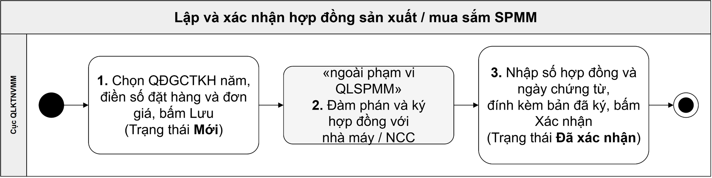

# Đặc tả: Hợp đồng sản xuất / mua sắm SPMM

**Figma:** file **BCY(2)** · Page 1 · khu vực 4 — **11 màn**, đánh số `01`–`11`, khung 1440.

## 1. Phạm vi

Hợp đồng là **bước 3** của chuỗi nghiệp vụ QLSPMM: sau *QĐGCTKH*, trước *Nhập kho*.

Cán bộ Cục QLKTNVMM lập hợp đồng trên căn cứ **một QĐGCTKH loại *Kế hoạch năm* đã ban hành**. Chọn quyết định xong, phần mềm đổ đủ danh sách SPMM của quyết định kèm số lượng đã được cấp; người lập điền số đặt hàng, đơn giá, thuế rồi bấm *Lưu* — phần mềm sinh *Mã hợp đồng*, hồ sơ ở trạng thái *Mới*. Người lập tải phụ lục mang ra ngoài đàm phán và ký hợp đồng giấy. Ký xong quay lại nhập *Số hợp đồng*, *Ngày chứng từ*, đính kèm bản đã ký rồi bấm *Xác nhận* — hồ sơ chuyển sang *Đã xác nhận* và khoá lại.

Một QĐGCTKH năm **ký được nhiều hợp đồng** với nhiều đơn vị sản xuất khác nhau, lập rải theo tiến độ. Một hợp đồng *Đã xác nhận* là căn cứ để **nhập kho nhiều đợt**.

**Đơn vị tính** là thuộc tính của SPMM trong danh mục SPMM — một SPMM một đơn vị tính. Hợp đồng chỉ **hiện lại** đơn vị tính đó ở cột *ĐVT*, **không đặt lại**. Việc một *Hệ thống* được đếm như thế nào là vấn đề ở tầng danh mục SPMM, chưa chốt.

**Đợt này chỉ dùng một loại tiền: VND.** Không có ô chọn loại tiền, không có tỉ giá. Đơn vị tiền ghi **đúng một chỗ** trên màn — hàng *Tổng cộng (VND)* ở chân bảng đặt hàng.

### 1.1 Bản triển khai

| Việc | Chạy ở bản |
|---|---|
| Toàn bộ 11 màn — lập · sửa · chọn quyết định · nhập số đặt hàng và đơn giá · xuất phụ lục · xác nhận · kết thúc · xoá · tra cứu | **Cục QL** |

Hợp đồng **không đi xuống các bản hệ đầu hệ** và **không nằm trong luồng đồng bộ** giữa Cục QL và 4 hệ. Cục cơ yếu đầu hệ không có chức năng này, kể cả ở dạng chỉ xem.

### 1.2 Ngoài phạm vi

- **Đàm phán, soạn thảo, trình ký, ký số và phê duyệt pháp lý hợp đồng** — nằm ở eOffice và quy trình riêng của Ban. Phần mềm chỉ **ghi nhận kết quả đã ký**.
- **Serial và mã định danh SPMM** — hợp đồng đếm theo **loại** SPMM, số lượng trên hợp đồng chưa ứng với vật thật nào. Serial do đơn vị sản xuất đánh và được **gõ lại ở bước nhập kho**; phần mềm phía Cục không sinh serial.
- **Danh mục *Bảng giá SPMM*** — hợp đồng chỉ **đọc** giá gợi ý từ đó, không sửa được bảng giá tại đây. Một bảng duy nhất, dùng chung với QĐGCTKH (`FR-hop-dong-002`).
- **Cây đơn vị**, **danh mục *Nhà cung cấp*** và **danh mục *Nguồn kinh phí*** — hợp đồng chỉ đọc, quản lý ở chức năng riêng. Danh mục *Nhà cung cấp* trước đây tên là *Đơn vị sản xuất*; nhà máy thuộc Ban nay khai ở **cây đơn vị** với *Phân loại đơn vị* = *Đơn vị sản xuất*.
- **Điều chuyển đơn vị sản xuất → Cục** — chức năng riêng, có đặc tả riêng.
- **Nhập kho theo hợp đồng** — chức năng riêng, có đặc tả riêng.

### 1.3 Hai số hiệu

| Tên | Nguồn | Định dạng | Bắt buộc |
|---|---|---|---|
| ***Mã hợp đồng*** | Phần mềm sinh khi *Lưu* lần đầu. Chỉ đọc, duy nhất, không đổi suốt vòng đời | `HĐ/QLKT/<năm>/<4 số>` | Luôn có kể từ lần lưu đầu |
| ***Số hợp đồng*** | Người dùng nhập tay, lấy từ bản hợp đồng giấy đã ký | Theo số hợp đồng của Ban | Bắt buộc khi *Xác nhận* |

***Mã hợp đồng*** là khoá liên kết dữ liệu và là cột bấm để mở hợp đồng. ***Số hợp đồng*** không dùng làm khoá — lúc lập hợp đồng chưa đàm phán xong thì chưa ký, chưa ký thì chưa có số.

## 2. Quy trình nghiệp vụ

| # | Ai làm | Làm gì | Ở đâu |
|:--:|---|---|---|
| 1 | Cán bộ Cục QLKTNVMM | Tạo hợp đồng, chọn **một** QĐGCTKH năm *Đã ban hành*. Phần mềm đổ đủ danh sách SPMM của quyết định kèm cột *Số lượng cấp*. Điền *SL đặt hàng* cho những SPMM đặt trong hợp đồng này, rà *Đơn giá* gợi ý, đặt thuế. Bấm *Lưu* — sinh *Mã hợp đồng*, hồ sơ ở trạng thái *Mới* | `5.3` · `5.4` |
| 2 | Cán bộ Cục QLKTNVMM · Đơn vị sản xuất | Tải phụ lục, **đàm phán và ký hợp đồng giấy** theo quy trình riêng của đơn vị | **Ngoài phạm vi QLSPMM** |
| 3 | Cán bộ Cục QLKTNVMM | Nhập *Số hợp đồng* và *Ngày chứng từ* lấy từ bản giấy, đính kèm **bản hợp đồng đã ký**, bấm *Xác nhận* — hồ sơ chuyển sang *Đã xác nhận* và khoá sửa | `5.3` · `5.7` |

**Điều kiện vào:** đã có một QĐGCTKH năm ở trạng thái *Đã ban hành*.
**Điều kiện ra:** hợp đồng *Đã xác nhận* là căn cứ để nhập kho.

*Tải xuống phụ lục* ở bước 2 **không** yêu cầu *Số hợp đồng*, chỉ yêu cầu đã *Lưu*. Phần mềm **không đối chiếu** phụ lục đã xuất với số liệu hiện tại của hợp đồng.

## 3. Phân quyền

Hợp đồng chỉ chạy ở bản Cục QL. Phạm vi dữ liệu cắt theo **đơn vị của người xem**, độc lập với quyền chức năng ở Mục 3.1.

| Người xem thuộc | Thấy hợp đồng nào |
|---|---|
| Cục QLKTNVMM | **Toàn bộ** |
| Một đơn vị sản xuất | Chỉ hợp đồng có *Đơn vị sản xuất* `5.3` `[5]` là **chính đơn vị mình**, và **chỉ trạng thái *Đã xác nhận*** |

Phạm vi này áp cả cho ô chọn hợp đồng của chức năng *Nhập kho* và cho tệp phụ lục xuất ra.

### 3.1 Quyền theo vai trò

Quyền gán cho tài khoản ở chức năng **Quản trị người dùng**, cùng cơ chế với QĐGCTKH (`srs-qdgctkh.md` Mục 3.2).

| Quyền | Cho phép |
|---|---|
| **Xem hợp đồng** | Mở màn danh sách `5.1`, mở xem chi tiết `5.2` / `5.8`, tải phụ lục |
| **Lập hợp đồng** | Tạo mới, sửa *Thông tin chung*, chọn và đổi QĐGCTKH, nhập *SL đặt hàng* · *Đơn giá* · *% Thuế* · *Ghi chú*, đính kèm tài liệu |
| **Xác nhận hợp đồng** | Bấm *Xác nhận* |
| **Kết thúc hợp đồng** | Bấm *Kết thúc* ở `5.8` |
| **Xoá hợp đồng** | Xoá hợp đồng còn *Mới* |

Phòng nào trong Cục QLKTNVMM giữ ba quyền *Lập* · *Xác nhận* · *Xoá* thì **chưa chốt**.

### 3.2 Thao tác theo trạng thái

Một thao tác chạy được khi **tài khoản có quyền ở Mục 3.1** *và* **trạng thái hợp đồng cho phép**. Thiếu một trong hai thì nút không hiện.

| Thao tác trên một hợp đồng | *Mới* | *Đã xác nhận* | *Kết thúc* |
|---|:--:|:--:|:--:|
| Xem chi tiết | ✔ | ✔ | ✔ |
| Sửa *Thông tin chung* | ✔ | ✘ | ✘ |
| Đổi *Số QĐGCTKH* | ✔ | ✘ | ✘ |
| Sửa *SL đặt hàng* · *Đơn giá* · *% Thuế* · *Ghi chú* | ✔ | ✘ | ✘ |
| Thêm và bớt *Tài liệu đính kèm* | ✔ | ✘ | ✘ |
| Mở xem và tải tệp đính kèm | ✔ | ✔ | ✔ |
| Tải xuống phụ lục | ✔ | ✔ | ✔ |
| Xác nhận | ✔ | ✘ | ✘ |
| Kết thúc | ✘ | ✔ | ✘ |
| Nhập kho theo hợp đồng này | ✘ | ✔ | ✘ |
| Xoá | ✔ | ✘ | ✘ |

`✔` được làm · `✘` phần mềm chặn

*Tạo hợp đồng* và *Xem danh sách* không phụ thuộc trạng thái, chỉ cần quyền ở Mục 3.1.

## 4. Vòng đời trạng thái

Ba trạng thái: ***Mới*** → ***Đã xác nhận*** → ***Kết thúc***. Không có nấc phê duyệt trung gian, không có nhánh *Trả lại*, không có đường lùi.

| Trạng thái | Nghĩa |
|---|---|
| ***Mới*** | Đang soạn, chưa ký giấy hoặc đã ký mà chưa ghi nhận vào phần mềm. Sửa và xoá được |
| ***Đã xác nhận*** | Đã có hợp đồng giấy ký, số và bản chụp đã ghi nhận. Khoá sửa. Từ đây mới nhập kho được |
| ***Kết thúc*** | Chốt sổ, không nhập kho thêm được. **Trạng thái cuối** |

| Từ | Đến | Kích hoạt bằng | Điều kiện | Hệ quả |
|---|---|---|---|---|
| *(chưa có)* | ***Mới*** | *Lưu* lần đầu ở `5.3` | Đủ trường bắt buộc khi lưu, xem `5.3` `[25]` | **Sinh *Mã hợp đồng***, không đổi về sau. Phần *SL đặt hàng* của hợp đồng hiện ở dòng *đang soạn thảo* trong bảng tra chỉ tiêu của hợp đồng khác |
| ***Mới*** | ***Đã xác nhận*** | *Xác nhận* ở `5.2` / `5.3`, xác nhận lại ở `5.7` | Đủ **ba mục**: *Số hợp đồng* · *Ngày chứng từ* · tệp **bản hợp đồng đã ký** | **Khoá sửa toàn bộ** — không sửa trường nào, không đổi số đặt hàng, không thêm bớt tệp. Phần *SL đặt hàng* chuyển từ *đang soạn thảo* sang **chiếm chỉ tiêu thật**, hạ trần của các hợp đồng khác. Ghi lại người bấm và thời điểm |
| ***Đã xác nhận*** | ***Kết thúc*** | *Kết thúc* ở `5.8`, xác nhận ở `5.11` | Không có điều kiện — **nhận đủ hay chưa đủ đều bấm được** | Khoá hẳn, không nhập kho thêm. *Tiến độ nhận hàng* **giữ nguyên giá trị đang có**, không lật thành *Đã nhận đủ*. Ghi lại người bấm và thời điểm |
| ***Mới*** | *(xoá hẳn)* | Icon xoá ở `5.1` hoặc nút *Xoá* ở `5.2`, xác nhận ở `5.9` | — | Xoá bản ghi. Phần chỉ tiêu hợp đồng đó đang giữ ở dòng *đang soạn thảo* **được nhả ra ngay** |

***Tiến độ nhận hàng* là trục riêng, không phải trạng thái.** Ba giá trị *Chưa nhận* · *Nhận một phần* · *Đã nhận đủ*, phần mềm **tự cộng** từ phiếu nhập kho vào kho của *Đơn vị đặt hàng*. Nó **không đè lên** trạng thái hồ sơ: hợp đồng nhận một phần vẫn đứng ở *Đã xác nhận*, và hợp đồng đóng thiếu mang cặp *Kết thúc* + *Nhận một phần*.

**Chuyển trạng thái bị CẤM:** hợp đồng *Kết thúc* **không mở lại**; hợp đồng *Đã xác nhận* **không quay lại *Mới***, **không thu hồi, không thay thế, không xoá**. Ký sai thì xử lý bằng phụ lục hợp đồng ngoài phần mềm.

**Khoá *sửa*, không khoá *dùng*.** Hồ sơ *Đã xác nhận* khoá lại nhưng **nhập kho vẫn trừ dần vào hợp đồng đó** qua nhiều đợt.

## 5. Màn hình

**11 mục**, toàn bộ chạy ở **bản Cục QL**, toàn bộ đã vẽ trên Figma.

Năm hộp thoại `5.5` `5.7` `5.9` `5.11` và bảng chọn `5.4` theo khuôn dùng chung ở `docs/design.md` Mục 9.4: tiêu đề là cụm động từ hành động · dòng nhận diện · câu hệ quả · nút chính mang đúng chữ của tiêu đề. Riêng `5.10` **không có dòng nhận diện** — hộp thoại đó mở ngay lúc bấm *Lưu*, mà lần lưu đầu thì hợp đồng chưa có *Mã hợp đồng* để nhận diện.

**Một cách báo thiếu điều kiện duy nhất: tô đỏ tại trường.** Không có thông báo nổi, không có hộp thoại chỉ để liệt kê mục còn thiếu — `BR-hop-dong-012`.

**SPMM luôn là MỘT cột `Mã - Tên`**, không tách Mã và Tên thành hai cột.

### 5.1 Danh sách hợp đồng

**Figma:** [HĐ 01 · Danh sách hợp đồng](https://www.figma.com/design/uYUO7YWV28C8X5hhiqHo6j/BCY-2-?node-id=729-4266) · **Bước:** điểm vào · **Slug:** `danh-sach-hd`

> Hàng lọc nằm trong lưới ngay dưới tiêu đề cột, áp dụng ngay khi nhập. Không có thẻ lọc riêng, không có nút *Tìm* / *Xoá lọc*.

| # | Items | Control type | Data type | Description |
|---|---|---|---|---|
| 1 | Ô chọn cột hiển thị | Multiselect | Danh sách cột | Bật tắt cột nào hiện trên lưới. Mặc định hiện đủ 13 cột. Chỉ đổi cách xem, không đổi dữ liệu |
| 2 | Tạo hợp đồng | Button | — | Mở `5.3` với hợp đồng trắng: *Loại hợp đồng* mặc định *Hợp đồng sản xuất*, *Nguồn kinh phí* mặc định *Cục QLKTNVMM*, bảng SPMM rỗng cho tới khi chọn *Số QĐGCTKH*. Chỉ hiện với tài khoản có quyền *Lập hợp đồng* |
| — | Bảng danh sách | Table | — | Cột: STT · **Mã hợp đồng** · Trạng thái · Tiến độ nhận hàng · Số hợp đồng · Số QĐGCTKH · Đơn vị sản xuất · Tổng trị giá (đ) · Thao tác. **Không có icon nhân bản**, không có nút *Xuất Excel* |
| 3 | Hàng lọc từng cột | Input · Dropdown | Theo cột | Lọc theo Mã hợp đồng, Trạng thái, Tiến độ nhận hàng, Số hợp đồng, Số QĐGCTKH, Đơn vị sản xuất. Lọc không ra dòng nào thì bảng rỗng, không chuyển màn |
| 4 | Mã hợp đồng | Link | Chuỗi | Phần mềm sinh khi *Lưu* lần đầu, dạng `HĐ/QLKT/<năm>/<4 số>`, không đổi suốt vòng đời. Cột bấm để mở: dòng *Mới* mở `5.2` chỉ xem, dòng *Đã xác nhận* mở `5.8` chỉ đọc |
| 5 | Trạng thái | Tag | Danh mục | Ba giá trị: *Mới* · *Đã xác nhận* · *Kết thúc*. **Tiến độ nhận hàng không nằm ở cột này** |
| 6 | Tiến độ nhận hàng | Text | Danh mục | *Chưa nhận* · *Nhận một phần* · *Đã nhận đủ*, phần mềm tự cộng từ phiếu nhập kho. **Hợp đồng còn *Mới* thì để trống** — chưa xác nhận thì chưa nhập kho được, trống và *Chưa nhận* là hai chuyện khác nhau |
| 7 | Số hợp đồng | Text | Chuỗi | Số trên bản giấy đã ký. **Để trống khi còn *Mới*** — chỉ nhập lúc xác nhận |
| 8 | Số QĐGCTKH | Text | Chuỗi | Số của quyết định mà hợp đồng neo vào. Một hợp đồng neo **đúng một** QĐGCTKH năm |
| 9 | Đơn vị sản xuất | Text | Chuỗi | Bên ký hợp đồng. **Màn danh sách không có cột *Loại hợp đồng*** |
| 10 | Tổng trị giá (đ) | Text | Số tiền | Tổng thành tiền **sau thuế** của hợp đồng, cộng từ bảng đặt hàng. Mọi hợp đồng cùng loại tiền VND nên cột này cộng ngang được giữa các dòng |
| 11 | Sửa | Icon button | — | Chỉ hiện ở dòng *Mới* và với tài khoản có quyền *Lập*. Mở **thẳng `5.3`**, không qua màn chỉ xem |
| 12 | Xoá | Icon button | — | Chỉ hiện ở dòng *Mới* và với tài khoản có quyền *Xoá*. Mở `5.9` trước khi xoá |
| 13 | Phân trang | Paginator | — | Mặc định 10 dòng một trang. Dòng chú thích ghi *"Hiển thị `<a>` – `<b>` / `<N>` hợp đồng"* |

Bảng còn bốn cột cuối **hiện mặc định**: *Ngày tạo* · *Người tạo* · *Người cập nhật cuối* · *Ngày cập nhật cuối*. Bản vẽ Figma không thể hiện bốn cột này vì khung chật.

### 5.2 Hợp đồng *Mới* — chỉ xem

**Figma:** [HĐ 02 · Hợp đồng Mới — chỉ xem](https://www.figma.com/design/uYUO7YWV28C8X5hhiqHo6j/BCY-2-?node-id=729-1128) · **Bước:** 1–3 · **Slug:** `hd-chi-tiet`

> Cùng bố cục và cùng bộ trường với `5.3`, mọi ô ở dạng chỉ đọc — **giữ nền trắng và giữ nguyên hình thức của ô gốc**: ô chọn vẫn có mũi tên xổ, ô ngày vẫn có biểu tượng lịch. Chỉ khác ở chỗ không bấm được, đúng `docs/design.md` Mục 9.1. Bấm *Mã hợp đồng* ở `5.1` vào đây.

| # | Items | Control type | Data type | Description |
|---|---|---|---|---|
| 1 | Nhãn trạng thái | Tag | Danh mục | *Mới*, ở đầu bên phải thanh tiêu đề khối *Thông tin chung* |
| 2 | Chuyển sang sửa | Icon button | — | Cạnh tiêu đề màn. Mở `5.3` với đúng hợp đồng đang xem. Chỉ hiện ở trạng thái *Mới* và với tài khoản có quyền *Lập* |
| 3 | Toàn bộ trường của *Thông tin chung* | Text (chỉ đọc) | — | Cùng bộ chín trường và cùng thứ tự với `5.3`. Không sửa được tại chỗ |
| 4 | Bảng *Thông tin đặt hàng* | Text (chỉ đọc) | — | Cùng mười cột với `5.3`, các ô nhập hiện thành **chữ trơn không khung**. Rê chuột vào *Số lượng cấp* vẫn ra bảng tra chỉ tiêu. **Ô tìm kiếm SPMM vẫn dùng được** — tìm là việc xem, không phải việc sửa |
| 5 | Chọn nhanh % thuế | Input | Số | **Ô nhập số, không phải ô chọn** — không có danh sách mức thuế dựng sẵn. Vẫn hiện trên hàng công cụ để người xem biết mức thuế đang áp cho cả bảng. Không có ô *Loại tiền* |
| 6 | Tải xuống phụ lục | Button | — | Hành vi như `5.3` `[12]` |
| 7 | Xoá | Button | — | Mở `5.9`. Chỉ hiện khi hồ sơ còn *Mới* và với tài khoản có quyền *Xoá* |
| 8 | Xác nhận | Button | — | Đủ ba điều kiện ở Mục 4 thì mở `5.7`. **Thiếu bất kỳ mục nào thì phần mềm mở thẳng màn sửa `5.3` với các mục còn thiếu đã tô đỏ** — xem `5.6`. Màn này không sửa được tại chỗ nên không báo lỗi tại đây, và **không có thông báo nổi nào** |
| — | *Hủy* · *Lưu* | — | — | **Không có** |

### 5.3 Tạo / sửa hợp đồng

**Figma:** [HĐ 03 · Tạo / sửa hợp đồng](https://www.figma.com/design/uYUO7YWV28C8X5hhiqHo6j/BCY-2-?node-id=728-5) · **Bước:** 1 · 3 · **Slug:** `hd-nhap`

> **Hai khối gập** xếp dọc trên một màn, gọi thẳng bằng tên: *Thông tin chung* · *Thông tin đặt hàng*. Không đánh số "Bảng 1/2", không đánh "Bước 1/2".
>
> Khối *Thông tin đặt hàng* là **bảng đóng theo quyết định**: không thêm được SPMM ngoài quyết định, không xoá được dòng — nên **không có hàng thêm nhanh, không có ô tích đầu dòng, không có cột *Thao tác***.

| # | Items | Control type | Data type | Description |
|---|---|---|---|---|
| 1 | Mã hợp đồng | Text (chỉ đọc) | Chuỗi | Phần mềm sinh khi *Lưu* lần đầu. Trước lần lưu đầu để trống. Không sửa được, không đổi suốt vòng đời |
| 2 | Số hợp đồng ⓘ | Input | Chuỗi | **Bắt buộc khi *Xác nhận*, không bắt buộc khi *Lưu***. Lấy từ bản giấy đã ký — phần mềm không sinh. Chữ mờ trong ô: *"Nhập khi xác nhận"*. Biểu tượng ⓘ cạnh nhãn giải thích đúng luật đó khi rê chuột. Bấm *Xác nhận* mà trống → tô đỏ ô, câu lỗi *"Chưa có Số hợp đồng."* ngay dưới ô, con trỏ nhảy vào đây. **Chặn** |
| 3 | Ngày chứng từ ⓘ | Date | Ngày | Ngày ghi trên bản giấy đã ký. **Bắt buộc khi *Xác nhận*, không bắt buộc khi *Lưu*** — biểu tượng ⓘ cạnh nhãn giải thích đúng luật đó khi rê chuột, cùng khuôn với *Số hợp đồng* `[2]`. **Không mặc định ngày hôm nay** — còn *Mới* thì để trống. Thiếu lúc bấm *Xác nhận* → tô đỏ, câu lỗi *"Chưa có Ngày chứng từ."* dưới ô. **Chặn** |
| 4 | Loại hợp đồng | Dropdown | Danh mục | Bắt buộc khi *Lưu*. Hai giá trị: ***Hợp đồng sản xuất*** (mặc định) và ***Hợp đồng thương mại***. **Rẽ nhánh nghiệp vụ sau đó** — quyết định ô *Đơn vị sản xuất* `[5]` lấy từ nguồn nào (`BR-hop-dong-021`). Đổi giá trị này thì **xoá luôn giá trị ô `[5]`**, buộc chọn lại. *Hợp đồng thương mại* **chưa làm ở đợt này** |
| 5 | Đơn vị sản xuất | Dropdown | Danh mục | **Bắt buộc khi *Lưu***. Bên ký hợp đồng — không gõ tay, không thêm giá trị mới tại chỗ. **Nguồn đổi theo *Loại hợp đồng*** `[4]`: *Hợp đồng sản xuất* lấy từ **cây đơn vị**, chỉ đơn vị có *Phân loại đơn vị* = *Đơn vị sản xuất*; *Hợp đồng thương mại* lấy từ **danh mục *Nhà cung cấp*** (`BR-hop-dong-021`) |
| 6 | Số QĐGCTKH | Dropdown | Danh mục | **Bắt buộc khi *Lưu***, là căn cứ của hợp đồng. Bấm mở bảng chọn `5.4`. Chọn xong phần mềm **đổ đủ danh sách SPMM** của quyết định kèm cột *Số lượng cấp*. Đổi sang quyết định khác khi bảng đã có số đặt hàng thì mở `5.5` trước. Một hợp đồng neo **đúng một** quyết định; một quyết định ký được **nhiều** hợp đồng |
| 7 | Đơn vị đặt hàng | Text (chỉ đọc) | Chuỗi | Luôn là *Cục QLKTNVMM* ở giai đoạn này, phần mềm tự điền. Giữ nền trắng như ô nhập, chỉ khác ở chỗ không bấm được |
| 8 | Nguồn kinh phí | Dropdown | Danh mục | Bắt buộc khi *Lưu*. Lấy từ danh mục, **mặc định *Cục QLKTNVMM***. Giá trị này **đi theo SPMM suốt vòng đời** kể từ khi nhập kho — `BR-hop-dong-017` |
| 9 | Mô tả | Textarea | Chuỗi | Không bắt buộc. Chiếm trọn một hàng, có bộ đếm ký tự dưới ô |
| 10 | Tài liệu đính kèm | Button + badge | Tệp | Mở hộp thoại quản lý tệp. Badge đếm số tệp đang có. **Bản hợp đồng đã ký là một trong ba điều kiện xác nhận** — chưa có tệp nào mà bấm *Xác nhận* thì câu lỗi *"Chưa đính kèm bản hợp đồng đã ký."* hiện đỏ ngay cạnh nút, cùng hàng. **Chặn**. Xác nhận **không kiểm nội dung tệp** |
| 11 | Chọn nhanh % thuế | Input | Số | **Ô nhập số, không phải ô chọn** — người lập gõ thẳng mức thuế, không có danh sách mức dựng sẵn. Gõ xong thì phần mềm **áp cho mọi dòng của bảng**, kể cả dòng đã sửa tay trước đó — chọn lại là ghi đè lại toàn bộ. Sau khi áp, sửa riêng từng dòng ở cột *% Thuế* vẫn được — `BR-hop-dong-010` |
| 12 | Tải xuống phụ lục | Button | — | Một nút, ra **một tệp Excel một sheet** *Danh sách SPMM đặt hàng*. Khối đầu trang lặp 10 mục nhận diện hợp đồng; lưới **10 cột** — trong phụ lục **SPMM tách thành hai cột *Mã* và *Tên***, khác màn hình nơi nó là một cột gộp, và **không có cột *Số lượng cấp***; chân lưới một hàng *Tổng cộng (VND)*. **Dòng để trống *SL đặt hàng* không lên phụ lục**. **Lưu trước rồi mới xuất**, không cần *Số hợp đồng*. Khuôn mẫu: [`PhuLuc_HopDong_Mau.xlsx`](PhuLuc_HopDong_Mau.xlsx). Đây là nút duy nhất của hàng công cụ — không có *Thêm SPMM*, không có *Nhập Excel*, không có *Tải xuống tệp mẫu* |
| 12b | Ô tìm kiếm SPMM | Input | Chuỗi | Nằm **trong lưới**, ở hàng ngay dưới tiêu đề cột và **đúng cột *SPMM*** — chín cột còn lại không có ô nào. Chữ mờ trong ô: *"Tìm SPMM"*. Gõ tới đâu lọc dòng tới đó, khớp **cả mã lẫn tên** trong cột `Mã - Tên`, không phân biệt hoa thường; xoá hết chữ thì bảng hiện lại đủ dòng. **Không có nút *Tìm*, không có nút *Xoá lọc***. Chỉ đổi cách xem, **không đổi dữ liệu** — `BR-hop-dong-022`. Gõ không khớp dòng nào thì thân bảng rỗng, hàng *Tổng cộng (VND)* vẫn giữ tổng của cả bảng |
| 13 | STT | Text | Số | Số thứ tự dòng trong bảng, phần mềm đánh |
| 14 | SPMM | Text | Chuỗi | Một cột `Mã - Tên`. **Đóng theo quyết định** — phần mềm đổ đủ, không thêm được SPMM ngoài quyết định, không xoá được dòng |
| 15 | ĐVT | Text (chỉ đọc) | Danh mục | Đơn vị tính **đi theo SPMM trong danh mục**, hợp đồng chỉ hiện lại chứ không đặt lại |
| 16 | Số lượng cấp | Text (chỉ đọc) | Số | Con số ở bảng *Tổng hợp kế hoạch toàn ngành* của quyết định đã chọn. Quyết định đã ban hành thì không đổi. **Rê chuột** vào ô hiện bảng tra bốn dòng xếp dọc, nguyên văn: *"Số lượng cấp (theo QĐGCTKH năm): `<số>`"* · *"Đã ký ở HĐ khác: `<số>`"* · *"Đang soạn thảo ở HĐ khác: `<số>`"* · **"Còn lại: `<số>` — tối đa `<số>` nếu phần đang soạn không ký"**. Bảng tra **không liệt kê số hiệu các hợp đồng khác**. Chỉ sống khi hợp đồng còn *Mới* |
| 17 | SL đặt hàng | Input trong ô bảng | Số | **Ít nhất một dòng phải có số** thì mới lưu được. **Không nhận `0`** — không đặt SPMM nào thì để **trống**; ô trống và số `0` là hai chuyện khác nhau. Phần mềm **không tự điền**. **Vượt trần thì CHẶN**: tô đỏ ô đó, câu lỗi *"Vượt số còn lại theo QĐGCTKH."* ngay dưới ô. Trần tính theo `BR-hop-dong-003`. **Chưa vượt trần nhưng cộng cả phần đang soạn ở hợp đồng khác thì vượt** → ô mang **dấu cảnh báo** (không phải đỏ — đỏ dành cho chặn), rê chuột ra bảng tra chỉ tiêu. Dấu này **còn nguyên sau khi lưu**, hiện cả khi mở lại xem ở `5.2`; chỉ mất khi số hết vướng hoặc hợp đồng đã xác nhận |
| 18 | Đơn giá | Input trong ô bảng | Số tiền | **Bắt buộc ở dòng đã có *SL đặt hàng***. Gợi ý lấy từ **Bảng giá SPMM dùng chung**, sửa tay tự do. Hợp đồng **không lấy giá từ quyết định**; đổi bảng giá sau đó không sửa lại hợp đồng đã lưu — `FR-hop-dong-002` |
| 19 | % Thuế | Input trong ô bảng | Số | Mức thuế của **riêng dòng đó**. Nhận giá trị từ ô nhập *Chọn nhanh % thuế* `[11]` rồi sửa lại được — một hợp đồng có thể vừa có dòng 8% vừa có dòng 0% |
| 20 | Thành tiền trước thuế | Text | Số tiền | Phần mềm tính: *SL đặt hàng* × *Đơn giá*. Dòng để trống *SL đặt hàng* thì ô này **để trống**, không hiện `0` |
| 21 | Thành tiền sau thuế | Text | Số tiền | Phần mềm tính: *Thành tiền trước thuế* cộng phần thuế theo *% Thuế* **của chính dòng đó** |
| 22 | Ghi chú | Input trong ô bảng | Chuỗi | Ghi chú tự do cho dòng. Không bắt buộc |
| 23 | Tổng cộng (VND) | Table footer | Số tiền | Hàng chân lưới, cộng dồn theo cột: một số ở cột *Thành tiền trước thuế*, một số ở cột *Thành tiền sau thuế*. **Chữ *(VND)* ở đây là chỗ duy nhất trên màn ghi đơn vị tiền**. Không có dòng *Chi phí khác*, không có *Khoản mục ngân sách* |
| 24 | Hủy | Button | — | Rời màn, bỏ thay đổi chưa lưu. Còn thay đổi chưa lưu thì hỏi lại trước khi rời |
| 25 | Lưu | Button | — | Lần lưu đầu sinh *Mã hợp đồng* và đưa hồ sơ vào trạng thái *Mới*. Sửa lại được nhiều lần, **giữ nguyên trạng thái *Mới***. Kiểm khi lưu: *Loại hợp đồng* `[4]`, *Đơn vị sản xuất* `[5]`, *Số QĐGCTKH* `[6]`, *Nguồn kinh phí* `[8]`, ít nhất một dòng có *SL đặt hàng* `[17]`, *Đơn giá* `[18]` của mọi dòng đã có số đặt hàng, và **không dòng nào vượt trần**. Thiếu hoặc sai thì **tô đỏ ngay tại ô**, con trỏ nhảy về ô sai đầu tiên, **chặn** — không có thông báo nổi. Chưa vượt trần nhưng cộng cả phần đang soạn thì vượt → mở `5.10` |
| 26 | Xác nhận | Button | — | **Lưu phần đang sửa trước, rồi mới kiểm điều kiện xác nhận** — `BR-hop-dong-018`. Ba điều kiện: *Số hợp đồng* `[2]`, *Ngày chứng từ* `[3]`, tệp bản đã ký ở *Tài liệu đính kèm* `[10]`. Đủ ba thì mở `5.7`; thiếu thì **ở lại màn này**, các mục thiếu tô đỏ tại chỗ — xem `5.6` |

### 5.4 Bảng chọn QĐGCTKH

**Figma:** [HĐ 04 · Hộp thoại chọn QĐGCTKH](https://www.figma.com/design/uYUO7YWV28C8X5hhiqHo6j/BCY-2-?node-id=729-1651) · **Bước:** 1 · **Slug:** `chon-qdgctkh`

> **Bảng xổ xuống của ô *Số QĐGCTKH***, không phải hộp thoại chặn — không có nền mờ, không có nút *Hủy* / *Xác nhận*. **Bấm một dòng là chọn xong** và bảng đóng lại, vì chỉ chọn **một** quyết định.

| # | Items | Control type | Data type | Description |
|---|---|---|---|---|
| 1 | Hàng lọc từng cột | Input · Dropdown | Theo cột | Ngay dưới tiêu đề cột, cùng khuôn với `5.1`. Lọc theo Số phiếu, Số QĐGCTKH, Năm áp dụng, Loại quyết định |
| 2 | Số phiếu | Link | Chuỗi | Số phiếu của quyết định, dạng `QĐ/QLKT/<năm>/<4 số>`. **Bấm vào dòng là chọn quyết định đó** rồi đóng bảng |
| 3 | Số QĐGCTKH | Text | Chuỗi | Số quyết định trên bản giấy đã ký, dạng `<số>/QĐ-QLKTNVMM`. Luôn có vì bảng chỉ hiện quyết định *Đã ban hành* |
| 4 | Năm áp dụng | Text | Số | Năm kế hoạch mà quyết định giao chỉ tiêu, **không phải năm lập** |
| 5 | Loại quyết định | Text | Danh mục | Đợt này chỉ có *Kế hoạch năm*. Loại *Bổ sung – đột xuất* xem Mục 10 |

**Điều kiện lọc danh sách:** chỉ hiện quyết định ở trạng thái ***Đã ban hành***. Quyết định còn *Mới* chưa phải căn cứ pháp lý nên không ký hợp đồng theo nó được.

**Chọn xong thì đổ danh sách SPMM.** Bảng SPMM **chưa** có số đặt hàng thì đổ thẳng. Bảng **đã** có số đặt hàng thì mở `5.5` trước.

### 5.5 Hộp thoại đổi QĐGCTKH

**Figma:** [HĐ 05 · Cảnh báo đổi QĐGCTKH](https://www.figma.com/design/uYUO7YWV28C8X5hhiqHo6j/BCY-2-?node-id=729-2174) · **Bước:** 1 · **Slug:** `doi-qdgctkh-canh-bao`

| # | Items | Control type | Data type | Description |
|---|---|---|---|---|
| 1 | Tiêu đề | Label | — | Nguyên văn *"Đổi QĐGCTKH"* |
| 2 | Dòng nhận diện | Label | — | *"Mã hợp đồng `<mã>` — Số QĐGCTKH `<số>`."* — nhắc lại quyết định **đang dùng**, không phải quyết định sắp đổi sang. Hai giá trị in đậm, phần nhãn để thường |
| 3 | Câu hệ quả | Label | — | Nguyên văn *"Sau khi đổi, toàn bộ danh sách SPMM và số đã nhập trong hợp đồng bị xoá và nạp lại theo quyết định mới. Vui lòng xác nhận."* |
| 4 | Hủy | Button | — | Giữ nguyên quyết định và số liệu cũ, đóng hộp thoại. Bấm `(x)` tương đương |
| 5 | Đổi QĐGCTKH | Button | — | Đổ lại danh sách SPMM theo quyết định mới. **Số đã điền mất theo**, không khôi phục được |

**Chỉ hiện khi bảng SPMM đã có số đặt hàng.** Bảng còn trắng thì đổi quyết định không mất gì, đổ thẳng, không hỏi.

### 5.6 Xác nhận bị chặn ở màn sửa

**Figma:** [HĐ 07 · Xác nhận bị chặn (lỗi tại ô)](https://www.figma.com/design/uYUO7YWV28C8X5hhiqHo6j/BCY-2-?node-id=729-3220) · **Bước:** 3 · **Slug:** `xac-nhan-chan`

> **Không phải một màn riêng** — đây là chính `5.3` sau khi bấm *Xác nhận* mà thiếu điều kiện.

| # | Items | Control type | Data type | Description |
|---|---|---|---|---|
| 1 | Báo lỗi tại từng mục | Label (lỗi) | — | Bấm *Xác nhận* ở `5.3` — hoặc bấm ở `5.2`, khi đó phần mềm mở thẳng `5.3` ở đúng trạng thái này — mà thiếu điều kiện nào thì hiện lỗi **ngay dưới mục đó**, đồng thời cho **mọi** mục còn thiếu: dưới ô *Số hợp đồng* — *"Chưa có Số hợp đồng."* · dưới ô *Ngày chứng từ* — *"Chưa có Ngày chứng từ."* · cạnh nút *Tài liệu đính kèm*, cùng hàng — *"Chưa đính kèm bản hợp đồng đã ký."* |
| 2 | Viền ô | — | — | Ô thiếu chuyển viền đỏ. Thiếu bao nhiêu mục thì tô đỏ bấy nhiêu mục **cùng lúc**, không báo lần lượt từng mục |
| 3 | Vị trí con trỏ | — | — | Nhảy về **mục thiếu đầu tiên** theo thứ tự trên màn |
| 4 | Hệ quả | — | — | `5.7` **không mở**, hợp đồng giữ nguyên *Mới*. **Chặn**. Bổ sung đủ tại chỗ rồi bấm *Xác nhận* lại thì mở `5.7` |

**Dòng vượt trần cũng chặn theo cùng một cách** — tô đỏ ô *SL đặt hàng* của dòng đó, câu lỗi *"Vượt số còn lại theo QĐGCTKH."*. Luật này chặn từ lúc *Lưu* nên hiếm khi còn sót tới lúc *Xác nhận*.

**Không có thông báo nổi và không có hộp thoại chặn** — `BR-hop-dong-012`.

### 5.7 Hộp thoại xác nhận hợp đồng

**Figma:** [HĐ 06 · Hộp thoại xác nhận hợp đồng](https://www.figma.com/design/uYUO7YWV28C8X5hhiqHo6j/BCY-2-?node-id=729-2697) · **Bước:** 3 · **Slug:** `xac-nhan-hd`

| # | Items | Control type | Data type | Description |
|---|---|---|---|---|
| 1 | Tiêu đề | Label | — | Nguyên văn *"Xác nhận hợp đồng"* |
| 2 | Dòng nhận diện | Label | — | *"Mã hợp đồng `<mã>` — Số hợp đồng `<số>`."* Hai giá trị in đậm, phần nhãn để thường |
| 3 | Câu hệ quả | Label | — | Nguyên văn *"Sau khi xác nhận, hợp đồng không sửa lại được nữa. Vui lòng xác nhận."* Không liệt kê tên tệp, không nhắc tổng trị giá, không có ô tích *"Tôi đã kiểm và chịu trách nhiệm"* |
| 4 | Hủy | Button | — | Đóng hộp thoại, giữ trạng thái *Mới*, không mất dữ liệu đang nhập. Bấm `(x)` tương đương |
| 5 | Xác nhận hợp đồng | Button | — | Chuyển hồ sơ sang *Đã xác nhận* rồi mở `5.8` — màn đó **bỏ cột *Số lượng cấp*** và bỏ bảng tra chỉ tiêu. Ghi lại **người bấm và thời điểm** |
| 6 | Hồ sơ đã bị xác nhận ở phiên khác | Label | — | Người khác vừa xác nhận cùng hồ sơ trong lúc hộp thoại đang mở → câu hệ quả `[3]` **đổi thành** *"Hồ sơ đã được xác nhận bởi người khác."*, nút chính `[5]` đổi thành *Đóng*. Đóng xong màn nạp lại ở trạng thái *Đã xác nhận*. **Báo ngay trong hộp thoại đang mở**, không đẻ thêm hộp thoại và không dùng thông báo nổi |

### 5.8 Hợp đồng đã xác nhận

**Figma:** [HĐ 08 · Hợp đồng đã xác nhận (chỉ đọc)](https://www.figma.com/design/uYUO7YWV28C8X5hhiqHo6j/BCY-2-?node-id=729-3743) · **Bước:** sau 3 · **Slug:** `hd-da-xac-nhan`

| # | Items | Control type | Data type | Description |
|---|---|---|---|---|
| 1 | Nhãn trạng thái | Tag | Danh mục | *Đã xác nhận*, hoặc *Kết thúc* nếu đã chốt sổ |
| 1b | Tiến độ nhận hàng | Tag | Danh mục | Đứng ngay sau nhãn trạng thái: *Chưa nhận* · *Nhận một phần* · *Đã nhận đủ*. Đọc một chỗ biết có nên bấm *Kết thúc* hay chưa |
| 2 | Toàn màn | — | — | Cùng bố cục `5.3`, **mọi ô ở trạng thái vô hiệu hoá**: ô chọn vẫn hiện mũi tên xổ và ô ngày vẫn hiện biểu tượng lịch — **giữ nguyên hình thức của ô gốc** như `5.2` — nhưng bấm không mở, không sửa được trường nào, không đổi *Số QĐGCTKH*, không đổi số đặt hàng, không đổi *Đơn giá* và *% Thuế*, không gõ được ô *Chọn nhanh % thuế*. *Số hợp đồng* và *Ngày chứng từ* đã có giá trị lấy từ bản giấy đã ký |
| 3 | Tài liệu đính kèm | Button + badge | Tệp | Mở được để **xem và tải** bản đã ký. **Không thêm, không xoá tệp** |
| 4 | Tải xuống phụ lục | Button | — | Vẫn dùng được sau khi xác nhận |
| 5 | Bảng *Thông tin đặt hàng* | Table | — | Mười cột — không có *Số lượng cấp*, không có bảng tra chỉ tiêu. **Ô tìm kiếm SPMM vẫn dùng được** dù hồ sơ đã khoá |
| 6 | Đã nhận | Text (chỉ đọc) | Số | Số đã nhập kho của dòng đó, cộng từ các phiếu nhập kho vào kho thuộc *Đơn vị đặt hàng*. Chưa nhận cái nào thì hiện **`0`**; dòng không đặt hàng thì **để trống** |
| 7 | Kết thúc | Button | — | Chỉ hiện với hợp đồng *Đã xác nhận* và tài khoản có quyền *Kết thúc*. Mở `5.11`. **Bấm được cả khi chưa nhận đủ** |
| — | *Hủy* · *Lưu* · *Xác nhận* · *Xoá* | — | — | **Không có**. Hợp đồng *Đã xác nhận* không xoá được, không sửa được |
| — | Icon bút chì cạnh tiêu đề | — | — | **Không có** — khác `5.2` đúng ở chỗ này |

**Khác `5.2` ở chỗ vô hiệu hoá:** `5.2` là hồ sơ còn sửa được nên ô vẫn ở trạng thái thường, chỉ là màn đó không cho sửa tại chỗ; `5.8` là hồ sơ đã khoá vĩnh viễn nên ô ở **trạng thái vô hiệu hoá thật**.

**Khoá *sửa*, không khoá *dùng*** — nhập kho vẫn trừ dần vào hợp đồng này qua nhiều đợt, cho tới khi bấm *Kết thúc*.

### 5.9 Hộp thoại xoá hợp đồng

**Figma:** [HĐ 09 · Cảnh báo xoá hợp đồng](https://www.figma.com/design/uYUO7YWV28C8X5hhiqHo6j/BCY-2-?node-id=729-4732) · **Bước:** ngoài luồng chính · **Slug:** `xoa-hd-canh-bao`

> Mở từ icon xoá trên dòng ở `5.1`, hoặc từ nút *Xoá* ở `5.2`.

| # | Items | Control type | Data type | Description |
|---|---|---|---|---|
| 1 | Tiêu đề | Label | — | Nguyên văn *"Xoá hợp đồng"* |
| 2 | Dòng nhận diện | Label | — | *"Mã hợp đồng `<mã>`."* Chỉ một giá trị — hợp đồng còn *Mới* thì **chưa có Số hợp đồng**, nên bỏ hẳn đoạn sau gạch dài thay vì để nhãn với ô trống |
| 3 | Câu hệ quả | Label | — | Nguyên văn *"Sau khi xoá, hợp đồng không khôi phục được và phần chỉ tiêu đang giữ được nhả lại cho hợp đồng khác. Vui lòng xác nhận."* |
| 4 | Hủy | Button | — | Đóng hộp thoại, không xoá gì. Bấm `(x)` tương đương |
| 5 | Xoá hợp đồng | Button | — | Xoá hẳn hồ sơ rồi quay lại `5.1`. Nút nền đỏ vì đây là hành động phá huỷ |

**Chỉ mở được với hợp đồng còn *Mới*.**

### 5.10 Hộp thoại lưu khi vượt chỉ tiêu

**Figma:** [HĐ 10 · Lưu khi vượt chỉ tiêu](https://www.figma.com/design/uYUO7YWV28C8X5hhiqHo6j/BCY-2-?node-id=832-9) · **Bước:** trong bước 1 · **Slug:** `luu-vuot-chi-tieu-canh-bao`

> Mở khi bấm *Lưu* ở `5.3` mà có dòng **chưa vượt trần** nhưng **cộng cả phần đang soạn ở hợp đồng khác thì vượt**. Vượt hẳn trần thì không mở hộp thoại này mà chặn tại ô — xem `BR-hop-dong-004`.

| # | Items | Control type | Data type | Description |
|---|---|---|---|---|
| 1 | Tiêu đề | Label | — | Nguyên văn *"Lưu hợp đồng"* |
| 2 | Câu hệ quả | Label | — | Nguyên văn *"Số lượng đặt hàng đang vượt quá chỉ tiêu trong QĐGCTKH. Vui lòng xác nhận."* **Không liệt kê SPMM nào** — dòng vướng đã có dấu cảnh báo ngay tại ô trên lưới |
| 3 | Huỷ | Button | — | Đóng hộp thoại, **không lưu**, con trỏ về ô *SL đặt hàng* của dòng vướng đầu tiên. Bấm `(x)` tương đương |
| 4 | Vẫn lưu | Button | — | Lưu bình thường, hồ sơ vào hoặc giữ trạng thái *Mới* |

### 5.11 Hộp thoại kết thúc hợp đồng

**Figma:** [HĐ 11 · Kết thúc hợp đồng](https://www.figma.com/design/uYUO7YWV28C8X5hhiqHo6j/BCY-2-?node-id=839-6680) · **Bước:** sau 3 · **Slug:** `ket-thuc-hd-canh-bao`

> Mở từ nút *Kết thúc* ở `5.8`.

| # | Items | Control type | Data type | Description |
|---|---|---|---|---|
| 1 | Tiêu đề | Label | — | Nguyên văn *"Kết thúc hợp đồng"* |
| 2 | Dòng nhận diện | Label | — | *"Mã hợp đồng `<mã>` — Số hợp đồng `<số>`."* Hai giá trị in đậm, phần nhãn để thường. Hợp đồng tới đây luôn có đủ hai số |
| 3 | Câu hệ quả | Label | — | Chưa nhận đủ: *"Hợp đồng chưa nhận đủ hàng, nếu kết thúc sẽ không nhập kho thêm được nữa. Vui lòng xác nhận."* Đã nhận đủ: *"Kết thúc thì sẽ không nhập kho thêm được nữa. Vui lòng xác nhận."* |
| 4 | Huỷ | Button | — | Đóng hộp thoại, giữ nguyên hợp đồng. Bấm `(x)` tương đương |
| 5 | Kết thúc | Button | — | Chuyển hồ sơ sang *Kết thúc* và khoá hẳn. *Tiến độ nhận hàng* **giữ nguyên**. Ghi lại người bấm và thời điểm |

## 6. Yêu cầu chức năng không thuộc màn hình nào

| ID | Yêu cầu | Cách kiểm |
|---|---|---|
| `FR-hop-dong-001` | **Phần mềm sinh *Mã hợp đồng* ở lần *Lưu* đầu tiên**, dạng `HĐ/QLKT/<năm>/<4 số>`, duy nhất trong toàn hệ, **không đổi và không tái sử dụng** kể cả khi hợp đồng bị xoá | Lưu một hợp đồng mới → có mã; xoá nó rồi lưu hợp đồng khác → mã mới, không trùng mã vừa xoá |
| `FR-hop-dong-002` | **Chỉ có MỘT Bảng giá SPMM, dùng chung với QĐGCTKH.** Hợp đồng lấy **giá gợi ý** từ bảng giá và **sửa tay tự do**; **không lấy giá từ quyết định** — giá trong quyết định là số dự trù xin ngân sách, giá hợp đồng là giá đàm phán được. Đổi bảng giá **không sửa lại** hợp đồng đã lưu. Cùng một yêu cầu với `FR-qdgctkh-002`. ⚠️ **Bản đang chạy chưa có bảng giá nào — phải làm mới** | Đổi giá một SPMM trong bảng giá → hợp đồng đã lưu giữ số cũ, hợp đồng tạo mới lấy giá mới; giá gợi ý ở hợp đồng **giống hệt** giá gợi ý của QĐGCTKH cho cùng SPMM |
| `FR-hop-dong-003` | **Phần mềm tính và cập nhật bảng tra chỉ tiêu theo thời gian thực.** Bốn con số ở `5.3` `[16]` tính lại mỗi lần mở màn: *Số lượng cấp* lấy từ quyết định, *Đã ký ở HĐ khác* cộng từ các hợp đồng *Đã xác nhận* cùng quyết định và cùng SPMM, *Đang soạn thảo ở HĐ khác* cộng từ các hợp đồng còn *Mới*, *Còn lại* là hiệu của ba số trên | Xác nhận một hợp đồng có 200 cái của SPMM A → mở hợp đồng khác cùng quyết định, dòng *Đã ký ở HĐ khác* của SPMM A tăng đúng 200 và trần hạ đúng 200 |
| `FR-hop-dong-004` | **Xoá hợp đồng còn *Mới* thì nhả chỉ tiêu ngay.** Phần *SL đặt hàng* hợp đồng đó đang giữ biến mất khỏi dòng *đang soạn thảo* của mọi hợp đồng khác cùng quyết định | Xoá một hợp đồng *Mới* → mở hợp đồng khác cùng quyết định, dòng *Đang soạn thảo ở HĐ khác* giảm đúng phần vừa xoá |

## 7. Quy tắc nghiệp vụ

Chỉ những quy tắc **xuyên nhiều màn** hoặc **không thuộc màn nào**. Luật của từng ô nằm trong bảng mô tả màn ở Mục 5.

| ID | Quy tắc | Áp ở |
|---|---|---|
| `BR-hop-dong-001` | **Một hợp đồng neo đúng MỘT QĐGCTKH năm *Đã ban hành*.** Một quyết định ký được **nhiều** hợp đồng với nhiều đơn vị sản xuất, lập rải theo tiến độ | `5.3` `[6]`, `5.4` |
| `BR-hop-dong-002` | **Danh sách SPMM đóng theo quyết định.** Phần mềm đổ đủ SPMM của quyết định đã chọn; **không thêm được SPMM ngoài quyết định, không xoá được dòng**. SPMM không đặt trong hợp đồng này thì để **trống** *SL đặt hàng* | `5.3` `[14]` `[17]` |
| `BR-hop-dong-003` | **Trần của hợp đồng đang lập = *Số lượng cấp* trừ phần đã đặt ở các hợp đồng *Đã xác nhận* cùng quyết định và cùng SPMM.** Hợp đồng còn *Mới* của người khác **không chiếm** chỉ tiêu nên **không hạ trần** — chỉ hiện ở dòng *đang soạn thảo* của bảng tra để người lập biết mà hỏi lại. Bản nháp bỏ quên vì thế không khoá được chỉ tiêu thật | `5.3` `[16]` `[17]`, `FR-hop-dong-003` |
| `BR-hop-dong-004` | **Vượt trần thì CHẶN, không phải cảnh báo mềm.** Phần mềm không cho *Lưu* dòng có *SL đặt hàng* lớn hơn trần; ô đó tô đỏ, câu lỗi *"Vượt số còn lại theo QĐGCTKH."*. **Chưa vượt trần nhưng cộng cả phần đang soạn ở hợp đồng khác thì vượt** → mở `5.10`, bấm *Vẫn lưu* thì lưu bình thường | `5.3` `[17]` `[25]`, `5.6`, `5.10` |
| `BR-hop-dong-005` | **Không nhận `0` ở *SL đặt hàng*.** Không đặt SPMM nào thì để **trống** — ô trống và số `0` là hai chuyện khác nhau. Dòng để trống không lên phụ lục và không cộng vào tổng | `5.3` `[17]` `[20]` |
| `BR-hop-dong-006` | ***Xác nhận* kiểm lại toàn bộ điều kiện của *Lưu*, cộng ba điều kiện riêng:** *Số hợp đồng* · *Ngày chứng từ* · tệp **bản hợp đồng đã ký**. Thiếu bất kỳ mục nào thì chặn. **Trần tính lại tại thời điểm bấm** — hợp đồng khác cùng quyết định vừa được xác nhận làm dòng nào vượt trần thì **tô đỏ ô *SL đặt hàng* của dòng đó**, câu lỗi *"Hợp đồng khác vừa được xác nhận, số này đã vượt chỉ tiêu."* ngay dưới ô, **chặn** | `5.2` `[8]`, `5.3` `[26]`, `5.6`, `5.7` |
| `BR-hop-dong-007` | ***Đã xác nhận* khoá *sửa*, không khoá *dùng*.** Không sửa được trường nào, không đổi được số đặt hàng, không thêm bớt tệp — nhưng **nhập kho vẫn trừ dần vào hợp đồng đó**, một hợp đồng nhận hàng **nhiều đợt** | Mục 4, `5.8` |
| `BR-hop-dong-008` | ***Đơn giá* chỉ là gợi ý từ Bảng giá SPMM dùng chung**, sửa tay tự do. Hợp đồng **không lấy giá từ quyết định** — giá trong quyết định là số dự trù, giá hợp đồng là giá đàm phán được | `5.3` `[18]`, `FR-hop-dong-002` |
| `BR-hop-dong-009` | **Một loại tiền duy nhất: VND.** Không có ô chọn loại tiền, không có tỉ giá. Đơn vị tiền ghi **đúng một chỗ** — hàng *Tổng cộng (VND)* ở chân bảng đặt hàng — không lặp ở tiêu đề từng cột | `5.3` `[23]`, `5.1` `[10]` |
| `BR-hop-dong-010` | **Ô *Chọn nhanh % thuế* là ô NHẬP SỐ, áp cho CẢ BẢNG và GHI ĐÈ.** Không có danh sách mức thuế dựng sẵn — người lập gõ thẳng mức cần áp. Gõ một mức thì phần mềm ghi mức đó vào **mọi dòng**, kể cả dòng đã sửa tay trước đó; gõ lại là ghi đè lại toàn bộ. Sau khi áp, sửa riêng cột *% Thuế* của từng dòng vẫn được | `5.3` `[11]` `[19]` |
| `BR-hop-dong-011` | **Đơn vị tính đi theo SPMM trong danh mục.** Cột *ĐVT* trên hợp đồng chỉ hiện lại, hợp đồng **không đặt lại** và không sửa được | `5.3` `[15]`, Mục 1 |
| `BR-hop-dong-012` | **Một cách báo thiếu điều kiện duy nhất: tô đỏ tại trường.** Câu lỗi nằm ngay dưới ô (riêng *Tài liệu đính kèm* thì cạnh nút, cùng hàng), con trỏ nhảy về trường thiếu đầu tiên, thiếu bao nhiêu mục thì tô đỏ bấy nhiêu **cùng lúc**. **Không có thông báo nổi và không có hộp thoại nào chỉ để liệt kê mục còn thiếu** — hộp thoại chỉ dùng cho **xác nhận hành động** | `5.3` `[25]` `[26]`, `5.6` |
| `BR-hop-dong-013` | **Vào xem và vào sửa là hai đường khác nhau.** Bấm *Mã hợp đồng* ở danh sách thì vào màn chỉ xem `5.2`; bấm icon sửa trên dòng thì vào thẳng màn sửa `5.3`. Cùng khuôn `BR-qdgctkh-007` | `5.1` `[4]` `[11]`, `5.2` `[2]` |
| `BR-hop-dong-014` | **Xoá được hợp đồng khi còn *Mới***, qua hộp thoại xác nhận. *Đã xác nhận* thì **không xoá**. Xoá xong phần chỉ tiêu hợp đồng đó đang giữ được **nhả ra ngay** | `5.1` `[12]`, `5.2` `[7]`, `5.9`, `FR-hop-dong-004` |
| `BR-hop-dong-015` | **Hai người xác nhận cùng một hồ sơ thì ai bấm trước được.** Người bấm sau nhận câu *"Hồ sơ đã được xác nhận bởi người khác."* **ngay trong hộp thoại đang mở**, nút chính đổi thành *Đóng*; đóng xong màn nạp lại ở trạng thái *Đã xác nhận*. **Không đẻ thêm hộp thoại, không dùng thông báo nổi** | `5.7` `[6]` |
| `BR-hop-dong-016` | **Đổi *Số QĐGCTKH* khi bảng đã có số đặt hàng thì phải qua hộp thoại `5.5`.** Đồng ý đổi thì toàn bộ danh sách SPMM và số đã nhập **bị xoá và nạp lại** theo quyết định mới, không khôi phục được. Bảng còn trắng thì đổi thẳng, không hỏi | `5.3` `[6]`, `5.4`, `5.5` |
| `BR-hop-dong-017` | ***Nguồn kinh phí* ghi trên hợp đồng đi theo SPMM suốt vòng đời** kể từ khi nhập kho, và quyết định lô đó cấp được cho hệ nào. Đợt này danh mục thực tế chỉ có một giá trị *Cục QLKTNVMM*, nhưng vẫn là ô chọn chứ không phải ô chỉ đọc | `5.3` `[8]` |
| `BR-hop-dong-018` | ***Xác nhận* thực hiện *Lưu* trước.** Bấm *Xác nhận* khi đang sửa dở thì phần vừa sửa được lưu trước, không xác nhận bản cũ. Lưu không qua được thì **không kiểm tiếp** điều kiện xác nhận. Cùng khuôn `BR-qdgctkh-004` | `5.2` `[8]`, `5.3` `[26]` |
| `BR-hop-dong-019` | ***Tiến độ nhận hàng* là trục riêng, không đè lên trạng thái hồ sơ.** Ba giá trị *Chưa nhận* · *Nhận một phần* · *Đã nhận đủ*, phần mềm **tự cộng** từ phiếu nhập kho vào **kho thuộc *Đơn vị đặt hàng***; không ai bấm, không khoá gì. Hàng nhập vào kho của đơn vị sản xuất **không tính** — đó là hàng chưa giao. Hợp đồng còn *Mới* thì ô này **trống** | `5.1` `[6]`, `5.8` `[1b]` `[6]` |
| `BR-hop-dong-020` | ***Kết thúc* bấm được cả khi chưa nhận đủ.** Không có điều kiện chặn. Sau khi kết thúc: khoá hẳn, **không nhập kho thêm được**, và *Tiến độ nhận hàng* **giữ nguyên giá trị đang có** — không lật thành *Đã nhận đủ*. Hợp đồng *Kết thúc* **không mở lại** | `5.8` `[7]`, `5.11` |
| `BR-hop-dong-021` | ***Đơn vị sản xuất* lấy từ hai nguồn khác nhau tuỳ *Loại hợp đồng*.** *Hợp đồng sản xuất* lấy từ **cây đơn vị**, chỉ đơn vị có *Phân loại đơn vị* = *Đơn vị sản xuất*; *Hợp đồng thương mại* lấy từ **danh mục *Nhà cung cấp***. Hai nguồn **không giao nhau** và **không nối với nhau**: nhà máy thuộc Ban là một đơn vị trong cây, nhà cung cấp thương mại chỉ là một dòng trong danh mục. Đổi *Loại hợp đồng* thì **xoá giá trị ô *Đơn vị sản xuất***, buộc chọn lại từ nguồn mới | `5.3` `[4]` `[5]`, Mục 1.2 |
| `BR-hop-dong-022` | **Ô tìm kiếm SPMM chỉ đổi CÁCH XEM, không đổi DỮ LIỆU.** Dòng đang bị ẩn vẫn giữ nguyên số đã gõ, vẫn **cộng vào *Tổng cộng (VND)***, vẫn **lên phụ lục**, và vẫn **bị kiểm khi *Lưu* / *Xác nhận*** — thiếu *Đơn giá* ở một dòng đang bị ẩn thì phần mềm **xoá chữ đang gõ trong ô tìm kiếm** để dòng đó hiện lại rồi mới tô đỏ, không báo lỗi ở một dòng người dùng không nhìn thấy. Bảng đóng theo quyết định nên tìm kiếm **không thêm bớt dòng nào** | `5.2` `[4]`, `5.3` `[12b]` `[25]` `[26]`, `5.8` `[5]` |

## 8. Yêu cầu phi chức năng

| ID | Yêu cầu | Cách kiểm |
|---|---|---|
| `NFR-hop-dong-001` | **Xác nhận là mốc đóng băng số liệu.** Hợp đồng *Đã xác nhận* giữ nguyên vĩnh viễn *SL đặt hàng*, *Đơn giá*, *% Thuế*, *Thành tiền* và *Tổng cộng*. Đổi Bảng giá SPMM, đổi *Số lượng cấp* của quyết định hay đổi bất kỳ danh mục nào sau đó **không làm đổi hợp đồng cũ**; mở lại sau nhiều năm vẫn khớp bản giấy đã ký | Xác nhận một hợp đồng, rồi đổi giá SPMM trong bảng giá → mở lại hợp đồng: mọi con số giữ nguyên |

## 9. Tiêu chí thành công

| # | Tiêu chí | Cách đo |
|:--:|---|---|
| 1 | **Người lập hợp đồng thứ N nhìn một chỗ biết SPMM đó còn được đặt bao nhiêu**, không phải tra sang quyết định giấy | Xác nhận hợp đồng A với 200 cái của SPMM X, lưu hợp đồng B còn *Mới* với 10 cái → mở hợp đồng C cùng quyết định, rê chuột vào SPMM X: thấy đủ bốn dòng, *Đã ký* = 200, *Đang soạn thảo* = 10, trần chặn ở *Số lượng cấp* − 200 |
| 2 | **Không hợp đồng nào ký vượt chỉ tiêu của quyết định** | Điền *SL đặt hàng* lớn hơn trần rồi bấm *Lưu* → ô tô đỏ, chặn, hợp đồng không lưu được |
| 3 | **Phụ lục xuất ra dùng thẳng được cho hợp đồng giấy**, không phải gõ lại tay | Xuất phụ lục ở trạng thái *Mới* → danh sách SPMM và số liệu khớp bảng trên màn, đúng số dòng đã điền |
| 4 | **Hợp đồng đã xác nhận không sửa được nhưng vẫn nhận hàng nhiều đợt** | Xác nhận một hợp đồng → không sửa được ô nào, không xoá được; lập hai phiếu nhập kho theo hợp đồng đó → cả hai đều trừ vào đúng hợp đồng |
| 5 | **Xoá hợp đồng chưa ký thì trả lại chỉ tiêu ngay**, không phải chờ ai xử lý | Lưu hợp đồng *Mới* với 10 cái của SPMM X, xoá đi → mở hợp đồng khác cùng quyết định, dòng *Đang soạn thảo ở HĐ khác* của SPMM X về đúng số cũ |

## 10. Chưa làm ở đợt này

- ***Hợp đồng thương mại*.** Đợt này chỉ ký *Hợp đồng sản xuất* với nhà máy thuộc Ban. Nguồn của ô *Đơn vị sản xuất* cho loại thương mại đã khai ở `BR-hop-dong-021` để Dev dựng sẵn, nhưng chưa có nghiệp vụ đi kèm.
- **Loại QĐGCTKH *Bổ sung – đột xuất* làm căn cứ hợp đồng.** Đợt này chỉ ký theo *Kế hoạch năm*.
- **Sơ đồ vòng đời trạng thái.** Hợp đồng có ba trạng thái nối thẳng một chiều, một tác nhân, không nhánh rẽ — Mục 4 dùng bảng là đủ, cùng cách xử lý với QĐGCTKH.

## 📝 Changelog

| Ngày cập nhật | Loại thay đổi | Nguồn/brainstorming liên quan | Người yêu cầu | Nội dung thay đổi |
|---|---|---|---|---|
| 2026-08-26 | thêm mới | `docs/cuc-ql/brainstorming/brainstorm-hop-dong.md` Mục 3 và Mục 4 · `docs/cuc-ql/user-flow/userflow-hop-dong.md` · ba file `screen-hop-dong-*.md` · 9 frame Figma khu vực 4 file BCY(2) | @quynhdtn17 | Bản đầu tiên. Mục 5 gồm 9 màn theo bản vẽ hiện tại, 7 yêu cầu chức năng ngoài màn, 18 quy tắc nghiệp vụ, 4 yêu cầu phi chức năng. Ghi các quyết định ngày 26/08: vượt trần thì **chặn** chứ không cảnh báo mềm, chỉ dùng **VND** và ghi đơn vị tiền đúng một chỗ, *Chọn nhanh % thuế* áp cả bảng và ghi đè, ĐVT đi theo SPMM, *Đơn vị sản xuất* lấy từ danh mục, xác nhận trùng phiên báo ngay trong hộp thoại đang mở. Feature không có sơ đồ vòng đời trạng thái. Soát lại bản vẽ cùng ngày: *Loại hợp đồng* lên trước *Đơn vị sản xuất*, *Ngày chứng từ* thêm biểu tượng ⓘ, màn chỉ xem `5.2` giữ nguyên mũi tên xổ và biểu tượng lịch của ô gốc. Ô *Chọn nhanh % thuế* đổi từ ô chọn sang **ô nhập số**; màn `5.8` chuyển sang **trạng thái vô hiệu hoá** — giữ mũi tên xổ và biểu tượng lịch nhưng bấm không mở. Thêm khuôn mẫu phụ lục `PhuLuc_HopDong_Mau.xlsx` (một sheet, 10 cột, SPMM tách Mã và Tên, không có *Số lượng cấp*) và đặc tả lại `5.3` `[13]` cùng `FR-hop-dong-005` theo khuôn đó. Bỏ ràng buộc *Kho nhận hàng* luôn là kho Cục. Mục 3 ghi rõ người của đơn vị sản xuất không vào được màn hợp đồng, chỉ gặp hợp đồng ở ô chọn của chức năng *Nhập kho*. Màn `5.8` bỏ cột *Số lượng cấp*. Mục 3 thêm bảng phạm vi dữ liệu: đơn vị sản xuất chỉ thấy hợp đồng ký với chính họ. |
| 2026-08-27 | cập nhật | @quynhdtn17 chốt 27/08/2026 | @quynhdtn17 | *Đơn vị sản xuất* thành bắt buộc khi *Lưu* và lọc theo *Loại hợp đồng*; *Kho nhận hàng* bỏ bắt buộc, liệt kê theo *Đơn vị đặt hàng*. `BR-006` đổi thành xác nhận kiểm lại toàn bộ điều kiện của *Lưu* và tính lại trần tại thời điểm bấm; `BR-004` thêm cảnh báo phần đang soạn; xoá `NFR-004`. Thêm màn `5.10` — hộp thoại cảnh báo khi cộng cả phần đang soạn thì vượt chỉ tiêu, bấm *Vẫn lưu* thì lưu bình thường. Tách *Tiến độ nhận hàng* thành trục riêng không đè trạng thái, thêm cột ở `5.1` và cột *Đã nhận* ở `5.8`, bỏ cột *Loại hợp đồng* khỏi màn danh sách; thêm trạng thái *Kết thúc* cùng nút và màn `5.11`; `5.11` có dòng nhận diện theo khuôn hộp thoại dùng chung. *Tiến độ nhận hàng* hiển thị bằng **nhãn mềm** — nền nhạt chữ đậm màu, khác nhãn trạng thái nền đặc chữ trắng. Soát lại toàn tài liệu: cập nhật số màn 9 → 11, Mục 3.2 thêm cột *Kết thúc*, Mục 4 ghi ba trạng thái, gỡ các câu còn nói *Tiến độ nhận hàng* chưa bật ở đợt này. |
| 2026-08-28 | cập nhật | @quynhdtn17 chốt 28/08/2026 | @quynhdtn17 | **Nhà máy thuộc Ban chuyển sang khai ở cây đơn vị.** Danh mục *Đơn vị sản xuất* đổi tên thành ***Nhà cung cấp***, chỉ còn dùng cho nhà cung cấp thương mại ngoài Ban. Thêm `BR-hop-dong-021`: ô *Đơn vị sản xuất* lấy từ **hai nguồn** tuỳ *Loại hợp đồng* — *Hợp đồng sản xuất* lấy từ cây đơn vị lọc *Phân loại đơn vị = Đơn vị sản xuất*, *Hợp đồng thương mại* lấy từ danh mục *Nhà cung cấp*; hai nguồn không giao nhau và không nối với nhau; đổi *Loại hợp đồng* thì xoá giá trị ô đó. Chốt tên cặp giá trị *Loại hợp đồng* là **Hợp đồng sản xuất / Hợp đồng thương mại**, gỡ câu hỏi mở tương ứng ở Mục 10 và thêm một dòng ở Mục 11 vì thương mại chưa làm đợt này. `5.3` `[8]` *Kho nhận hàng* đổi nguồn: liệt kê theo ***Đơn vị sản xuất*** thay vì *Đơn vị đặt hàng*. Mục 1.2 khai lại ba nguồn danh mục |
| 2026-08-28 | cập nhật | @quynhdtn17 chốt 28/08/2026 · 9 frame Figma khu vực 4 file BCY(2) | @quynhdtn17 | **Bảng *Thông tin đặt hàng* thêm ô tìm kiếm SPMM.** Ô nhập nằm trong lưới, ở hàng ngay dưới tiêu đề cột và đúng cột *SPMM*, chữ mờ *"Tìm SPMM"*, gõ tới đâu lọc dòng tới đó theo cả mã lẫn tên; không có nút *Tìm* và không có nút *Xoá lọc*. Thêm `BR-hop-dong-022`: tìm kiếm chỉ đổi cách xem, không đổi dữ liệu — dòng đang bị ẩn vẫn giữ số đã gõ, vẫn cộng vào *Tổng cộng (VND)*, vẫn lên phụ lục và vẫn bị kiểm khi *Lưu* / *Xác nhận*. Ô này có ở cả `5.2` và `5.8` vì tìm là việc xem, không phải việc sửa |
