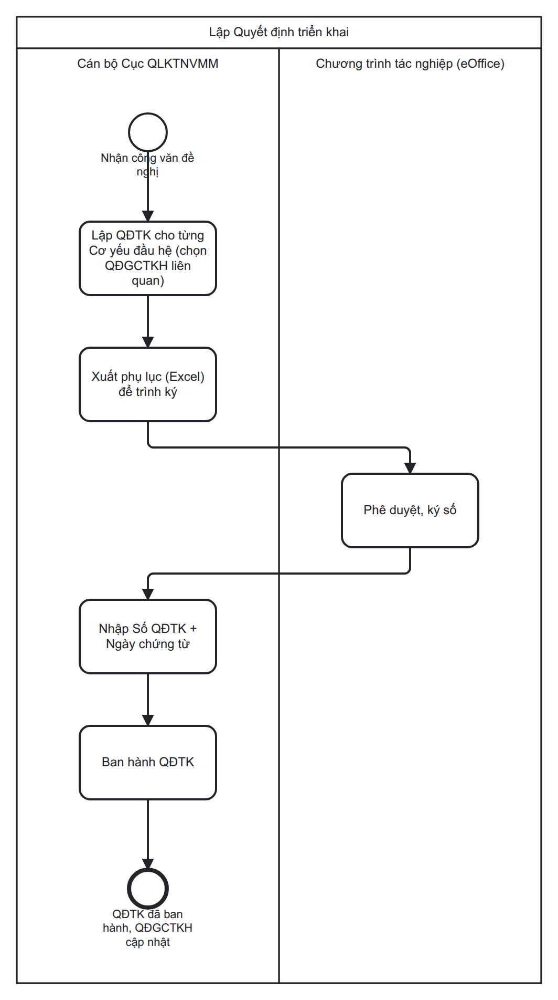

# SRS: Quyết định triển khai (QĐTK)

## 1. Phạm vi

Cục QLKTNVMM lập một **Quyết định triển khai (QĐTK)** để ghi nhận các thay đổi phát sinh **sau khi QĐGCTKH năm/đột xuất đã ban hành** — khi thực tế triển khai khác kế hoạch (đổi số lượng/địa điểm triển khai, hoặc cần xin cấp thêm từ kho dự phòng).

**Ngoài phạm vi:**

| Việc | Ở đâu |
|---|---|
| Lập công văn, trình ký, ký số, phê duyệt pháp lý | **eOffice** — bất biến I6 |
| Ghi nhận "Số lượng đã cấp" (điều chuyển thực tế SPMM giữa các đơn vị cơ yếu) — QĐTK chỉ ĐỌC giá trị này, không ghi/sửa | `dieu-chuyen-spmm` — xem công thức tính tại Mục 7.4 |
| Quản lý danh mục Đơn vị (tên, cấp/loại đơn vị, quan hệ trên-dưới) | Chưa có tài liệu (chức năng khác của hệ thống, chỉ đọc) |

## 2. Quy trình nghiệp vụ

### 2.1 Luồng chuẩn



**Swimlane BPMN 2.0:** [quyet-dinh-trien-khai-bpmn-editor.html](bpmn/quyet-dinh-trien-khai-bpmn-editor.html) · [tao-quyet-dinh-trien-khai.bpmn](bpmn/tao-quyet-dinh-trien-khai.bpmn) · [quyet-dinh-trien-khai-bpmn.png](bpmn/quyet-dinh-trien-khai-bpmn.png)

### 2.2 Các bước

| # | Ai làm | Việc | Trạng thái sau bước |
|---|---|---|---|
| 1 | *Ngoài phần mềm* | Cán bộ Cục QLKTNVMM nhận công văn đề nghị xin thay đổi SL/địa điểm hoặc xin cấp từ dự phòng từ đơn vị cơ yếu đầu hệ | — |
| 2 | Cán bộ Cục QLKTNVMM | Lập QĐTK cho từng cơ yếu đầu hệ **trên hệ thống**: nhập Đơn vị đề nghị, Năm áp dụng, chọn 1 QĐGCTKH liên quan đã ban hành đúng năm đó, nhập danh sách SPMM cần điều chỉnh; xuất **file phụ lục (Excel)** từ bảng Thông tin chi tiết | Mới |
| 3 | Cán bộ Cục QLKTNVMM | Lập công văn đề nghị trên eOffice (đính kèm phụ lục vừa xuất), trình ký nội bộ — *ngoài phần mềm*; công văn được phê duyệt + ký số | Mới *(không đổi)* |
| 4 | Cán bộ Cục QLKTNVMM | Vào QĐTK đã lập, nhập Số quyết định triển khai + Ngày chứng từ, đính kèm công văn đã ký số, bấm **Ban hành** — hệ thống cập nhật QĐGCTKH liên quan (Mục 7) | **Đã ban hành** |

## 3. Phân quyền

### 3.1 Vai trò & phân quyền

| Hành động | Cán bộ Cục QLKTNVMM |
|---|:--:|
| Xem Danh sách QĐTK | ✔ |
| Tạo QĐTK mới | ✔ |
| Sửa QĐTK | ✔ |
| Xoá QĐTK | ✔ |
| Nhập bảng chi tiết (3 lối: 1 dòng / hàng loạt / Excel) | ✔ |
| Xuất phụ lục (Excel) | ✔ |
| Bấm **Lưu nháp** | ✔ |
| Bấm **Ban hành** (nhập Số quyết định triển khai/Ngày chứng từ, đính kèm công văn đã ký số) | ✔ |
| Xem chi tiết QĐTK đã *Đã ban hành* (chỉ đọc) | ✔ |

`✔` được làm.

⚠️ RBAC chi tiết (danh sách quyền/role code cụ thể) **chưa liệt kê được** ở tài liệu này.

### 3.2 Phân quyền theo dữ liệu

| # | Luật |
|---|---|
| 1 | Quyền vào chức năng QĐTK (xem/lập/sửa/xoá/ban hành) kiểm soát theo **RBAC chung của QLSPMM** (`libUserRoleAuthorize`, `design.md` Mục 8.7) — feature này **không đặt hệ phân quyền riêng**, chỉ khai báo đúng nhóm quyền cần cho từng nút/khối. |
| 2 | Người dùng không đủ quyền cho 1 thao tác → nút/khối thao tác đó **ẩn hẳn khỏi giao diện**, **không** hiển thị dạng làm mờ (disabled) — vẽ wireframe theo vai trò phải bỏ hẳn nút ra khỏi khung. |
| 3 | Đơn vị có **Đơn vị = Đơn vị đề nghị** của 1 QĐTK được **xem (chỉ đọc)** bản ghi QĐTK đó trên Danh sách QĐTK, kể cả khi không phải Cán bộ Cục QLKTNVMM đã lập ra bản ghi — không được Sửa/Xoá/Ban hành. |

## 4. Vòng đời trạng thái QĐTK

| Trạng thái | Ý nghĩa nghiệp vụ |
|---|---|
| **Mới** | Đang soạn (kể cả sau khi Lưu nháp nhiều lần). Chờ công văn được ký số ở eOffice rồi mới Ban hành |
| **Đã ban hành** | Đã bấm Ban hành. QĐGCTKH liên quan đã được cập nhật. **Trạng thái cuối** |

| Từ | Sự kiện | Sang | Điều kiện | Hệ quả |
|---|---|---|---|---|
| — | Bấm *Tạo QĐTK mới* | **Mới** | — | Số phiếu tự sinh ngay khi mở màn trắng |
| Mới | Bấm *Lưu nháp* | **Mới** *(không đổi)* | **Chỉ bắt buộc Đơn vị đề nghị + Năm áp dụng** (BR-quyet-dinh-trien-khai-020) — cho phép Lưu nháp khi chưa chọn QĐGCTKH liên quan, chưa nhập Số quyết định triển khai/Ngày chứng từ, và bảng Thông tin chi tiết chưa có dòng nào | Ghi lại đúng dữ liệu hiện có |
| Mới | Bấm *Ban hành* | **Đã ban hành** | Đủ Đơn vị đề nghị + QĐGCTKH liên quan + ≥1 dòng điều chỉnh hợp lệ + Số QĐ triển khai + Ngày chứng từ (thiếu → E-quyet-dinh-trien-khai-001/002/003; trùng → E-quyet-dinh-trien-khai-004). Không còn dòng nào trùng hoàn toàn SPMM + Địa điểm + Loại điều chỉnh (BR-quyet-dinh-trien-khai-021 → E-quyet-dinh-trien-khai-015). Số lượng cấp đủ, không gây âm kho — kiểm ngay tại thời điểm bấm Ban hành trên dữ liệu hiện hành đã khoá trong transaction, KHÔNG dùng snapshot để tính (BR-quyet-dinh-trien-khai-010/BR-quyet-dinh-trien-khai-011/BR-quyet-dinh-trien-khai-013; không đủ → E-quyet-dinh-trien-khai-006/E-quyet-dinh-trien-khai-009). QĐTK chưa bị xử lý trước đó (chống double-submit, BR-quyet-dinh-trien-khai-012 → E-quyet-dinh-trien-khai-008) | Tính delta, ghi Chi tiết thay đổi + Phiên bản mới vào QĐGCTKH (Mục 7), rồi quay thẳng về Danh sách QĐTK |

## 5. Màn hình

### 5.1 Danh sách QĐTK

**Slug:** `danh-sach-quyet-dinh-trien-khai` · **Bước trong quy trình:** 1 (điểm vào), 6 (mở lại xem)

**Preview:** [prototype.html#scr-ds](html-design/quyet-dinh-trien-khai-prototype.html#scr-ds)

| # | Tên | Loại control | Bắt buộc | Rule / validate | Hành vi khi bấm | Lỗi |
|---|---|---|:--:|---|---|---|
| — | Cột hiển thị | Dropdown (multiSelect) | — | `maxSelectedLabels: 0` — luôn hiện dạng đếm ("11 cột được chọn"), không liệt kê tên cột | Bật/tắt cột trên lưới | — |
| — | Nút "+ Tạo QĐTK mới" | Button | — | Luôn bật | **Navigate** sang màn Tạo QĐTK, trạng thái khởi tạo *Mới*, Số phiếu tự sinh ngay | — |
| — | Nút làm mới | Button (icon) | — | Không xoá bộ lọc | Tải lại bảng theo bộ lọc hiện tại | — |
| 1 | STT | Label | — | Căn giữa, đánh số theo trang | — | — |
| 2 | Số phiếu | Link | — | Mã hệ thống tự sinh ngay khi tạo (kể cả *Mới*) | Click → *Mới* mở Tạo QĐTK chế độ sửa · *Đã ban hành* mở xem chi tiết chỉ đọc | — |
| 3 | Số quyết định triển khai | Label | — | **Không bắt buộc** khi tạo hoặc Lưu nháp; **bắt buộc** khi Ban hành. Chỉ sửa được khi QĐTK ở *Mới* — khoá hoàn toàn (chỉ đọc) khi *Đã ban hành* (BR-quyet-dinh-trien-khai-017, xem 5.2 mục 2) | — | — |
| 4 | Trạng thái | Tag (màu) | — | 2 giá trị *Mới / Đã ban hành*, tô theo `COMMON_STATUS_COLOR` (`design.md` Mục 3.5): Mới=lam #059bb4, Đã ban hành=lục #1da750 | Lọc theo trạng thái ở hàng lọc | — |
| 5 | Ngày chứng từ | Label | — | Mặc định = ngày hiện tại lúc tạo. Chỉ sửa được khi QĐTK ở *Mới* — cùng quy tắc với Số quyết định triển khai (BR-quyet-dinh-trien-khai-017) | — | — |
| 6 | Số QĐGCTKH | Link | — | — | **Navigate** sang chức năng QĐGCTKH (traceability, FR-quyet-dinh-trien-khai-012) | — |
| 7 | Đơn vị đề nghị | Label | — | khớp field "Đơn vị đề nghị" ở màn Tạo QĐTK | — | — |
| — | Đơn vị tạo · Người tạo · Thời gian tạo | Label | — | Hiện khi cuộn ngang bảng | — | — |
| — | Hàng lọc (dưới header cột) | Textbox / Dropdown / Calendar theo cột | — | **Không có ô Tìm kiếm rời, không nút Tìm/Xoá lọc** — lọc ngay tại từng cột (`design.md` Mục 9.2) | Lọc tại chỗ | Không ra QĐTK nào → thân bảng rỗng, không chặn |
| — | Thao tác | Button (icon) | — | **Sửa** (bút chì, chỉ khi *Mới*) · **Xoá** (thùng rác đỏ, chỉ khi *Mới*, FR-quyet-dinh-trien-khai-014 — **xoá mềm**, xem Mục 6) · làm mới. Ẩn hẳn nút theo quyền, không vẽ nút xám (`design.md` Mục 8.7) | Xoá → hộp thoại xác nhận (nội dung xem FR-quyet-dinh-trien-khai-014, Mục 6), xác nhận → **ẩn khỏi Danh sách QĐTK** (dữ liệu vẫn giữ trong hệ thống, ghi Người xoá + Thời gian xoá) | — |
| — | Empty state | Label | — | Hiện khi chưa có QĐTK nào khớp bộ lọc | — | — |

---

### 5.2 Tạo QĐTK — Mục I. Thông tin chung

**Slug:** `tao-quyet-dinh-trien-khai` · **Bước:** 2, 4

**Preview:** [prototype.html#scr-lap](html-design/quyet-dinh-trien-khai-prototype.html#scr-lap)

| # | Tên | Loại control | Bắt buộc | Rule / validate | Hành vi khi bấm | Lỗi |
|---|---|---|:--:|---|---|---|
| — | Nút Hủy bỏ | Button | — | Nếu dữ liệu trên màn đã thay đổi so với lần Lưu nháp/mở màn gần nhất (BR-quyet-dinh-trien-khai-018) → hiện hộp thoại xác nhận "Bỏ thay đổi chưa lưu?" trước khi rời màn; không có thay đổi → rời ngay | Quay về Danh sách QĐTK, không lưu | — |
| — | Nút Lưu nháp | Button | — | **Chỉ bắt buộc Đơn vị đề nghị + Năm áp dụng** (BR-quyet-dinh-trien-khai-020) — cho phép Lưu nháp khi chưa chọn QĐGCTKH liên quan, chưa nhập Số quyết định triển khai/Ngày chứng từ, và bảng Thông tin chi tiết còn rỗng. Khoá nút + hiện đang xử lý ngay khi bấm, chống bấm 2 lần (BR-quyet-dinh-trien-khai-016) | Ghi lại đúng dữ liệu hiện có, trạng thái *Mới* giữ nguyên | Ghi thất bại → giữ nguyên dữ liệu trên màn, thử lại được |
| — | Nút Ban hành | Button | — | Đủ Đơn vị đề nghị + QĐGCTKH liên quan + ≥1 dòng điều chỉnh hợp lệ + **Số quyết định triển khai + Ngày chứng từ** (bắt buộc từ bước này, kèm check trùng). Không còn dòng nào trùng hoàn toàn SPMM + Địa điểm + Loại điều chỉnh (BR-quyet-dinh-trien-khai-021). Khoá nút + hiện đang xử lý ngay khi bấm | Trạng thái → **Đã ban hành**, tính delta + cập nhật QĐGCTKH (Mục 7), quay về Danh sách QĐTK | Thiếu QĐGCTKH liên quan → E-quyet-dinh-trien-khai-001 · Bảng rỗng → E-quyet-dinh-trien-khai-002 · Thiếu Số QĐ triển khai/Ngày chứng từ → E-quyet-dinh-trien-khai-003 · Số QĐ triển khai trùng → E-quyet-dinh-trien-khai-004 · Có dòng trùng hoàn toàn → E-quyet-dinh-trien-khai-015 |
| 1 | Số phiếu | Label readonly | — | Tự sinh ngay lúc tạo, chỉ đọc suốt đời | — | — |
| 2 | Số quyết định triển khai | Textbox | *(khi Ban hành)* | **Bắt buộc phải nhập trước khi Ban hành** (thiếu → E-quyet-dinh-trien-khai-003). **Sửa được khi QĐTK ở Mới** — khoá hoàn toàn (chỉ đọc) khi *Đã ban hành* (BR-quyet-dinh-trien-khai-017). **Không được trùng với BẤT KỲ QĐTK nào khác trong TOÀN HỆ THỐNG** — kể cả QĐTK đang ở trạng thái *Mới* đã lưu Số quyết định triển khai (không chỉ riêng QĐTK *Đã ban hành*); so sánh không phân biệt hoa/thường, tự chuẩn hoá bằng trim khoảng trắng; kiểm tra **ngay khi nhập**, kể cả lúc Lưu nháp và **bắt buộc lúc Ban hành** (BR-quyet-dinh-trien-khai-007) | — | Trùng → E-quyet-dinh-trien-khai-004 |
| 3 | Ngày chứng từ | DatePicker | *(khi Ban hành)* | Mặc định = hôm nay. **Bắt buộc phải có giá trị trước khi Ban hành** (thiếu → E-quyet-dinh-trien-khai-003). **Sửa được khi QĐTK ở Mới** — khoá hoàn toàn khi *Đã ban hành* (BR-quyet-dinh-trien-khai-017) | — | — |
| 4 | Đơn vị đề nghị | Dropdown | ✔ | Danh sách hiển thị bao gồm: đơn vị của người dùng đang đăng nhập (người tạo) và tất cả các đơn vị con trực thuộc đơn vị đó. Mặc định = đơn vị người tạo. Sửa được khi *Mới* (BR-quyet-dinh-trien-khai-017) | — | — |
| 5 | Đơn vị tạo | Label (disabled) | — | Mặc định = đơn vị của người đăng nhập, không sửa được | — | — |
| 6 | Năm áp dụng | Dropdown | ✔ | Mặc định = năm hiện tại, sửa được. **Đổi giá trị này → clear QĐGCTKH liên quan + clear toàn bộ bảng Mục II** (BR-quyet-dinh-trien-khai-009) | Đổi giá trị → xoá QĐGCTKH liên quan + xoá bảng chi tiết, bắt buộc chọn/nhập lại | — |
| 7 | QĐGCTKH liên quan | Dropdown (1 giá trị) → Link | *(khi Ban hành)* | **Không bắt buộc lúc Lưu nháp** (BR-quyet-dinh-trien-khai-020) — **bắt buộc khi Ban hành** (thiếu → E-quyet-dinh-trien-khai-001). Chỉ chọn được **1** QĐGCTKH, và **CHỈ trong đúng Năm áp dụng đã chọn** (BR-quyet-dinh-trien-khai-008). Khi *Đã ban hành* → đổi thành **link**, không sửa được nữa | Click (khi đã khoá) → mở QĐGCTKH gốc | — |
| 8 | Người tạo | Label readonly | — | Hiện cả tên đăng nhập và tên hiển thị (vd `nva01 — Nguyễn Văn A`) | — | — |
| 9 | Thời gian tạo | Label readonly | — | Timestamp tạo bản ghi | — | — |
| 10 | Mô tả | Textarea | — | Tùy chọn | — | — |
| — | Tài liệu đính kèm | Button + Badge | — | Thành phần dùng chung, badge đếm số tệp | Mở hộp thoại danh sách tệp | — |

---

### 5.3 Tạo QĐTK — Mục II. Thông tin chi tiết, cách xem *Nhóm theo SPMM* (mặc định)

**Slug:** `tao-quyet-dinh-trien-khai` · **Bước:** 3

**Preview:** [prototype.html#scr-lap](html-design/quyet-dinh-trien-khai-prototype.html#scr-lap) · **Mẫu phụ lục xuất:** [Phu_luc_QDTK_mau.xlsx](srs/Phu_luc_QDTK_mau.xlsx)

| # | Tên | Loại control | Bắt buộc | Rule / validate | Hành vi khi bấm | Lỗi |
|---|---|---|:--:|---|---|---|
| — | Nút "+ Thêm 1 dòng" | Button (chân bảng) | — | Thêm 1 dòng trống trực tiếp vào bảng chính | Sinh 1 dòng "chưa hoàn tất" ở cuối bảng, sẵn sàng chọn SPMM/Địa điểm/Loại điều chỉnh/Số lượng điều chỉnh tại chỗ (xem 5.5) | — |
| — | Nút "Xuất phụ lục (Excel)" | Button | — | Xuất dữ liệu điều chỉnh theo đúng biểu mẫu [Phu_luc_QDTK_mau.xlsx](srs/Phu_luc_QDTK_mau.xlsx) ra file tải về máy — FR-quyet-dinh-trien-khai-018, bước 2 userflow. File gồm khối tiêu đề (Đơn vị đề nghị, Năm áp dụng, QĐGCTKH liên quan, Số phiếu QĐTK) + bảng chi tiết cột STT/Mã SPMM/Tên SPMM/Địa điểm triển khai/ĐVT/Số lượng cấp/Loại điều chỉnh/Số lượng điều chỉnh/Số lượng cấp (mới)/Ghi chú mục đích. **Luôn xuất phẳng** — mỗi dòng điều chỉnh đã hoàn tất = đúng 1 dòng Excel, **không xuất dòng nhóm/tổng theo SPMM** dù đang xem ở chế độ Nhóm theo SPMM | Tải file .xlsx theo biểu mẫu về máy, dùng để đính kèm công văn đề nghị trên Chương trình tác nghiệp | Chưa có dòng nào → thông báo "Chưa có danh mục điều chỉnh để xuất phụ lục" |
| — | Nút "Nhập hàng loạt" | Button | — | Chọn nhiều SPMM × nhiều Địa điểm triển khai cùng lúc qua hộp thoại | Mở hộp thoại 5.6 | — |
| — | Nút "Nhập Excel" | Button | — | Import từ file `.xlsx` | Mở hộp thoại 5.7 | — |
| — | Xem theo | Dropdown | ✔ | 2 lựa chọn: *Nhóm theo SPMM* (mặc định, gập hết) / *Trải phẳng*. Đặt đầu bên trái hàng công cụ (`design.md` Mục 9.3) | Đổi cách xem **không mất dữ liệu đang có, không mất dòng đang chọn** | — |
| — | Hàng lọc (SPMM / Địa điểm triển khai / Loại điều chỉnh) | `.fpick` multiselect (SPMM, Địa điểm) + Dropdown đơn (Loại điều chỉnh) | — | Lọc sống ngay dưới header cột, không cần nút Tìm/Xoá lọc riêng | Lọc tại chỗ, không mất dữ liệu | — |
| — | Dòng nhóm (SPMM) | Table row | — | Mang STT · Mã · Tên SPMM · ĐVT · **Σ Số lượng cấp** · **NET có dấu** (Σ tăng − Σ giảm; **đỏ, đậm nếu ≠ 0** — cảnh báo mềm mất cân đối, xem BR-quyet-dinh-trien-khai-015) · **Σ Số lượng cấp (mới)**. Không có ô nhập ở dòng nhóm. Nền TRẮNG đồng nhất (`design.md` Mục 9.3 điểm 3b) | Tích dòng nhóm = chọn cả cụm con bên dưới. Bấm mũi tên gập/mở | — |
| — | Dòng con (trong 1 nhóm SPMM) | Table row | — | Địa điểm triển khai · ĐVT · Số lượng cấp · Loại điều chỉnh · **Số lượng điều chỉnh (ô nhập luôn sửa được)** · Số lượng cấp (mới, readonly) · Ghi chú mục đích (ô nhập) | Sửa Số lượng điều chỉnh → Số lượng cấp (mới) + tổng dòng nhóm tự tính lại ngay, giữ nguyên caret đang gõ | Giảm khiến Số lượng cấp (mới) < Số lượng đã cấp → cảnh báo đỏ tại dòng, xem E-quyet-dinh-trien-khai-009 |
| — | Checkbox chọn dòng + "Xoá dòng đã chọn" | Checkbox / Button | — | Tick 1 hoặc nhiều dòng | Hiện thanh công cụ chọn: Điền số hàng loạt / Xoá dòng đã chọn | — |
| — | Xoá 1 dòng | Icon button (thùng rác đỏ) | — | Chỉ khi QĐTK ở *Mới* | Xoá đúng 1 dòng — **độc lập, KHÔNG kéo theo dòng nào khác** — FR-quyet-dinh-trien-khai-009 | — |

---

### 5.4 Tạo QĐTK — Mục II. Thông tin chi tiết, cách xem *Trải phẳng*

**Slug:** `tao-quyet-dinh-trien-khai` · **Bước:** 3

**Preview:** [prototype.html#scr-lap](html-design/quyet-dinh-trien-khai-prototype.html#scr-lap)

| # | Tên | Loại control | Bắt buộc | Rule / validate | Hành vi khi bấm | Lỗi |
|---|---|---|:--:|---|---|---|
| — | Xem theo — *Trải phẳng* | Dropdown | ✔ | Mỗi dòng = 1 dòng điều chỉnh, đứng độc lập — không nhóm, không mũi tên gập, có STT liên tục | Đổi cách xem không mất gì | — |
| — | Cột SPMM (mã-tên, cắt `…` nếu dài, hover xem đủ) · Địa điểm triển khai · ĐVT · Số lượng cấp · Loại điều chỉnh · Số lượng điều chỉnh (ô nhập) · Số lượng cấp (mới, readonly) · Ghi chú mục đích (ô nhập) | Table cell | — | Mọi cột sắp xếp/lọc tự do. Cột số căn phải (`.num`) | Sửa *Số lượng điều chỉnh* và *Ghi chú mục đích* thẳng trong ô bảng | như 5.3 |

---

### 5.5 Thêm dòng inline "+ Thêm 1 dòng"

**Slug:** `tao-quyet-dinh-trien-khai` · **Bước:** 3

**Preview:** [prototype.html#scr-lap](html-design/quyet-dinh-trien-khai-prototype.html#scr-lap)

| # | Tên | Loại control | Bắt buộc | Rule / validate | Hành vi khi bấm | Lỗi |
|---|---|---|:--:|---|---|---|
| — | SPMM (dòng mới) | Dropdown | ✔ | Chọn 1 trong danh mục SPMM đang có trên QĐGCTKH liên quan → tự hiện ĐVT, reset Địa điểm/Số lượng cấp | Đổi SPMM → clear Địa điểm đã chọn (nếu có) | — |
| — | Địa điểm triển khai (dòng mới) | Dropdown | ✔ | **Chỉ liệt kê địa điểm mà SPMM đó ĐÃ CÓ trên QĐGCTKH liên quan** — KHÔNG cho địa điểm mới, KHÔNG nhập tự do (muốn địa điểm mới → dùng "Nhập hàng loạt", xem 5.6 + BR-quyet-dinh-trien-khai-015b). Disabled cho tới khi đã chọn SPMM | Chọn → tự hiện Số lượng cấp hiện hành | — |
| — | Loại điều chỉnh | Dropdown | ✔ | 2 giá trị *Điều chỉnh tăng* / *Điều chỉnh giảm* — **không tự fill, bắt buộc người dùng chọn** | — | Thiếu khi cố lưu → dòng ở nhóm "chưa hoàn tất" |
| — | Số lượng điều chỉnh | Textbox (number) | ✔ | Số nguyên dương (BR-quyet-dinh-trien-khai-002); nếu Loại điều chỉnh = giảm thì Số lượng cấp (mới) không được âm và không thấp hơn Số lượng đã cấp (BR-quyet-dinh-trien-khai-003/BR-quyet-dinh-trien-khai-014) | Nhập → Số lượng cấp (mới) tự tính ngay tại chỗ, kèm cảnh báo inline nếu vi phạm | Vi phạm → cảnh báo đỏ ngay dưới ô, chưa chặn cứng cho tới khi rời màn/Ban hành |
| — | Ghi chú mục đích | Textbox | — | Tuỳ chọn, không tự động điền | — | — |
| — | Icon xoá dòng | Icon button | — | Chỉ ở *Mới* | Xoá đúng dòng đó | — |

---

### 5.6 Hộp thoại "Nhập hàng loạt"

**Slug:** `nhap-hang-loat` · **Bước:** 3 · Cơ chế: **chọn nhiều SPMM × nhiều Địa điểm triển khai, nhập lưới**

**Preview:** [prototype.html#modalBulk](html-design/quyet-dinh-trien-khai-prototype.html#modalBulk)

| # | Tên | Loại control | Bắt buộc | Rule / validate | Hành vi khi bấm | Lỗi |
|---|---|---|:--:|---|---|---|
| 1 | Chọn SPMM | Checkbox multiselect (`.mpick`, tìm được) | ✔ *(≥1)* | Danh mục SPMM đang có trên QĐGCTKH liên quan | Mỗi lần đổi → tính lại lưới bước 3 | — |
| 2 | Chọn Địa điểm triển khai | Checkbox multiselect (`.mpick`, tìm được) | ✔ *(≥1)* | Mặc định chỉ liệt kê địa điểm ĐANG có trên QĐGCTKH. Tick **"Thêm địa điểm mới"** → đổi nguồn sang **toàn bộ danh mục Đơn vị** (BR-quyet-dinh-trien-khai-015b) | — | — |
| 3 | Lưới kết quả (N dòng) | Table, mỗi dòng: checkbox · STT · SPMM · Địa điểm · Số lượng cấp · **Loại điều chỉnh (bắt buộc/dòng)** · **Số lượng điều chỉnh (bắt buộc/dòng)** · Số lượng cấp (mới, readonly) · icon xoá | ✔ | = tích Descartes SPMM×Địa điểm đã chọn, **loại trừ tổ hợp đã có sẵn trong bảng chính** (ẩn hẳn, không hiện mờ). Có thanh công cụ điền hàng loạt (chọn nhiều dòng → set chung Loại điều chỉnh/Số lượng điều chỉnh). **Dòng ứng với địa điểm mới hoàn toàn** (chưa có trong QĐGCTKH liên quan, chỉ sinh khi tick "Thêm địa điểm mới") → dropdown Loại điều chỉnh **chỉ cho chọn Tăng** (ẩn/khoá lựa chọn Giảm, BR-quyet-dinh-trien-khai-015b) | Sửa từng ô trong lưới trước khi Xác nhận | Chọn Giảm cho địa điểm mới → E-quyet-dinh-trien-khai-014 |
| — | Nút Xác nhận | Button | — | Validate **mọi dòng đã chạm** (có nhập Loại điều chỉnh hoặc Số lượng điều chỉnh): đủ 2 trường + Số lượng điều chỉnh > 0 + không âm/không dưới Số lượng đã cấp + **địa điểm mới không được chọn Giảm** (BR-quyet-dinh-trien-khai-015b). **Vi phạm → tô đỏ TẤT CẢ dòng lỗi cùng lúc**, banner liệt kê tối đa 3 lỗi kèm STT + "... và N dòng khác", **không đưa dòng hợp lệ nào vào bảng chính cho tới khi hết lỗi** (all-or-nothing, xem E-quyet-dinh-trien-khai-005) | Đủ điều kiện → đẩy toàn bộ dòng đã chạm vào bảng chính, đóng hộp thoại, dòng mới được tick sẵn (highlight) | E-quyet-dinh-trien-khai-005 · E-quyet-dinh-trien-khai-014 |
| — | Nút Hủy | Button | — | — | Đóng, không sinh dòng nào | — |

---

### 5.7 Hộp thoại "Nhập Excel"

**Slug:** `nhap-excel` · **Bước:** 3

**Preview:** [prototype.html#modalExcel](html-design/quyet-dinh-trien-khai-prototype.html#modalExcel)

Chờ update.

---

## 6. Yêu cầu chức năng

| ID | Yêu cầu | Cách kiểm |
|---|---|---|
| `FR-quyet-dinh-trien-khai-009` | **Xoá 1 dòng điều chỉnh** trong bảng Thông tin chi tiết — mỗi dòng độc lập, xoá 1 dòng KHÔNG kéo theo dòng nào khác | Xoá 1 dòng bất kỳ → chỉ đúng dòng đó biến mất, các dòng còn lại (kể cả cùng SPMM) giữ nguyên |
| `FR-quyet-dinh-trien-khai-011` | **Ban hành QĐTK** — với mỗi dòng điều chỉnh, tính delta có dấu theo Loại điều chỉnh (tăng → +Số lượng điều chỉnh, giảm → −Số lượng điều chỉnh) rồi gửi sang QĐGCTKH để ghi vào Chi tiết thay đổi (ledger) + gộp thành 1 Phiên bản mới. Số lượng cấp (hiện hành) tại QĐGCTKH được tính lại = Số lượng cấp gốc + Σ delta của mọi Chi tiết thay đổi liên quan (công thức Mục 7.2) — thuộc phạm vi tài liệu này | Ban hành 1 QĐTK có N dòng → QĐGCTKH nhận đúng N giá trị delta có dấu đúng theo Loại điều chỉnh, sinh N dòng Chi tiết thay đổi + 1 dòng Phiên bản mới, Số lượng cấp tính lại đúng công thức cộng dồn |
| `FR-quyet-dinh-trien-khai-012` | **Traceability 2 chiều QĐTK ↔ QĐGCTKH** — từ QĐTK nhảy sang QĐGCTKH liên quan và ngược lại | Click link cả 2 chiều đều tới đúng bản ghi |
| `FR-quyet-dinh-trien-khai-018` | Xuất phụ lục (Excel) — xuất đúng biểu mẫu [Phu_luc_QDTK_mau.xlsx](srs/Phu_luc_QDTK_mau.xlsx), luôn dạng phẳng (1 dòng điều chỉnh = 1 dòng Excel, không xuất dòng nhóm/tổng), dùng đính kèm công văn eOffice (xem 5.3) | Xuất → file đúng số dòng đã hoàn tất (không có dòng nhóm/tổng), đúng cột theo mẫu |
| `FR-quyet-dinh-trien-khai-016` | Xác nhận khi Huỷ bỏ có thay đổi chưa lưu (áp cho màn Tạo QĐTK, xem 5.2) | Sửa dữ liệu rồi bấm Huỷ bỏ → hiện hộp thoại xác nhận; không sửa gì → rời ngay không hỏi |
| `FR-quyet-dinh-trien-khai-017` | Chống thao tác trùng trên MỌI nút hành động (Lưu nháp/Ban hành/Xác nhận 2 hộp thoại nhập hàng loạt & Excel) — khoá + hiện đang xử lý ngay khi bấm, mở lại khi xong | Bấm liên tiếp 2 lần → chỉ 1 lượt xử lý được ghi nhận |
| `FR-quyet-dinh-trien-khai-019` | **Đánh dấu + truy vết lệch Số lượng cấp tại QĐGCTKH** — khi Số lượng cấp hiện hành của 1 dòng QĐGCTKH khác Số lượng cấp gốc, đánh dấu nổi bật (tô đỏ) dòng đó; bấm vào → mở bảng Chi tiết thay đổi, lọc sẵn đúng Mã SPMM + Địa điểm triển khai (xem Mục 7.3) | Cho 1 dòng QĐGCTKH có Số lượng cấp hiện hành ≠ Số lượng cấp gốc, khi mở màn thì dòng đó tô đỏ; bấm vào → chuyển đúng bảng Chi tiết thay đổi, bộ lọc tự set đúng SPMM + Địa điểm, hiển thị đúng (các) dòng ledger liên quan |
| `FR-quyet-dinh-trien-khai-014` | **Xoá QĐTK (Mới) — xoá mềm** — chỉ khi QĐTK ở trạng thái *Mới*; bấm Xoá hiện hộp thoại xác nhận nội dung: *"Xóa quyết định. Số phiếu {Số phiếu}. Số quyết định triển khai {Số quyết định triển khai}. Sau khi xóa, quyết định không khôi phục được, vui lòng xác nhận."*; xác nhận → **ẩn khỏi Danh sách QĐTK** (bản ghi vẫn giữ trong hệ thống, không xoá vật lý), ghi nhận **Người xoá** + **Thời gian xoá** (BR-quyet-dinh-trien-khai-022) | Bấm Xoá ở dòng *Mới* → hộp thoại đúng nội dung trên; xác nhận → bản ghi biến mất khỏi Danh sách nhưng vẫn tồn tại trong hệ thống, kèm đúng Người xoá + Thời gian xoá |

## 7. Ban hành quyết định triển khai cập nhật QĐGCTKH

### 7.1 Cơ chế nghiệp vụ

| Vế nghiệp vụ gốc | Cách ghi |
|---|---|
| Đổi SL/địa điểm triển khai | 1 dòng điều chỉnh giảm tại địa điểm cũ + 1 dòng điều chỉnh tăng tại địa điểm mới |
| Xin cấp từ dự phòng | 1 dòng tăng tại địa điểm cần cấp, ghi Địa điểm triển khai = "Dự phòng Cục"/"Dự phòng Cơ yếu" ở dòng giảm đối ứng |
| Đổi hẳn địa điểm (giữ nguyên SL) | 1 dòng giảm hết tại địa điểm cũ + 1 dòng tăng đúng số đó tại địa điểm mới |

**Cân đối net theo SPMM** (Σ tăng so Σ giảm trong cùng 1 SPMM của 1 QĐTK) là **cảnh báo mềm** hiển thị ở dòng nhóm (5.3) + popup xác nhận lúc Ban hành nếu lệch (BR-quyet-dinh-trien-khai-015).

### 7.2 Công thức tính (không ghi đè, tính qua cộng dồn)

```
delta (mỗi dòng) = + Số lượng điều chỉnh   nếu Loại điều chỉnh = tăng
                  = − Số lượng điều chỉnh   nếu Loại điều chỉnh = giảm

Validate theo TỪNG SPMM × Địa điểm triển khai — cộng dồn TẤT CẢ dòng cùng QĐTK tác động lên
đúng tổ hợp đó rồi mới kiểm, KHÔNG kiểm riêng lẻ từng dòng:

  Số lượng cấp (mới) = Số lượng cấp + Σ delta của các dòng cùng SPMM × Địa điểm
                        trong QĐTK này                                          ≥ 0
                        và (nếu tổng là giảm) ≥ Số lượng đã cấp của tổ hợp đó

Số lượng cấp (mỗi dòng QĐGCTKH, tính runtime, qua nhiều QĐTK theo thời gian) = Số lượng cấp gốc
                        + Σ delta của dòng đó trong toàn bộ Chi tiết thay đổi
```

**Snapshot vs dữ liệu hiện hành (BR-quyet-dinh-trien-khai-010):** snapshot chốt lúc lập QĐTK **CHỈ dùng để so sánh/cảnh báo** khi số liệu đã đổi (Mục 8 BR-011/BR-013). Mọi phép tính, điều kiện chặn, và giá trị **Số lượng cấp (trước)/Số lượng cấp (mới)** ghi vào ledger khi Ban hành **PHẢI dùng dữ liệu hiện hành, được khoá trong transaction** tại đúng thời điểm Ban hành — KHÔNG dùng giá trị snapshot để tính hay ghi ledger.

Bảng QĐGCTKH hiển thị 3 cột liên quan: **Mã SPMM — Địa điểm triển khai — Số lượng cấp**.

### 7.3 2 bảng dữ liệu mới tại QĐGCTKH (do QĐTK sinh ra, nhưng thuộc quyền sở hữu của chức năng QĐGCTKH)

| Bảng | Vai trò | Trường chính |
|---|---|---|
| **`QĐGCTKH_ChiTietThayDoi`** (ledger) | 1 dòng = 1 lần 1 dòng QĐGCTKH bị 1 QĐTK tác động | Mã SPMM, Địa điểm triển khai, ĐVT, Loại điều chỉnh (tăng/giảm), Số lượng cấp (trước), Số lượng điều chỉnh (delta có dấu), Số lượng cấp (mới), QĐTK liên quan, Ngày chứng từ (của QĐTK), Người ban hành (người bấm Ban hành trên QĐTK), Ghi chú — đúng field đã dùng ở màn Chi tiết thay đổi (QĐGCTKH). |
| **`QĐGCTKH_PhienBan`** (version) | 1 dòng = 1 lần Ban hành QĐTK, gộp mọi Chi tiết thay đổi sinh ra CÙNG lúc | Số phiên bản (v1 = bản gốc → tăng dần), QĐTK gây ra, mô tả tổng hợp, ngày hiệu lực, người ban hành |

**Preview:** [prototype.html#scr-qdgctkh-sim](html-design/quyet-dinh-trien-khai-prototype.html#scr-qdgctkh-sim) — màn minh hoạ phía QĐGCTKH, dựng trong cùng prototype để thấy rõ hệ quả khi QĐTK Ban hành (không phải màn thuộc feature `quyet-dinh-trien-khai`).

**Cách hiển thị tại màn hình QĐGCTKH (trong phạm vi tài liệu này):** khi Số lượng cấp hiện hành (đã cộng dồn mọi delta) của 1 dòng QĐGCTKH **khác** Số lượng cấp gốc, hệ thống đánh dấu nổi bật (tô đỏ, gạch chân) giá trị đó; bấm vào → điều hướng sang bảng `QĐGCTKH_ChiTietThayDoi`, tự động lọc đúng theo Mã SPMM + Địa điểm triển khai của dòng vừa bấm, để người dùng tra ra đúng (các) QĐTK đã gây ra thay đổi đó (xem `FR-quyet-dinh-trien-khai-019`).

### 7.4 Xử lý case biên

- Dòng điều chỉnh tại địa điểm mới hoàn toàn (chưa có trong QĐGCTKH, chỉ chọn được qua "Nhập hàng loạt" — BR-quyet-dinh-trien-khai-015b) → hệ thống tự sinh 1 dòng QĐGCTKH mới (Số lượng cấp gốc = 0, delta = ±X theo Loại điều chỉnh).
- Số lượng cấp giảm về 0 → **giữ nguyên dòng**, không xoá (tránh mất mắt xích Chi tiết thay đổi).
- "Số lượng đã cấp" **tách biệt hoàn toàn** khỏi cơ chế này — chỉ chức năng Điều chuyển ghi, QĐTK không đụng vào trong bất kỳ trường hợp nào.
  - **Công thức tính "Số lượng đã cấp"** cho 1 dòng SPMM + Đơn vị triển khai trên QĐTK — **hiện trạng hệ thống thật, xác nhận ngày 28/8** (`BR-quyet-dinh-trien-khai-014`/`E-quyet-dinh-trien-khai-009` dùng chính giá trị này để so sánh): (1) xác định QĐGCTKH liên quan đến QĐTK; (2) lấy danh sách Phiếu đề nghị SPMM nằm trong QĐGCTKH đó; (3) tại **Căn cứ điều chuyển SPMM**, chỉ lấy bản ghi thỏa **cả 5 điều kiện**: Loại điều chuyển = "Chuyển kho giữa các đơn vị cơ yếu"; **Trạng thái = Đã duyệt**; Căn cứ = Phiếu đề nghị SPMM (thuộc QĐGCTKH đang xét); SPMM = SPMM của dòng trên QĐTK; Đơn vị nhận = Đơn vị triển khai của dòng trên QĐTK; (4) **Số lượng đã cấp = SUM(Số lượng chuyển)** của các bản ghi thỏa mãn trên.
  - ⚠️ **CẦN CẬP NHẬT SAU KHI `dieu-chuyen-spmm` REBUILD LÊN PRODUCTION** — công thức trên phản ánh đúng hệ thống **hiện đang chạy** (production, ngày 28/8), dùng tên chức năng "Căn cứ điều chuyển SPMM" + điều kiện "Trạng thái = Đã duyệt" (logic phê duyệt cũ). SRS `dieu-chuyen-spmm-srs.md` (đã chốt 2026-08-28, xây mới hoàn toàn — không migrate phiếu lịch sử, không còn trạng thái "Đã duyệt") mô tả hệ thống **SẼ thay thế**: tên chức năng đổi thành **"Điều chuyển SPMM"**, điều kiện lọc đổi thành **"Trạng thái = Đã nhận"** (`FR-dieu-chuyen-spmm-011` loại (3)). Khi `dieu-chuyen-spmm` mới lên production, module tính "Số lượng đã cấp" của QĐTK phải đổi điều kiện lọc theo đúng hệ mới — tránh tính thiếu/sai khi đối chiếu dữ liệu điều chuyển thực tế. Cho tới lúc đó, công thức "Đã duyệt" ở trên vẫn là **nguồn tính đúng** vì hệ thống điều chuyển hiện hành chưa đổi.
- Ghi vào QĐGCTKH lúc Ban hành **thất bại** (timeout, xung đột...) → QĐTK **KHÔNG chuyển Đã ban hành**, giữ nguyên Mới (BR-quyet-dinh-trien-khai-016, E-quyet-dinh-trien-khai-013).
- **Ghi nguyên khối (all-or-nothing)**: N dòng Chi tiết thay đổi + 1 Phiên bản mới của 1 lượt Ban hành phải ghi thành **1 giao dịch duy nhất** ở phía QĐGCTKH — nếu bất kỳ dòng nào ghi lỗi giữa chừng, mọi dòng đã ghi trong lượt đó phải được **rollback hết**, không để QĐGCTKH ở trạng thái ghi một phần (BR-quyet-dinh-trien-khai-016).

## 8. Quy tắc nghiệp vụ & thông báo lỗi

| ID | Quy tắc | Áp ở màn/bước | Khi nào báo | Hiện ở đâu | Nguyên văn (đề xuất) | Chặn? |
|---|---|---|---|---|---|:--:|
| `E-quyet-dinh-trien-khai-001` | QĐGCTKH liên quan là bắt buộc khi Ban hành | 5.2 | Bấm Ban hành khi chưa chọn | Thông báo tại màn | *"Chọn QĐGCTKH liên quan trước khi Ban hành."* | ✔ |
| `E-quyet-dinh-trien-khai-002` | Bảng Thông tin chi tiết không được rỗng (hoặc chỉ toàn dòng chưa hoàn tất) khi Ban hành | 5.3, 5.4 | Bấm Ban hành khi bảng rỗng | Thông báo tại màn | *"Thêm ít nhất 1 dòng điều chỉnh trước khi Ban hành."* | ✔ |
| `E-quyet-dinh-trien-khai-003` | Số quyết định triển khai + Ngày chứng từ **bắt buộc khi Ban hành** (không bắt buộc lúc Tạo/Lưu nháp — sửa được khi *Mới*, khoá hoàn toàn khi *Đã ban hành*, BR-quyet-dinh-trien-khai-017) | 5.2 | Bấm Ban hành khi thiếu 1 trong 2 | Thông báo tại màn Tạo QĐTK | *"Nhập đủ Số quyết định triển khai và Ngày chứng từ."* | ✔ |
| `BR-quyet-dinh-trien-khai-002` | Số lượng điều chỉnh phải là **số nguyên dương** (> 0) ở mọi lối nhập (+ Thêm 1 dòng / Nhập hàng loạt / Nhập Excel) | 5.3–5.7 | Nhập giá trị không hợp lệ | Ngay ô nhập | *"Số lượng điều chỉnh phải là số nguyên dương."* | ✔ |
| `BR-quyet-dinh-trien-khai-003` | Nếu Loại điều chỉnh = giảm, Số lượng cấp (mới) **không được nhỏ hơn 0** (kiểm riêng dòng đó — xem thêm BR-quyet-dinh-trien-khai-014 cho điều kiện so với Số lượng đã cấp) | 5.3–5.7 | Nhập dòng giảm vi phạm | Ngay dòng liên quan | cảnh báo inline mềm lúc nhập; chặn cứng lúc Ban hành theo BR-quyet-dinh-trien-khai-011 | ✔ *(chặn tại Ban hành)* |
| `BR-quyet-dinh-trien-khai-007` / `E-quyet-dinh-trien-khai-004` | Số quyết định triển khai **không được trùng với BẤT KỲ QĐTK nào khác trong TOÀN HỆ THỐNG** — kể cả QĐTK đang ở trạng thái *Mới* đã lưu Số quyết định triển khai (không chỉ riêng QĐTK *Đã ban hành*). So sánh không phân biệt hoa/thường, tự chuẩn hoá bằng trim khoảng trắng. Kiểm **ngay khi nhập**, kể cả lúc Lưu nháp | 5.2 | Nhập giá trị trùng | Ngay ô nhập | *"Số quyết định triển khai này đã được dùng cho QĐTK khác."* | ✔ |
| `E-quyet-dinh-trien-khai-005` | **Nhập hàng loạt**: dòng đã chạm (có nhập Loại điều chỉnh hoặc Số lượng điều chỉnh) nhưng thiếu trường kia, hoặc Số lượng điều chỉnh ≤ 0 | 5.6 | Bấm Xác nhận khi còn dòng lỗi | Tô đỏ TẤT CẢ dòng lỗi + banner chân hộp thoại (tối đa 3 lỗi + STT, "... và N dòng khác") | *"Còn N dòng chưa hợp lệ, kiểm tra lại trước khi xác nhận."* | ✔ *(all-or-nothing, không dòng nào được ghi cho tới khi hết lỗi)* |
| `BR-quyet-dinh-trien-khai-010` | Snapshot Số lượng cấp **chốt đúng 1 lần** tại thời điểm lập QĐTK (không phải mỗi lần Lưu nháp) — **CHỈ dùng để so sánh/cảnh báo** khi số liệu đã đổi kể từ lúc lập, vì khoảng cách thời gian tới lúc Ban hành có thể vài ngày (chờ ký số eOffice). Mọi phép tính, điều kiện chặn, và giá trị Số lượng cấp (trước)/Số lượng cấp (mới) ghi vào ledger khi Ban hành **PHẢI dùng dữ liệu hiện hành, khoá trong transaction** — KHÔNG dùng giá trị snapshot để tính hay ghi ledger (xem Mục 7.2) | 5.2 | Bấm Ban hành | — | — | — |
| `BR-quyet-dinh-trien-khai-011` / `E-quyet-dinh-trien-khai-006` | Khi bấm nút Ban hành, nếu dòng giảm có Số lượng cấp (mới) **< 0 hoặc < Số lượng đã cấp** (Ban hành xong sẽ âm kho hoặc thấp hơn thực giao) → **chặn cứng**, bắt buộc sửa lại trước; trường hợp lệch khác chỉ cảnh báo mềm (`E-quyet-dinh-trien-khai-007`), không chặn | 5.2 | Bấm nút Ban hành | Banner đỏ đầu màn | *"Số liệu đã thay đổi và không còn đủ để ban hành. Sửa lại trước khi Ban hành."* | ✔ |
| `E-quyet-dinh-trien-khai-007` | So snapshot lúc lập với dữ liệu hiện hành lúc Ban hành, có lệch nhưng **KHÔNG dẫn tới âm kho** (khác trường hợp chặn cứng của BR-quyet-dinh-trien-khai-011) | 5.2 | Bấm Ban hành, có lệch nhẹ | Banner vàng đầu màn | *"Số liệu đã thay đổi nhẹ so với lúc lập, vẫn đủ điều kiện Ban hành."* | ✘ *(mềm, không chặn)* |
| `BR-quyet-dinh-trien-khai-012`, `BR-quyet-dinh-trien-khai-016` / `E-quyet-dinh-trien-khai-008` | 1 QĐTK chỉ được xử lý Ban hành **đúng 1 lần** — nút Ban hành khoá ngay khi bấm (chống double-click ở tầng UI); backend kiểm lại **trạng thái hiện hành thật** ngay lúc xử lý — QĐTK đang được xử lý hoặc đã *Đã ban hành* → chặn, **không ghi lặp delta** vào QĐGCTKH | 5.2 | Bấm Ban hành lần 2 hoặc QĐTK đã đổi trạng thái trong lúc xem màn | Thông báo tại màn | *"QĐTK này đã được xử lý, tải lại để xem trạng thái mới nhất."* | ✔ |
| `BR-quyet-dinh-trien-khai-013` | Ngay **tại thời điểm bấm Ban hành**, hệ thống kiểm tra lại Số lượng cấp ở từng dòng — nếu 1 QĐTK khác vừa được ban hành trước làm SL không còn đủ → chặn, không ghi vào QĐGCTKH | 5.2 | Bấm Ban hành | Thông báo tại màn | như `E-quyet-dinh-trien-khai-006` | ✔ |
| `BR-quyet-dinh-trien-khai-014` / `E-quyet-dinh-trien-khai-009` | Số lượng điều chỉnh (Loại điều chỉnh = giảm) không được làm Số lượng cấp (mới) **nhỏ hơn Số lượng đã cấp** hiện tại của chính dòng đó — kế hoạch không được thấp hơn số đã giao thực tế | 5.3–5.7 | Nhập/Ban hành dòng giảm vi phạm | Ngay dòng liên quan | *"Số lượng cấp (mới) thấp hơn số lượng đã triển khai. Giảm số lượng điều chỉnh hoặc đổi địa điểm."* | ✔ |
| `BR-quyet-dinh-trien-khai-015` | Cân đối net (Σ tăng − Σ giảm) theo từng SPMM **nên** bằng 0 — lệch là **cảnh báo mềm** (popup xác nhận lúc Ban hành), không chặn cứng | 5.2 (Ban hành) | Bấm Ban hành khi có SPMM net ≠ 0 | Popup xác nhận | *"Có N SPMM chưa cân đối tăng/giảm — xác nhận vẫn Ban hành?"* | ✘ *(mềm, xác nhận là qua)* |
| `BR-quyet-dinh-trien-khai-015b` / `E-quyet-dinh-trien-khai-014` | Địa điểm mới chỉ chọn được qua **Nhập hàng loạt** (tick "Thêm địa điểm mới") — nguồn là toàn bộ danh mục Đơn vị, **không nhập tự do**. **Các dòng ứng với 1 tổ hợp SPMM × Địa điểm CHƯA tồn tại trong QĐGCTKH chỉ được chọn Loại điều chỉnh = Tăng** — không cho chọn Giảm tại tổ hợp chưa từng có (vì Số lượng cấp gốc = 0, không có gì để giảm). Ban hành xong sinh dòng QĐGCTKH mới với Số lượng cấp gốc = 0 | 5.6, Ban hành | Chọn "Thêm địa điểm mới" rồi chọn Giảm; Ban hành | Hộp thoại Nhập hàng loạt | *"Địa điểm mới chỉ được chọn Điều chỉnh tăng."* | ✔ |
| `BR-quyet-dinh-trien-khai-016` | Mọi nút gây side-effect (Lưu nháp/Ban hành/Xác nhận nhập hàng loạt & Excel) khoá ngay khi bấm + hiện đang xử lý; ghi kết quả thất bại → **không đổi trạng thái**, báo lỗi cho thử lại. Riêng Ban hành: ghi N dòng Chi tiết thay đổi + 1 Phiên bản mới phải là **1 giao dịch nguyên khối** ở phía QĐGCTKH — lỗi giữa chừng thì rollback hết, không để QĐGCTKH ghi một phần | Toàn tính năng | Bấm nút hành động | Nút tự khoá + toast/banner lỗi nếu fail | *"Không lưu được, vui lòng thử lại."* | — |
| `BR-quyet-dinh-trien-khai-017` | Số quyết định triển khai/Ngày chứng từ và **mọi trường sửa được** — sửa được khi *Mới*; chỉ đọc khi *Đã ban hành*. Quy tắc DUY NHẤT, không có ngoại lệ theo field | 5.2 | Mở màn Tạo QĐTK | — | — | — |
| `BR-quyet-dinh-trien-khai-018` | Bấm Huỷ bỏ/điều hướng ra ngoài khi có thay đổi chưa lưu → hộp thoại xác nhận trước khi rời màn | 5.2 (Huỷ bỏ) | Bấm Huỷ bỏ có thay đổi chưa lưu | Hộp thoại xác nhận | *"Bạn có thay đổi chưa lưu. Rời khỏi trang?"* | ✔ *(chặn tới khi xác nhận)* |
| `E-quyet-dinh-trien-khai-010` | File Excel sai biểu mẫu — thiếu/sai tên cột | 5.7 | Đọc file | Hộp thoại kết quả | *"Tệp không đúng biểu mẫu. Tải lại tệp mẫu và điền vào đó."* | ✔ *(chặn cả file)* |
| `E-quyet-dinh-trien-khai-011` | Dòng Excel có Mã SPMM hoặc Địa điểm không tồn tại trong QĐGCTKH liên quan (và không ở chế độ địa điểm mới) | 5.7 | Đọc file | Hộp thoại kết quả (liệt kê từng dòng bị bỏ qua) | Liệt kê theo dòng, kèm lý do | ✘ *(bỏ qua dòng đó, không chặn cả file)* |
| `E-quyet-dinh-trien-khai-012` | Dòng Excel có Số lượng điều chỉnh không phải số nguyên dương, thiếu Loại điều chỉnh, hoặc vi phạm `BR-quyet-dinh-trien-khai-002`/`BR-quyet-dinh-trien-khai-014` | 5.7 | Đọc file | Hộp thoại kết quả | Liệt kê theo dòng, kèm lý do | ✘ *(bỏ qua dòng đó)* |
| `E-quyet-dinh-trien-khai-013` | Cập nhật QĐGCTKH thất bại khi Ban hành (backend lỗi ghi ledger/version sau khi mọi kiểm tra khác đã PASS) | 5.2 (Ban hành) | Ngay sau khi bấm Ban hành, bước ghi QĐGCTKH lỗi | Thông báo tại màn | *"Có lỗi khi cập nhật QĐGCTKH, thử lại sau."* | ✔ *(giữ nguyên Mới, không chuyển Đã ban hành)* |
| `BR-quyet-dinh-trien-khai-006` | Số quyết định triển khai + Ngày chứng từ bắt buộc khi Ban hành — trùng `E-quyet-dinh-trien-khai-003`, xem hàng trên | 5.2 | — | — | — | ✔ |
| `BR-quyet-dinh-trien-khai-008` | QĐGCTKH liên quan chỉ hiện/cho chọn trong đúng Năm áp dụng đã chọn | 5.2 | Mở dropdown QĐGCTKH liên quan | Danh sách dropdown tự lọc | — | — |
| `BR-quyet-dinh-trien-khai-009` | Đổi Năm áp dụng → xoá QĐGCTKH liên quan đang chọn + xoá toàn bộ bảng Thông tin chi tiết | 5.2 | Đổi giá trị Năm áp dụng | Ngay tại màn | — | — |
| `BR-quyet-dinh-trien-khai-004`, `BR-quyet-dinh-trien-khai-005` | Công thức cộng dồn + không bao giờ ghi đè Số lượng đã cấp — xem Mục 7 | Ban hành QĐTK | — | — | — | — |
| `BR-quyet-dinh-trien-khai-020` | **Lưu nháp chỉ bắt buộc Đơn vị đề nghị + Năm áp dụng** — cho phép Lưu nháp khi chưa chọn QĐGCTKH liên quan, chưa nhập Số quyết định triển khai/Ngày chứng từ, và bảng Thông tin chi tiết chưa có dòng nào. Mọi điều kiện đầy đủ khác chỉ kiểm tại thời điểm Ban hành | 5.2 (Lưu nháp) | Bấm Lưu nháp | — | — | — |
| `BR-quyet-dinh-trien-khai-021` / `E-quyet-dinh-trien-khai-015` | Trong 1 QĐTK, không được tồn tại **2 dòng điều chỉnh trùng hoàn toàn** cả 3 tiêu chí SPMM + Địa điểm triển khai + Loại điều chỉnh — cán bộ phải tự gộp (cộng dồn Số lượng điều chỉnh) hoặc xoá bớt dòng trùng trước khi Ban hành | 5.2 (Ban hành) | Bấm Ban hành, có dòng trùng | Banner đỏ đầu màn + đánh dấu đúng các dòng trùng | *"Có {N} dòng bị trùng {SPMM} × {Địa điểm triển khai} × {Loại điều chỉnh}. Gộp hoặc xoá bớt trước khi Ban hành."* | ✔ |
| `BR-quyet-dinh-trien-khai-022` | Xoá QĐTK ở trạng thái *Mới* là **xoá mềm** — bản ghi vẫn lưu trong hệ thống nhưng ẩn khỏi Danh sách QĐTK; ghi nhận **Người xoá** + **Thời gian xoá** tại thời điểm xác nhận xoá | 5.1 (Xoá) | Xác nhận xoá | — | — | — |

## 9. Tiêu chí thành công

| # | Tiêu chí | Đo bằng |
|---|---|---|
| 1 | Mọi trường hợp đổi SL/địa điểm hoặc xin cấp từ dự phòng được ghi nhận qua hệ thống **trước khi** điều chuyển thực tế | Đối chiếu số QĐTK đã ban hành với số lần điều chuyển thực tế trong kỳ báo cáo: **100%** |
| 2 | QĐGCTKH liên quan luôn phản ánh đúng Số lượng cấp mới nhất **ngay sau khi** QĐTK được ban hành, không cần thao tác cập nhật thủ công | Kiểm tra Số lượng cấp tại QĐGCTKH ngay sau Ban hành khớp đúng công thức cộng dồn delta (Mục 7.2): **100% khớp** |
| 3 | Không phát sinh Số lượng cấp âm tại QĐGCTKH sau khi QĐTK được ban hành | Kiểm tra dữ liệu QĐGCTKH ngay sau mỗi lần Ban hành: **0 trường hợp** |

## 10. Changelog

| Ngày cập nhật | Loại thay đổi | Nguồn/brainstorming liên quan | Người yêu cầu | Nội dung thay đổi |
|-----------------|------------------|-----------------------------------|-------------------|-------------------------|
| 2026-09-04 | update | user request (cập nhật BR-quyet-dinh-trien-khai-014 / E-quyet-dinh-trien-khai-009 — công thức "Số lượng đã cấp") | @maihuong | Mục 7.4: bổ sung điều kiện **"Trạng thái = Đã duyệt"** (thiếu sót — trước đây không xuất hiện trong công thức dù ghi chú bên dưới có nhắc) vào công thức tính "Số lượng đã cấp" cho 1 dòng SPMM + Đơn vị triển khai trên QĐTK — nay đủ 5 điều kiện lọc: Loại điều chuyển = "Chuyển kho giữa các đơn vị cơ yếu" / Trạng thái = Đã duyệt / Căn cứ = Phiếu đề nghị SPMM thuộc QĐGCTKH đang xét / SPMM khớp dòng QĐTK / Đơn vị nhận = Đơn vị triển khai dòng QĐTK. Xác nhận với user: đây là **hiện trạng hệ thống production thật** (ngày 28/8), giữ nguyên "Đã duyệt" — KHÔNG đổi thành "Đã nhận" như flag cũ đề xuất. Viết lại rõ ràng flag **"⚠️ CẦN CẬP NHẬT"**: công thức "Đã duyệt" là nguồn tính ĐÚNG hiện tại (hệ thống điều chuyển production chưa đổi); chỉ cần rà lại điều kiện lọc trạng thái **khi nào `dieu-chuyen-spmm` mới lên production** (SRS mới đã chốt dùng "Đã nhận", tên chức năng đổi thành "Điều chuyển SPMM"). Không đổi ID `BR-quyet-dinh-trien-khai-014`/`E-quyet-dinh-trien-khai-009`, không phát sinh BR/E/FR mới. |
